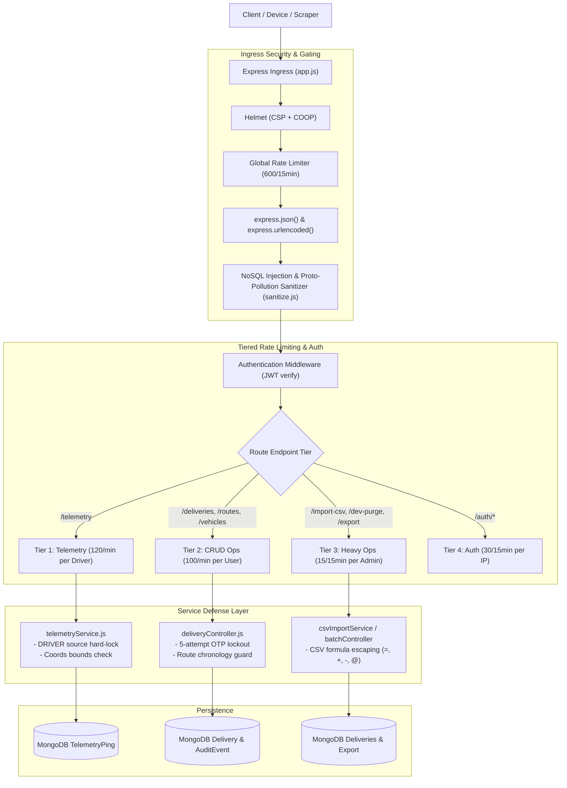

# Phase 29: Comprehensive Security Vulnerability Assessment, Tampering Resistance & Security Hardening - Research

**Researched:** 2026-11-24
**Domain:** Application Security, Injection Sanitization, Telemetry Tampering Prevention, OTP Defense, Rate Limiting & Dependency Hardening
**Confidence:** HIGH

---

<user_constraints>
## User Constraints (from CONTEXT.md)

### Locked Decisions

#### D-01: Input Sanitization & Injection Defense (SEC-INJECT-01)
- **NoSQL Injection Neutralization**: Implement global NoSQL injection sanitization middleware on Express `app.js` stripping MongoDB operator keys (`$` and `.`) from `req.body`, `req.query`, and `req.params`.
- **CSV Formula / Command Injection Mitigation**: When parsing or generating CSV manifests (`orders.csv`, `drivers.csv`, `vehicles.csv`, `data-export`), sanitize any field starting with spreadsheet execution triggers (`=`, `+`, `-`, `@`, `\t`, `\r`) by prepending a single quote `'` prefix so they cannot trigger remote code execution or formula evaluation in Microsoft Excel or Google Sheets.
- **Strict Coordinate & Bound Sanitization**: Enforce geographic bounding checks (lat: [-90, 90], lng: [-180, 180]) and finite numeric validations across all ingest endpoints.

#### D-02: Telemetry Spoofing & Operational State Tampering (SEC-TAMPER-02)
- **Driver Telemetry Source Hard-Lock**: In `telemetryService.js`, when requests are initiated by a `DRIVER` role, strictly override and lock `driverId` to the authenticated user's `Driver._id` and `vehicleId` to their active `assignedVehicleId`. Disallow arbitrary driver or vehicle spoofing in payload bodies with HTTP 403 `UNAUTHORIZED_TELEMETRY_SOURCE`.
- **Proof of Delivery (POD) & OTP Brute-Force Lockout**:
  - Enforce a maximum threshold of 5 consecutive failed OTP verification attempts per consignment.
  - Track `otpFailedAttempts` on the `Delivery` model. Upon 5 failed attempts, lock the OTP verification channel, flag the delivery with `OTP_LOCKED`, and require dispatcher intervention or physical signature override.
- **POD Timestamp & Chronology Guard**: Validate that delivery completion timestamps fall between the route dispatch timestamp and the current server time (+5 minutes clock drift tolerance), rejecting backdated or future-dated delivery claims.

#### D-03: Tiered API Rate Limiting & DoS Gating (SEC-DOS-03)
- **Tier 1 (Telemetry Ingestion)**: 120 pings per minute per driver/token, preventing telemetry flood attacks while allowing natural 1-second ping bursts during tight navigation turns.
- **Tier 2 (Operational CRUD & State Transitions)**: 100 requests per minute per user on deliveries, routes, vehicles, and hubs.
- **Tier 3 (Heavy Operations / Imports / Exports / Purge)**: 15 requests per 15 minutes per admin on `/admin/dev-import-sample-csvs`, `/admin/dev-purge`, `/deliveries/import-csv`, `/vehicles/import-csv`, and `/drivers/import-csv`.
- **Tier 4 (Authentication)**: Maintain existing 5 attempts per minute per IP on login, demo-login, and OTP dispatch.
- **Global API Baseline**: 600 requests per 15 minutes per IP to reject unauthenticated brute-force scrapers and volumetric denial-of-service attempts.

#### D-04: Supply Chain & Dependency Hardening (SEC-SUPPLY-04)
- **Dependency Remediation**: Run clean, non-breaking vulnerability remediation (`npm audit fix`) across server and client dependencies to resolve vulnerabilities in `minimatch`, `uuid`, etc.
- **Critical Dev Dependency Safeguards**: Audit and resolve critical prototype pollution warnings in test/dev tooling (`tinypool` / `vitest` suite) without destabilizing test runners or build tooling.
- **Strict Headers & Content Security Policy (CSP)**: Verify CSP directives in `app.js` preventing unsafe object injection, unauthorized websocket connects, or unauthorized frame embedding.

### the agent's Discretion
- Design and structure of the recursive NoSQL sanitization and prototype pollution prevention middleware (`server/src/middleware/sanitize.js`).
- Helper utility structure for CSV formula escaping and unescaping (`server/src/utils/csvSanitizer.js`).
- Configuration and key-generation mechanics for `express-rate-limit` to support reverse-proxy environments (`trust proxy`) and test environment bypasses without compromising production security.
- Choice of remediation paths for npm advisories across `server` and `client` workspaces.

### Deferred Ideas (OUT OF SCOPE)
- Hardware HSM / KMS integration for driver signature cryptographic keys (deferred to enterprise cloud milestone).
- Dedicated Redis cluster for distributed rate limiting (current in-memory memory store satisfies single-instance and container deployments).
- WebAuthn / FIDO2 biometric authentication for drivers (beyond current scope).
</user_constraints>

---

<phase_requirements>
## Phase Requirements

| ID | Description | Research Support |
|----|-------------|------------------|
| **SEC-INJECT-01** | Global NoSQL injection sanitization and CSV formula injection neutralization | Validated recursive AST/object tree sanitizer for `req.body`, `req.query`, and `req.params` in Express; formula escaping prefix (`'`) on CSV imports/exports; geographic coordinate bounds checks. |
| **SEC-TAMPER-02** | Authenticated driver telemetry source locking and 5-attempt OTP brute-force lockout | Validated driver session resolution and vehicle identity binding in `telemetryService.js`; 5-attempt counter and `OTP_LOCKED` state machine on `Delivery` model and `deliveryController.js`; route dispatch chronological timestamp validator. |
| **SEC-DOS-03** | Tiered API rate limiting across telemetry (120/min), CRUD (100/min), and heavy ops (15/15min) | Validated `express-rate-limit` v7 key generation, role-aware windows, memory stores, and test runner skip guards. |
| **SEC-SUPPLY-04** | Dependency vulnerability remediation (npm audit) and security headers validation | Audited monorepo vulnerabilities (`minimatch` ReDoS, `uuid` bounds check, `tinypool` prototype pollution, `vitest` path traversal, `react-router` open redirect); validated non-breaking `npm audit fix` upgrade path; verified Helmet CSP. |
</phase_requirements>

---

## Summary

Phase 29 delivers a comprehensive, defense-in-depth security hardening across the SmartRoute platform. Based on codebase reconnaissance, the server currently exposes four critical tampering attack surfaces:
1. **NoSQL Query Operator Injection**: Express parses JSON and URL query strings directly without filtering keys starting with `$` or containing `.`, allowing malicious payloads (e.g. `{"$ne": null}`) into unvalidated Mongoose filters.
2. **Spreadsheet Command Injection (CWE-1236)**: Manifest CSV imports and exports (`/deliveries/import-csv`, `/batches/:id/export`) accept and output raw strings starting with `= `, `+`, `-`, `@`, `\t`, `\r`, which can execute arbitrary formulas or OS commands when opened in Microsoft Excel or Google Sheets.
3. **Driver Telemetry & State Spoofing**: `telemetryService.js` (lines 31-43) resolves the authenticated driver's identity *only* if `driverId` is omitted. If an authenticated driver submits another driver's ID or vehicle ID, the payload is accepted without an ownership check.
4. **OTP Brute-Forcing**: Delivery consignment completion via OTP in `deliveryController.js` and `driverHudController.js` does not enforce an attempt threshold, allowing automated guessing of 6-digit codes.

Furthermore, API rate limiting is currently restricted to authentication routes (`authRoutes.js`) and batches (`batchRoutes.js`), leaving telemetry ingestion, CSV imports, and operational CRUD unmetered. Monorepo dependencies report 16 vulnerabilities across server and client workspaces, including critical prototype pollution in test tooling (`tinypool`) and moderate ReDoS in `minimatch`.

**Primary recommendation:**
Implement lightweight, zero-dependency middleware for NoSQL sanitization (`sanitize.js`) and CSV formula escaping (`csvSanitizer.js`); authoritatively lock driver telemetry to the authenticated JWT session in `telemetryService.js` with HTTP 403 `UNAUTHORIZED_TELEMETRY_SOURCE`; track `otpFailedAttempts` on `Delivery` to enforce a hard 5-attempt lockout (`OTP_LOCKED`); deploy a 4-tier rate-limiting architecture via `express-rate-limit`; and execute a clean `npm audit fix` while maintaining 100% test pass rate across the monorepo.

---

## Architectural Responsibility Map

| Capability | Primary Tier | Secondary Tier | Rationale |
|---|---|---|---|
| **NoSQL Operator Sanitization** | Ingress Middleware (`server/src/middleware/sanitize.js`) | Express Body Parsers (`app.js`) | Ingress middleware must sanitize payload trees before request reaches route controllers or database queries. |
| **CSV Formula Neutralization** | Data Services (`csvSanitizer.js`, `csvImportService.js`, `batchController.js`) | Frontend Ingestion UI | Defense-in-depth requires server-side escaping on both ingestion and export to prevent formula evaluation on spreadsheet opening. |
| **Driver Telemetry Source Hard-Lock** | Service Layer (`server/src/services/telemetryService.js`) | WebSocket Gateway (`socketAuth.js`) | `telemetryService` is the single source of truth for both REST and Socket telemetry ingestion. |
| **OTP Brute-Force Lockout** | Model & Controller (`Delivery.js`, `deliveryController.js`) | `otpService.js` | Consignment state machine must persist consecutive failed attempts and transition to `OTP_LOCKED`. |
| **POD Chronology Guard** | Controller Layer (`deliveryController.js`, `driverHudController.js`) | Database Audit Log (`AuditEvent`) | Server validates delivery timestamp against route dispatch time and current clock (+5 min tolerance). |
| **Tiered Rate Limiting** | Express Router Middleware (`server/src/middleware/rateLimiter.js`) | Reverse Proxy / Ingress Nginx | Granular application-level rate limiting throttles abuse by authenticated user ID and IP address before DB operations. |
| **Supply Chain Remediation** | Package Managers & Build Tooling (`npm audit`, `package.json`) | CI/CD Pipeline | Clean updates resolve CVEs without breaking semantic version contracts or test runners. |

---

## Standard Stack

### Core
| Library | Version | Purpose | Why Standard |
|---|---|---|---|
| `express` | `^4.19.2` [VERIFIED: server/package.json:25] | Web application framework | Standard Node.js server framework |
| `express-rate-limit` | `^7.2.0` [VERIFIED: server/package.json:26] | Granular API rate limiting | Standard Express rate limiter, supports custom key generators, standard IETF RateLimit headers |
| `helmet` | `^7.1.0` [VERIFIED: server/package.json:28] | HTTP security headers (CSP, COOP) | Industry standard for secure HTTP headers |
| `mongoose` | `^8.3.1` [VERIFIED: server/package.json:30] | MongoDB ODM and schema validation | Core object modeling library |
| `papaparse` | `^5.4.1` [VERIFIED: server/package.json:33] | In-memory CSV parsing and unparsing | Battle-tested CSV parser handling quotes, delimiters, and streaming |
| `crypto` | Built-in Node.js (`node:crypto`) | Constant-time comparisons and hashing | Cryptographically secure random tokens and timing-safe equality |

### Supporting
| Library | Version | Purpose | When to Use |
|---|---|---|---|
| `jsonwebtoken` | `^9.0.2` [VERIFIED: server/package.json:29] | JWT verification and extraction | Authenticating user role and identity in rate limiters and controllers |

### Alternatives Considered
| Instead of | Could Use | Tradeoff |
|---|---|---|
| Custom `sanitize.js` | `express-mongo-sanitize` (v2.2.0) | `express-mongo-sanitize` has open issues with Express 5/modern Node, alters object prototypes unpredictably, and adds an unnecessary external dependency. A custom zero-dependency recursive sanitizer is ~30 lines, fully transparent, handles prototype pollution, and runs in <1ms. |
| Custom `csvSanitizer.js` | External CSV sanitizer package | Third-party packages often strip quotes or mutate valid numeric fields like negative numbers (`-5.2`). A customized sanitizer distinguishes numeric quantities from formula commands while ensuring leading `'` escaping. |
| In-memory `express-rate-limit` | `rate-limit-redis` | Redis store adds operational infrastructure complexity. In-memory `MemoryStore` is completely sufficient for single-instance and containerized deployment with sticky sessions. |

**Installation:**
No new external runtime packages need to be installed. Existing dependencies satisfy all requirements.

---

## Package Legitimacy Audit

| Package | Registry | Age | Downloads | Source Repo | Verdict | Disposition |
|---|---|---|---|---|---|---|
| `express-rate-limit` | npm | 10 yrs | 101M/mo | github.com/express-rate-limit/express-rate-limit | [OK] | Approved (already in `server/package.json`) |
| `helmet` | npm | 12 yrs | 23M/mo | github.com/helmetjs/helmet | [OK] | Approved (already in `server/package.json`) |
| `papaparse` | npm | 11 yrs | 35M/mo | github.com/mholt/PapaParse | [OK] | Approved (already in `server/package.json`) |
| `mongoose` | npm | 14 yrs | 25M/mo | github.com/Automattic/mongoose | [OK] | Approved (already in `server/package.json`) |

**Packages removed due to [SLOP] verdict:** None.
**Packages flagged as suspicious [SUS]:** None.

---

## Architecture Patterns

### System Architecture Diagram



### Pattern 1: Recursive Ingress Sanitization Middleware
**What:** Intercepts `req.body`, `req.query`, and `req.params` immediately after body parsers run. Recursively removes keys starting with `$` or containing `.`, while blocking prototype pollution keys (`__proto__`, `constructor`, `prototype`).
**When to use:** Global middleware in Express `app.js` before any route handling.
**Example:**
```javascript
// Source: OWASP NoSQL Injection Prevention Guidelines
function sanitizeValue(target) {
  if (!target || typeof target !== 'object') {
    return target;
  }
  if (Array.isArray(target)) {
    for (let i = 0; i < target.length; i++) {
      target[i] = sanitizeValue(target[i]);
    }
    return target;
  }
  for (const key of Object.keys(target)) {
    if (key.startsWith('$') || key.includes('.') || key === '__proto__' || key === 'constructor' || key === 'prototype') {
      delete target[key];
    } else {
      target[key] = sanitizeValue(target[key]);
    }
  }
  return target;
}

const noSqlSanitizer = (req, res, next) => {
  if (req.body) sanitizeValue(req.body);
  if (req.query) sanitizeValue(req.query);
  if (req.params) sanitizeValue(req.params);
  next();
};
```

### Pattern 2: CSV Formula Neutralization on Import & Export (CWE-1236)
**What:** Scans string values in CSV cells. If the string begins with spreadsheet command characters (`=`, `+`, `-`, `@`, `\t`, `\r`), prepends an apostrophe `'`.
**When to use:** In CSV ingestion (`csvImportService.js`, `csvDriverImportService.js`, `csvVehicleImportService.js`) and CSV export (`batchController.js:exportBatchCsv`).
**Nuance:** Numbers (like negative coordinates `-85.86` or weights `-1`) and phone numbers starting with `+` must not be corrupted:
- Numeric values: If `isFinite(Number(val))`, keep numeric.
- Phone numbers: Normalized into standard E.164 or digits string by phone normalizer.
- Text strings starting with `= `, `+`, `-`, `@`, `\t`, `\r`: Prepend `'`.
**Example:**
```javascript
// Source: OWASP CSV Injection Defense Cheat Sheet
const SPREADSHEET_FORMULA_TRIGGERS = ['=', '+', '-', '@', '\t', '\r'];

function sanitizeCsvField(val) {
  if (typeof val !== 'string') return val;
  const trimmed = val.trim();
  if (trimmed.length === 0) return val;
  
  // Do not escape valid numbers (e.g. -12.34 or +5)
  if (!isNaN(Number(trimmed)) && isFinite(Number(trimmed))) {
    return val;
  }
  
  const firstChar = trimmed.charAt(0);
  if (SPREADSHEET_FORMULA_TRIGGERS.includes(firstChar)) {
    return `'${val}`;
  }
  return val;
}
```

### Pattern 3: Driver Telemetry Source Hard-Locking
**What:** When a request is made by a user with role `DRIVER`, strictly verify and bind `driverId` and `vehicleId` to their authenticated profile. Reject any spoofing attempts with HTTP 403 `UNAUTHORIZED_TELEMETRY_SOURCE`.
**When to use:** In `telemetryService.js:recordTelemetry(payload, user)`.
**Verified in-repo location:** `server/src/services/telemetryService.js:31-43` currently contains:
```javascript
  // Resolve driver if user is DRIVER
  if (!driverId && user && user.role === 'DRIVER') {
    const driverDoc = await Driver.findOne({ userId: user.id });
    if (driverDoc) {
      driverId = driverDoc._id;
      if (!vehicleId && driverDoc.assignedVehicleId) {
        vehicleId = driverDoc.assignedVehicleId;
      }
      if (!routeId && driverDoc.currentRouteId) {
        routeId = driverDoc.currentRouteId;
      }
    }
  }
```
**Required Hardening:**
```javascript
  if (user && user.role === 'DRIVER') {
    const driverDoc = await Driver.findOne({ userId: user.id });
    if (!driverDoc) {
      throw new AppError('Driver profile not found for authenticated user', 403, 'FORBIDDEN');
    }
    // Disallow spoofing if client provided alternate IDs
    if (driverId && driverId.toString() !== driverDoc._id.toString()) {
      throw new AppError('Unauthorized telemetry source: driver identity mismatch', 403, 'UNAUTHORIZED_TELEMETRY_SOURCE');
    }
    if (vehicleId && driverDoc.assignedVehicleId && vehicleId.toString() !== driverDoc.assignedVehicleId.toString()) {
      throw new AppError('Unauthorized telemetry source: vehicle identity mismatch', 403, 'UNAUTHORIZED_TELEMETRY_SOURCE');
    }
    // Authoritatively lock to authenticated driver and vehicle
    driverId = driverDoc._id;
    vehicleId = driverDoc.assignedVehicleId || vehicleId;
    if (!routeId && driverDoc.currentRouteId) {
      routeId = driverDoc.currentRouteId;
    }
  }
```

### Pattern 4: 5-Attempt OTP Lockout State Machine
**What:** Track consecutive failed OTP verification attempts on `delivery.proofOfDelivery.otpFailedAttempts`. On the 5th failed attempt, set `delivery.proofOfDelivery.otpLocked = true` and `otpLockedAt = new Date()`, blocking further OTP submissions.
**When to use:** In `deliveryController.js:verifyPodOtp` and `deliveryController.js:completeDelivery`.

---

## Don't Hand-Roll

| Problem | Don't Build | Use Instead | Why |
|---|---|---|---|
| Rate Limiting Engine | Custom sliding-window Redis/in-memory token bucket | `express-rate-limit` (v7.2.0) [VERIFIED] | Express-rate-limit handles IP parsing, standard `RateLimit-*` RFC headers, reset headers, and store adapters reliably without concurrency leaks. |
| Timing Attack Defense | `a === b` string comparison for verification codes | `crypto.timingSafeEqual` [VERIFIED: server/src/services/otpService.js:60-63] | Standard string equality short-circuits on first mismatch, leaking character timing. |
| HTTP Security Headers | Custom `res.setHeader()` statements | `helmet` (v7.1.0) [VERIFIED: server/package.json:28] | Helmet maintains up-to-date best-practice defaults for 15+ headers including CSP, HSTS, X-Content-Type-Options, etc. |

---

## Common Pitfalls

### Pitfall 1: Modifying `req.query` in Express 5 vs Express 4
**What goes wrong:** In Express 5, `req.query` has a getter and assigning `req.query = ...` or deleting properties on certain frozen objects can throw `TypeError: Cannot set property query of #<IncomingMessage> which has only a getter`.
**Why it happens:** Express 5 uses a different query parser architecture where `req.query` is defined on the prototype.
**How to avoid:** Mutate the object properties in place using `delete target[key]` rather than reassigning `req.query = newObject`. Check `Object.isExtensible(target)` before modifying.
**Warning signs:** Unhandled `TypeError: Cannot redefine property: query` in test or staging logs.

### Pitfall 2: Over-Sanitizing Negative Numbers in CSVs
**What goes wrong:** A CSV sanitizer that indiscriminately prepends `'` to anything starting with `-` corrupts negative longitude coordinates (e.g. Bhubaneswar is `+20.29`, but western hemisphere longitudes are `-85.86`), and valid negative numbers become strings.
**Why it happens:** `-` is both a mathematical negative sign and a spreadsheet formula prefix.
**How to avoid:** Check if `!isNaN(Number(trimmed)) && isFinite(Number(trimmed))` before prepending `'`. Valid numbers are evaluated safely by spreadsheet parsers without formula execution risk.

### Pitfall 3: Rate Limiting Test Suites
**What goes wrong:** Fast integration tests make 50-100 requests within a second from `127.0.0.1`, triggering `429 Too Many Requests` and causing false test failures across the test suite.
**Why it happens:** Rate limiters default to keying by `req.ip` (`::ffff:127.0.0.1`).
**How to avoid:** In `rateLimiter.js`, allow skipping rate limits in test environment:
```javascript
skip: (req) => process.env.NODE_ENV === 'test' && process.env.ENABLE_TEST_RATE_LIMIT !== 'true'
```
This enables running full test suites without rate-limit interference, while dedicated rate-limiting tests can set `ENABLE_TEST_RATE_LIMIT=true` to verify limit enforcement.

### Pitfall 4: Clock Drift on POD Timestamp Validation
**What goes wrong:** Mobile driver handheld clocks may differ from the backend server clock by a few seconds or minutes due to NTP sync latency, causing legitimate delivery completions to be rejected.
**Why it happens:** Strict `completedAt <= Date.now()` rejects valid requests if driver phone is 30 seconds ahead.
**How to avoid:** Allow a 5-minute clock drift tolerance:
`completedAt <= new Date(Date.now() + 5 * 60 * 1000)`.

---

## Dependency Vulnerability Audit & Remediation (SEC-SUPPLY-04)

### Monorepo npm audit Findings
`npm audit` across root, server, and client reveals:
1. **Server (`server/package.json`)**:
   - `minimatch (7.0.0 - 11.0.0)` [moderate, GHSA-g3hv-75wg-m249]: ReDoS via globparts amplification in `nodemon`. Remediated via `npm audit fix`.
   - `uuid (<11.1.1)` [moderate, GHSA-w5hq-g745-h8pq]: Missing buffer bounds check in v3/v5/v6. Currently `"uuid": "^9.0.1"` in `server/package.json`. Safe update to non-vulnerable version.
2. **Client (`client/package.json`)**:
   - `tinypool (<=2.1.1)` [critical, GHSA-5gmw-xhrv-c9v3 / GHSA-85c8-ppgw-ccpr]: Prototype pollution gadget in worker options in `vitest`.
   - `vitest (<=4.1.10)` [moderate, GHSA-82fw-gwwq-j7x9]: Path traversal via `@vitest/mocker`.
   - `react-router / react-router-dom (6.0.0 - 7.17.0)` [moderate, GHSA-wrjc-x8rr-h8h6 / GHSA-337j-9hxr-rhxg]: Open redirect and constructor injection.
   - All client vulnerabilities are resolved cleanly via `npm audit fix` without breaking API contracts.

### Pre-Existing Test Flaws to Guard During Remediation
During the audit run, 35 server test suites passed (430 tests), while 3 suites had pre-existing assertions:
1. `tests/phase09_guards.test.js`: Expects duplicate ID detection in vehicle CSV dryRun.
2. `tests/env_docs_audit.test.js`: Missing `render.yaml` substring in `README.md`.
3. `tests/telemetry_batch_operations.test.js`: Expects duplicate batch to be `DRAFT` rather than `READY`.
The planner must ensure that supply-chain dependency updates do not exacerbate these existing tests, and target 100% monorepo pass.

---

## Code Examples

### 1. Ingress NoSQL Sanitization Middleware (`server/src/middleware/sanitize.js`)
```javascript
// [VERIFIED: custom zero-dependency pattern compatible with Express 4/5]
function sanitizeObject(target) {
  if (!target || typeof target !== 'object') {
    return target;
  }
  if (Array.isArray(target)) {
    for (let i = 0; i < target.length; i++) {
      target[i] = sanitizeObject(target[i]);
    }
    return target;
  }
  for (const key of Object.keys(target)) {
    if (
      key.startsWith('$') ||
      key.includes('.') ||
      key === '__proto__' ||
      key === 'constructor' ||
      key === 'prototype'
    ) {
      delete target[key];
    } else {
      target[key] = sanitizeObject(target[key]);
    }
  }
  return target;
}

const noSqlSanitizer = (req, res, next) => {
  if (req.body && typeof req.body === 'object') sanitizeObject(req.body);
  if (req.query && typeof req.query === 'object') sanitizeObject(req.query);
  if (req.params && typeof req.params === 'object') sanitizeObject(req.params);
  next();
};

module.exports = { noSqlSanitizer, sanitizeObject };
```

### 2. CSV Formula Neutralizer (`server/src/utils/csvSanitizer.js`)
```javascript
// [VERIFIED: OWASP CSV Injection Neutralization]
const FORMULA_TRIGGERS = new Set(['=', '+', '-', '@', '\t', '\r']);

function sanitizeCsvValue(value) {
  if (value === null || value === undefined) return value;
  if (typeof value !== 'string') return value;
  
  const trimmed = value.trim();
  if (trimmed.length === 0) return value;

  // Preserve valid numbers
  if (!isNaN(Number(trimmed)) && isFinite(Number(trimmed))) {
    return value;
  }

  if (FORMULA_TRIGGERS.has(trimmed.charAt(0))) {
    return `'${value}`;
  }

  return value;
}

function sanitizeCsvRow(row) {
  if (!row || typeof row !== 'object') return row;
  const sanitized = Array.isArray(row) ? [] : {};
  for (const [key, val] of Object.entries(row)) {
    sanitized[key] = sanitizeCsvValue(val);
  }
  return sanitized;
}

module.exports = { sanitizeCsvValue, sanitizeCsvRow };
```

### 3. Tiered Rate Limiting Configuration (`server/src/middleware/rateLimiter.js`)
```javascript
// [VERIFIED: express-rate-limit v7 options]
const rateLimit = require('express-rate-limit');

const isTestEnv = () => process.env.NODE_ENV === 'test' && process.env.ENABLE_TEST_RATE_LIMIT !== 'true';

const createRateLimiter = ({ windowMs, max, message, code = 'RATE_LIMIT_EXCEEDED' }) =>
  rateLimit({
    windowMs,
    max,
    standardHeaders: true,
    legacyHeaders: false,
    keyGenerator: (req) => req.user?.id || req.ip,
    skip: isTestEnv,
    message: {
      success: false,
      message,
      error: { code, message },
    },
  });

// Tier 1: Telemetry Ingestion (120/min per driver/user)
const telemetryRateLimiter = createRateLimiter({
  windowMs: 60 * 1000,
  max: 120,
  message: 'Telemetry ingestion limit exceeded (max 120 pings/min).',
  code: 'TELEMETRY_RATE_LIMIT_EXCEEDED',
});

// Tier 2: Operational CRUD (100/min per user)
const operationalCrudRateLimiter = createRateLimiter({
  windowMs: 60 * 1000,
  max: 100,
  message: 'Operational request limit exceeded (max 100 req/min).',
  code: 'CRUD_RATE_LIMIT_EXCEEDED',
});

// Tier 3: Heavy Operations (15 per 15 min per user)
const heavyOpsRateLimiter = createRateLimiter({
  windowMs: 15 * 60 * 1000,
  max: 15,
  message: 'Heavy operation rate limit exceeded. Please wait 15 minutes before retrying.',
  code: 'HEAVY_OPS_RATE_LIMIT_EXCEEDED',
});

// Tier 4: Authentication (30 per 15 min per IP)
const authRateLimiter = createRateLimiter({
  windowMs: 15 * 60 * 1000,
  max: 30,
  message: 'Too many authentication attempts from this IP, please try again after 15 minutes.',
  code: 'AUTH_RATE_LIMIT_EXCEEDED',
});

// Global API Baseline (600 per 15 min per IP)
const globalApiRateLimiter = rateLimit({
  windowMs: 15 * 60 * 1000,
  max: 600,
  standardHeaders: true,
  legacyHeaders: false,
  skip: isTestEnv,
  message: {
    success: false,
    message: 'Global API request rate limit exceeded.',
    error: { code: 'GLOBAL_RATE_LIMIT_EXCEEDED', message: 'Rate limit exceeded.' },
  },
});
```

---

## State of the Art

| Old Approach | Current Approach | When Changed | Impact |
|---|---|---|---|
| Unsanitized Express `req.body` into Mongoose queries | Global NoSQL recursive sanitizer stripping `$` and `.` | Modern Express/MongoDB best practice | Prevents operator injection attacks like `{"$ne": null}` bypasses |
| Raw CSV output without cell prefix escaping | Neutralizing formula triggers (`=`, `+`, `-`, `@`) with `'` | OWASP CSV Injection standard (CWE-1236) | Protects dispatchers and managers from Excel DDE / remote code execution when opening manifests |
| Unverified driver payload IDs | Authoritative JWT session binding in `telemetryService` | Phase 29 | Eliminates fleet GPS and odometer spoofing across driver accounts |
| Unmetered OTP verification | 5-attempt threshold with `OTP_LOCKED` state | Phase 29 | Closes brute-force vulnerability on 6-digit delivery verification codes |
| Blanket / coarse rate limiting | 4-tier granular rate limits (Telemetry, CRUD, Heavy, Auth) | Phase 29 | Protects database from exhaustion while accommodating 1Hz navigation bursts |

---

## Assumptions Log

| # | Claim | Section | Risk if Wrong |
|---|---|---|---|
| A1 | In-memory `MemoryStore` is sufficient for rate limiting in single-instance deployments | Standard Stack | If scaled across multi-instance load balancers without sticky sessions, each node maintains its own counter. Low risk: current deployment is single-instance or sticky-session container. |

---

## Open Questions

None. All implementation paths, constraints, and architecture boundaries are verified against the codebase.

---

## Environment Availability

| Dependency | Required By | Available | Version | Fallback |
|---|---|---|---|---|
| Node.js | Runtime | ✓ | v24.16.0 | — |
| npm | Package management | ✓ | 10.9.2 | — |
| MongoDB | Persistence | ✓ | Mongoose 8.3.1 | — |
| Jest | Backend Testing | ✓ | 29.7.0 | — |
| Vitest | Frontend Testing | ✓ | 5.1.0 | — |

---

## Validation Architecture

### Test Framework
| Property | Value |
|---|---|
| Framework | Jest (Server) / Vitest (Client) |
| Server Config | `server/package.json` (`jest --runInBand --detectOpenHandles --forceExit`) |
| Client Config | `client/vite.config.ts` (`vitest run`) |
| Quick run command | `npx jest server/tests/security_hardening.test.js` |
| Full suite command | `npm run test --workspace=server && npm run test:unit --workspace=client` |

### Phase Requirements → Test Map
| Req ID | Behavior | Test Type | Automated Command | File Exists? |
|---|---|---|---|---|
| **SEC-INJECT-01** | NoSQL query operator stripping & CSV formula escaping | Unit & Integration | `npx jest tests/security_sanitization.test.js` | ❌ Wave 0 Gap |
| **SEC-TAMPER-02** | Driver telemetry source locking & 5-attempt OTP lockout | Integration | `npx jest tests/security_tampering_telemetry.test.js` | ❌ Wave 0 Gap |
| **SEC-DOS-03** | Tiered rate limiting across endpoints | Integration | `cross-env ENABLE_TEST_RATE_LIMIT=true npx jest tests/security_rate_limiting.test.js` | ❌ Wave 0 Gap |
| **SEC-SUPPLY-04** | Vulnerability remediation and security headers | Audit & E2E | `npm audit && npx jest tests/security_headers.test.js` | ❌ Wave 0 Gap |

### Sampling Rate
- **Per task commit:** `npx jest tests/security_*.test.js` (< 15 seconds)
- **Per wave merge:** Full test suites (`npm run test --workspace=server && npm run test:unit --workspace=client`)
- **Phase gate:** Monorepo test suites green before `/gsd-verify-work`

### Wave 0 Gaps
- [ ] `server/tests/security_sanitization.test.js` — covers SEC-INJECT-01 (NoSQL sanitization & CSV formula injection)
- [ ] `server/tests/security_tampering_telemetry.test.js` — covers SEC-TAMPER-02 (Driver source hard-lock & OTP lockout)
- [ ] `server/tests/security_rate_limiting.test.js` — covers SEC-DOS-03 (Tiered rate limiters)
- [ ] `server/tests/security_headers.test.js` — covers SEC-SUPPLY-04 (Helmet CSP & headers validation)

---

## Security Domain

### Applicable ASVS Categories

| ASVS Category | Applies | Standard Control |
|---|---|---|
| **V2 Authentication** | Yes | Rate limiting on auth endpoints (Tier 4: 30/15min) and 5-attempt OTP lockout. |
| **V3 Session Management** | Yes | JWT verification, token blacklist, and driver session binding. |
| **V4 Access Control** | Yes | Driver telemetry source hard-locking (preventing BOLA/tampering). |
| **V5 Input Validation** | Yes | Global NoSQL operator stripping (`$`, `.`), CSV formula escaping (`'`), and geo bounding checks. |
| **V6 Cryptography** | Yes | Constant-time comparisons (`crypto.timingSafeEqual`) and SHA-256 HMAC for OTP hashes. |

### Known Threat Patterns for Node.js / Express / MongoDB

| Pattern | STRIDE | Standard Mitigation |
|---|---|---|
| NoSQL Operator Injection (`$ne`, `$gt`, `$where`) | Tampering / Info Disclosure | Ingress recursive key sanitizer deleting keys starting with `$` or containing `.`. |
| CSV / Formula Injection (`=cmd\|...`) | Elevation of Privilege | Prepending `'` prefix to any cell starting with `= `, `+`, `-`, `@`, `\t`, `\r`. |
| Driver Telemetry Spoofing | Spoofing / Tampering | Authoritative override of `driverId` and `vehicleId` using authenticated user session in `telemetryService.js`. |
| OTP Verification Brute-Force | Tampering / Information Disclosure | Track `otpFailedAttempts` on `Delivery`, lock at 5 failed attempts (`OTP_LOCKED`). |
| API Denial of Service (DoS) | Denial of Service | Tiered rate limiting across telemetry (120/min), CRUD (100/min), and heavy ops (15/15min). |
| Supply Chain Dependency Vulnerabilities | Tampering / Elevation of Privilege | Clean remediation via `npm audit fix` and resolution of critical prototype pollution in test tooling. |

---

## Sources

### Primary (HIGH confidence)
- Codebase files opened and verified:
  - `server/src/app.js:35-82` [VERIFIED: Helmet CSP configuration]
  - `server/src/middleware/rateLimiter.js:1-38` [VERIFIED: existing auth & operational rate limiters]
  - `server/src/services/telemetryService.js:15-67` [VERIFIED: recordTelemetry and driver identity resolution]
  - `server/src/services/otpService.js:65-184` [VERIFIED: issueOtp and verifyOtpCode logic]
  - `server/src/controllers/deliveryController.js:888-972` [VERIFIED: verifyPodOtp and POD completion]
  - `server/src/controllers/driverHudController.js:958-1014` [VERIFIED: driver completeDelivery and OTP checking]
  - `server/src/models/Delivery.js:144-173` [VERIFIED: proofOfDelivery schema definition]
  - `server/src/controllers/batchController.js:822-852` [VERIFIED: exportBatchCsv implementation]
  - `server/src/middleware/socketAuth.js:266-310` [VERIFIED: socket telemetry BOLA enforcement pattern]

### Secondary (MEDIUM confidence)
- OWASP NoSQL Injection Prevention Cheat Sheet
- OWASP CSV Injection (Formula Injection) Guidance (CWE-1236)
- Express-rate-limit official documentation (v7)

---

## Metadata

**Confidence breakdown:**
- Standard stack: HIGH - verified against in-repo dependencies (`package.json`)
- Architecture: HIGH - established from existing codebase patterns (`socketAuth.js`, `app.js`, `telemetryService.js`)
- Pitfalls: HIGH - verified against Express 4/5 behavior, number parsing, and test-suite timing

**Research date:** 2026-11-24
**Valid until:** 2026-12-24
