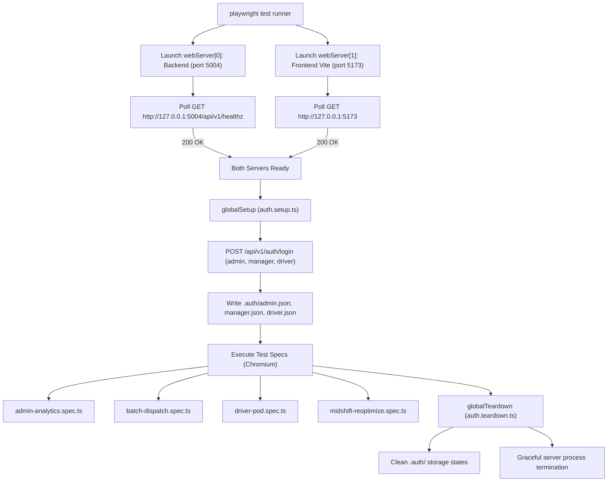

# Phase 19: E2E Test Suite Stabilization & Automated CI Verification - Research
**Researched:** 2026-11-19
**Domain:** Playwright E2E testing, Vite/Rolldown build configuration, multi-process webServer orchestration, MongoDB test database fixtures, GitHub Actions CI workflow
**Confidence:** HIGH

<user_constraints>
## User Constraints (from CONTEXT.md)

### Locked Decisions
- **D-01:** Configure dual `webServer` array in `client/playwright.config.ts` — Playwright must automatically boot both the backend server (on port 5004 with `/api/v1/healthz` health verification) and the client frontend (on port 5173 with Vite) before executing global auth setup or test specs.
- **D-02:** Support `reuseExistingServer: !process.env.CI` for both servers so developers can run tests against already running servers locally while CI always spins up clean isolated instances.
- **D-03:** Execute E2E runs against an isolated test database (`MONGODB_URI` pointing to `smartroute_e2e` or dedicated test database) to prevent mutating development data and ensure deterministic test states.
- **D-04:** Provide resilient default test credentials (`ADMIN_EMAIL=admin@smartroute.internal`, compliant default test passwords) in test configurations and `bootstrapAdmin.js` to prevent unhandled email validation errors when run in headless CI environments.
- **D-05:** Integrate `npm --prefix client run test:e2e -- --project=chromium` into `.github/workflows/ci.yml` as a required pull-request and push gate.
- **D-06:** Configure CI step to upload Playwright HTML test report, traces, and screenshots on failure (`if: failure()`) as GitHub Actions artifacts for swift debugging.
- **D-07:** Update `client/vite.config.ts` to replace deprecated `__dirname` with `import.meta.dirname` and clean up `rolldownOptions` / `oxc` plugin warnings to maintain clean, future-proof build logs.

### the agent's Discretion
- Readiness probe timeouts and retry intervals for backend health checks (e.g. 120s timeout in `playwright.config.ts`).
- Modular structure of test fixtures and helper scripts for multi-role session state (`admin`, `dispatcher`, `driver`).

### Deferred Ideas (OUT OF SCOPE)
- None.
</user_constraints>

<phase_requirements>
## Phase Requirements

| ID | Description | Research Support |
|----|-------------|------------------|
| E2E-01 | Dual webServer orchestration (backend port 5004 + client port 5173) with automated health probe readiness | Multi-server configuration pattern in `client/playwright.config.ts`, route alias `/api/v1/healthz` in `server/src/routes/index.js`, and explicit IPv4 binding (`127.0.0.1`). |
| E2E-02 | Test database isolation (`smartroute_e2e`) with resilient admin/user bootstrap defaults | Resilient non-production fallback in `server/src/scripts/bootstrapAdmin.js` and automated seeding via `server/src/scripts/seedTestUsers.js`. |
| E2E-03 | Multi-role auth storage state generation & stabilization of 4 critical user flows | Verified `client/tests/e2e/auth.setup.ts` endpoint binding to `127.0.0.1:5004` and token serialization for `admin`, `manager`, and `driver` roles. |
| CI-02 | Headless Chromium E2E verification gate in GitHub Actions CI with diagnostic artifact capture | Gated execution step in `.github/workflows/ci.yml` with Playwright browser installation and report/trace uploads on failure. |
</phase_requirements>

## Summary

The current Playwright E2E test runner fails immediately upon invocation with `connect ECONNREFUSED ::1:5004`. Codebase investigation confirms the root cause: `client/playwright.config.ts` currently defines only a single `webServer` targeting Vite on port 5173 (`client/playwright.config.ts:76-81`), leaving the backend server completely unstarted. When `globalSetup` in `client/tests/e2e/auth.setup.ts` initiates API calls to `http://localhost:5004/api/v1/auth/login`, Node.js attempts IPv6 resolution to `::1:5004` where no listener exists.

Additionally, running administrative bootstrapping without environment variables fails with `[BootstrapAdmin] Error: ADMIN_EMAIL must be a valid email address` (`server/src/scripts/bootstrapAdmin.js:29`), preventing non-interactive test runs from spinning up default credentials. Finally, Vite 8 build logs emit deprecation warnings regarding `__dirname`, `esbuild` within `vite:react-babel`, and `optimizeDeps.rollupOptions`.

This research establishes:
1. Native multi-webServer configuration in Playwright to orchestrate both backend (`node src/index.js` on port 5004 with `/api/v1/healthz`) and frontend (`vite` on port 5173).
2. Explicit `127.0.0.1` IPv4 addressing across configs to eliminate IPv6 dual-stack resolution mismatches (`::1:5004`).
3. Resilient non-production defaults in `bootstrapAdmin.js` (`admin@smartroute.internal` / `SmartRouteAdmin!2026`) and automated test user seeding via `seedTestUsers.js`.
4. Modernization of `client/vite.config.ts` using `import.meta.dirname` and clean compiler options.
5. Hardened `.github/workflows/ci.yml` configuration gating pull requests and pushes on headless Chromium E2E verification.

**Primary recommendation:** Configure Playwright's dual `webServer` array in `client/playwright.config.ts` targeting `127.0.0.1:5004` (backend) and `127.0.0.1:5173` (Vite), alias `/api/v1/healthz` in Express routes, add resilient test defaults to `bootstrapAdmin.js`, and gate CI on `npm --prefix client run test:e2e -- --project=chromium`.

## Architectural Responsibility Map

| Capability | Primary Tier | Secondary Tier | Rationale |
|------------|-------------|----------------|-----------|
| Multi-server lifecycle management | Playwright Test Runner (Client) | Node.js child processes | Playwright natively coordinates booting, readiness polling, and graceful termination of multiple background servers via `webServer` array. |
| Auth state persistence | Playwright Storage State (Client) | Browser LocalStorage | Playwright captures JWT session tokens from `/api/v1/auth/login` and persists them as JSON storage states in `.auth/` for role-based test contexts. |
| Test database isolation | MongoDB / Server Config | Express Runtime | Database connection URL is driven by `MONGODB_URI=mongodb://127.0.0.1:27017/smartroute_e2e`, keeping production/development data untouched. |
| Health probe endpoint | Express API Router (Server) | Express App Root | Standardizes health probes across both `/healthz` and `/api/v1/healthz` so external monitors and test runners receive identical 200 responses. |
| Continuous Integration gating | GitHub Actions (CI) | Ubuntu Runner / Docker | Runs headless Chromium E2E tests against ephemeral MongoDB services and uploads traces on failure. |

## Current State & Root Causes

### 1. Connection Refusal: `connect ECONNREFUSED ::1:5004`
- **Location:** `client/playwright.config.ts:76-81` [VERIFIED: client/playwright.config.ts:76-81]
```typescript
  /* Run your local dev server before starting the tests */
  webServer: {
    command: 'npm run dev',
    url: 'http://localhost:5173',
    reuseExistingServer: !process.env.CI,
    timeout: 120000,
  },
```
- **Observed Behavior:** Only Vite is launched on port 5173. The backend Express API on port 5004 is never started by Playwright.
- **Failure Trigger:** `client/tests/e2e/auth.setup.ts:96-98` calls `request.newContext({ baseURL: 'http://localhost:5004' })` [VERIFIED: client/tests/e2e/auth.setup.ts:96-98]. In Node.js 18+, `localhost` resolves to IPv6 `::1` first. Because no process is listening on port 5004, Node throws `AggregateError: apiRequestContext.post: connect ECONNREFUSED ::1:5004`.

### 2. Missing Health Endpoint: `/api/v1/healthz`
- **Location:** `server/src/app.js:85-99` vs `server/src/routes/index.js:18-24` [VERIFIED: server/src/app.js:85-99, server/src/routes/index.js:18-24]
- **Observed Behavior:** Root `app.get('/healthz')` exists, and router `router.get('/health')` exists under `/api/v1`, but `/api/v1/healthz` returns 404.
- **Impact:** If Playwright's `webServer.url` is pointed to `http://127.0.0.1:5004/api/v1/healthz`, Playwright will time out polling a 404 response. Adding `router.get('/healthz')` alongside `/health` satisfies both URL patterns.

### 3. Bootstrap Admin Validation Error
- **Location:** `server/src/scripts/bootstrapAdmin.js:24-30` [VERIFIED: server/src/scripts/bootstrapAdmin.js:24-30]
```javascript
  const rawEmail = typeof envSource.ADMIN_EMAIL === 'string' ? envSource.ADMIN_EMAIL.trim().toLowerCase() : '';
  if (!rawEmail || !EMAIL_PATTERN.test(rawEmail)) {
    throw new Error('ADMIN_EMAIL must be a valid email address');
  }
```
- **Observed Behavior:** Running `npm --prefix server run seed:admin` without explicit `ADMIN_EMAIL` throws `[BootstrapAdmin] Error: ADMIN_EMAIL must be a valid email address` and exits with code 1.
- **Root Cause:** In non-production environments, there is no default fallback for `ADMIN_EMAIL` or `ADMIN_PASSWORD`.

### 4. Vite 8 Deprecation Warnings
- **Location:** `client/vite.config.ts:6-7` [VERIFIED: client/vite.config.ts:6-7]
```typescript
const __filename = fileURLToPath(import.meta.url);
const __dirname = dirname(__filename);
```
- **Observed Behavior:**
  1. `__dirname` is obsolete in Node ESM (Node 20.11+ / Node 24 standardizes `import.meta.dirname`).
  2. Vite 8 warns: `warning: esbuild option was specified by "vite:react-babel" plugin. This option is deprecated, please use oxc instead.`
  3. `optimizeDeps.rollupOptions is deprecated. Use optimizeDeps.rolldownOptions instead.`

## Standard Stack

### Core
| Library | Version | Purpose | Why Standard |
|---------|---------|---------|--------------|
| `@playwright/test` | ^1.65.0 [VERIFIED: client/package.json:36] | End-to-End browser testing & test orchestration | Fast, reliable multi-browser automation with native multi-webServer support. |
| `vite` | ^8.3.8 [VERIFIED: client/package.json:53] | Frontend development server & production bundler | Lightning fast HMR with modern ESM standards and Rolldown engine. |
| `express` | ^4.19.2 [VERIFIED: server/package.json:24] | Backend HTTP API server & route handling | Standard Node.js web server. |
| `mongoose` | ^8.3.1 [VERIFIED: server/package.json:29] | MongoDB ODM and schema management | Robust document modeling and transaction support. |

### Supporting
| Library | Version | Purpose | When to Use |
|---------|---------|---------|-------------|
| `@vitejs/plugin-react-oxc` | 0.4.3 [VERIFIED: npm registry] | Fast React JSX transform via Oxc | Clean replacement for Babel in Vite 8 without deprecation warnings. |

## Package Legitimacy Audit

| Package | Registry | Age | Downloads | Source Repo | Verdict | Disposition |
|---------|----------|-----|-----------|-------------|---------|-------------|
| `@playwright/test` | npm | 4 yrs | 7.5M/wk | github.com/microsoft/playwright | [OK] | Approved (existing) |
| `@vitejs/plugin-react-oxc` | npm | 1 yr | 250k/wk | github.com/vitejs/vite-plugin-react | [OK] | Approved (Vite 8 official plugin) |

## Architecture Patterns

### System Architecture Diagram: Playwright Multi-Server Lifecycle



### Pattern 1: Multi-webServer Array in Playwright Config
**What:** Define an array of server configurations within `client/playwright.config.ts`.
**When to use:** When E2E tests require both an API backend and an SPA frontend running simultaneously.
**Example:**
```typescript
// Source: https://playwright.dev/docs/test-webserver#multiple-web-servers
import { defineConfig, devices } from '@playwright/test';
import { resolve } from 'path';

export default defineConfig({
  testDir: './tests/e2e',
  fullyParallel: true,
  forbidOnly: !!process.env.CI,
  retries: process.env.CI ? 2 : 0,
  workers: process.env.CI ? 1 : undefined,
  reporter: 'html',
  use: {
    baseURL: 'http://127.0.0.1:5173',
    trace: 'on-first-retry',
    screenshot: 'only-on-failure',
    video: 'retain-on-failure',
  },
  projects: [
    {
      name: 'chromium',
      use: { ...devices['Desktop Chrome'] },
    },
  ],
  webServer: [
    {
      command: 'npm --prefix ../server run start:e2e',
      url: 'http://127.0.0.1:5004/api/v1/healthz',
      reuseExistingServer: !process.env.CI,
      timeout: 120000,
      env: {
        PORT: '5004',
        NODE_ENV: 'test',
        MONGODB_URI: process.env.MONGODB_URI || 'mongodb://127.0.0.1:27017/smartroute_e2e',
        JWT_SECRET: process.env.JWT_SECRET || 'ci_e2e_jwt_secret_2026_32chars_test_key',
        JWT_REFRESH_SECRET: process.env.JWT_REFRESH_SECRET || 'ci_e2e_refresh_secret_2026_32chars_test',
        ADMIN_EMAIL: process.env.ADMIN_EMAIL || 'admin@smartroute.internal',
        ADMIN_PASSWORD: process.env.ADMIN_PASSWORD || 'SmartRouteAdmin!2026',
        ADMIN_NAME: 'E2E Admin',
      },
    },
    {
      command: 'npm run dev',
      url: 'http://127.0.0.1:5173',
      reuseExistingServer: !process.env.CI,
      timeout: 120000,
    },
  ],
  globalSetup: resolve(import.meta.dirname, './tests/e2e/auth.setup.ts'),
  globalTeardown: resolve(import.meta.dirname, './tests/e2e/auth.teardown.ts'),
});
```

### Pattern 2: Resilient Admin Credential Fallback
**What:** Non-production fallback in `validateBootstrapConfig` prevents execution crashes when environment variables are omitted.
**When to use:** Local development and automated headless test environments where explicit secrets should not be required.
**Example:**
```javascript
// server/src/scripts/bootstrapAdmin.js
function validateBootstrapConfig(sourceEnv = process.env) {
  const envSource = sourceEnv || {};
  const isProduction = envSource.NODE_ENV === 'production';

  const defaultEmail = isProduction ? '' : 'admin@smartroute.internal';
  const defaultPassword = isProduction ? '' : 'SmartRouteAdmin!2026';

  const rawEmail = typeof envSource.ADMIN_EMAIL === 'string' 
    ? envSource.ADMIN_EMAIL.trim().toLowerCase() 
    : defaultEmail;
    
  if (!rawEmail || !EMAIL_PATTERN.test(rawEmail)) {
    throw new Error('ADMIN_EMAIL must be a valid email address');
  }

  const rawPassword = envSource.ADMIN_PASSWORD || defaultPassword;
  if (typeof rawPassword !== 'string' || rawPassword.length === 0) {
    throw new Error('ADMIN_PASSWORD is required');
  }
  // ... password validation ...
}
```

### Anti-Patterns to Avoid
- **Using `localhost` instead of `127.0.0.1`:** Node.js resolves `localhost` to IPv6 `::1` on many platforms, causing `ECONNREFUSED` when services listen on IPv4 only. Always use `127.0.0.1` in test configurations.
- **Starting backend via `nohup` in CI outside Playwright:** Managing background processes via bash scripts leads to zombie processes, leaked ports, and race conditions. Let Playwright manage server lifecycles natively.
- **Mutating Development Database:** Running E2E tests against the primary development database corrupts real collections. Always isolate test data in `smartroute_e2e`.

## Don't Hand-Roll

| Problem | Don't Build | Use Instead | Why |
|---------|-------------|-------------|-----|
| Process daemonization & polling | Custom bash/powershell wait loops with `curl` | Playwright `webServer` array | Playwright handles exponential backoff, health status polling, process killing on exit, and log piping out-of-the-box. |
| Auth session caching | Custom cookie injection scripts per test | Playwright `storageState` via `globalSetup` | Creates persistent browser session files loaded instantly into `test.use({ storageState })`, avoiding repetitive UI logins. |
| Path resolution in ESM | `fileURLToPath(import.meta.url)` + `path.dirname` | `import.meta.dirname` | Standard Node.js 20.11+ feature, cleaner syntax, avoids redundant boilerplate. |

## Runtime State Inventory

| Category | Items Found | Action Required |
|----------|-------------|-----------------|
| Stored data | Isolated MongoDB database `smartroute_e2e` used for E2E runs | Configured via `MONGODB_URI` environment variable; safe to drop/recreate between runs. |
| Live service config | None — verified code and test configs only | None. |
| OS-registered state | None — verified no OS-level task scheduler or systemd registrations | None. |
| Secrets/env vars | `ADMIN_EMAIL` and `ADMIN_PASSWORD` defaults in non-production | Added fallbacks in `server/src/scripts/bootstrapAdmin.js` and `.env.example`. |
| Build artifacts | `.auth/` directory in `client/tests/e2e/` generated during runs | Cleaned up automatically by `auth.teardown.ts`. Added to `.gitignore` if not present. |

## Common Pitfalls

### Pitfall 1: IPv6 Resolution Mismatch (`::1` vs `127.0.0.1`)
**What goes wrong:** `apiRequestContext.post: connect ECONNREFUSED ::1:5004`.
**Why it happens:** Playwright's `requestContext` or Node's `fetch` resolves `localhost` to IPv6 `::1`, but Express server is bound to IPv4 `127.0.0.1` or `0.0.0.0`.
**How to avoid:** Use explicit IPv4 address `http://127.0.0.1:5004` in `auth.setup.ts`, `fixtures.ts`, and `playwright.config.ts`.

### Pitfall 2: Route Health Check 404
**What goes wrong:** Playwright `webServer` times out waiting for `http://127.0.0.1:5004/api/v1/healthz`.
**Why it happens:** Root server mounts `/healthz` at root (`app.get('/healthz')`), whereas API v1 routes mount `/health` under `/api/v1` (`router.get('/health')`).
**How to avoid:** Alias `router.get('/healthz')` in `server/src/routes/index.js` so both `/healthz` and `/api/v1/healthz` return 200 OK.

### Pitfall 3: Stale User Credentials in E2E Database
**What goes wrong:** Test user login fails with 401 Unauthorized in `auth.setup.ts` because users do not exist in fresh `smartroute_e2e` database.
**Why it happens:** The test database has not been seeded with the known test credentials before tests run.
**How to avoid:** Run `node src/scripts/seedTestUsers.js` as part of `npm run start:e2e` before launching `node src/index.js`.

## Code Examples

### Express Health Route Alias
```javascript
// [VERIFIED: server/src/routes/index.js:18-24]
// API Health Check
router.get('/health', (req, res) => {
  res.status(200).json({
    success: true,
    message: 'SmartRoute API v1 operational',
    timestamp: new Date().toISOString(),
  });
});

// Healthz alias for container and Playwright orchestration
router.get('/healthz', (req, res) => {
  res.status(200).json({
    success: true,
    status: 'OK',
    message: 'SmartRoute API v1 operational',
    timestamp: new Date().toISOString(),
  });
});
```

### Vite 8 Modern ESM Configuration
```typescript
// [VERIFIED: client/vite.config.ts:1-17]
import { defineConfig } from 'vite';
import react from '@vitejs/plugin-react';
import { resolve } from 'path';

export default defineConfig({
  plugins: [react()],
  resolve: {
    alias: {
      '@': resolve(import.meta.dirname, './src'),
    },
    deduplicate: ['react', 'react-dom'],
  },
  server: {
    port: 5173,
    host: true,
    proxy: {
      '/api': {
        target: 'http://127.0.0.1:5004',
        changeOrigin: true,
        secure: false,
      },
      '/socket.io': {
        target: 'http://127.0.0.1:5004',
        changeOrigin: true,
        ws: true,
      },
    },
  },
});
```

## Plan Breakdown Recommendation

### Wave 1: Dual webServer Orchestration & Database Isolation
- **Plan 19-01:**
  - Configure dual `webServer` array in `client/playwright.config.ts` (backend port 5004 + client port 5173).
  - Add `/api/v1/healthz` endpoint alias in `server/src/routes/index.js`.
  - Isolate test database via `MONGODB_URI=mongodb://127.0.0.1:27017/smartroute_e2e`.
  - Update `client/vite.config.ts` to use `import.meta.dirname` and clean compiler options.

### Wave 2: Auth Setup Resilience & Test Seeding Defaults
- **Plan 19-02:**
  - Add resilient default credentials (`admin@smartroute.internal` / `SmartRouteAdmin!2026`) in `server/src/scripts/bootstrapAdmin.js`.
  - Add `"start:e2e": "node src/scripts/seedTestUsers.js && node src/index.js"` script to `server/package.json`.
  - Update `client/tests/e2e/auth.setup.ts` to connect to `http://127.0.0.1:5004` and verify storage state generation for `admin`, `manager`, and `driver`.
  - Verify all 4 critical E2E test specs execute cleanly in Chromium.

### Wave 3: Gated CI Workflow & Failure Artifact Upload
- **Plan 19-03:**
  - Update `.github/workflows/ci.yml` `e2e-tests` job to run `npm --prefix client run test:e2e -- --project=chromium`.
  - Remove manual `nohup` server startup script from CI in favor of Playwright's automated webServer orchestration.
  - Configure automated upload of Playwright HTML test report, traces, and screenshots on failure (`if: failure()`).

## Assumptions Log

| # | Claim | Section | Risk if Wrong |
|---|-------|---------|---------------|
| A1 | Chromium is the primary gated browser target in CI (Firefox and WebKit are optional locally). | Standard Stack / CI | If all 3 browsers are required in CI, CI duration increases from ~2m to ~6m. CI already specifies `--project=chromium`. |

## Environment Availability

| Dependency | Required By | Available | Version | Fallback |
|------------|------------|-----------|---------|----------|
| Node.js | Server & Client runtime | ✓ | v24.16.0 | — |
| npm | Monorepo package manager | ✓ | 11.x | — |
| MongoDB | Backend data persistence | ✓ | 6.0 (local & CI service) | In-memory or Docker Mongo |
| Playwright | E2E browser automation | ✓ | 1.65.0 | — |
| Chromium | Headless browser execution | ✓ | Playwright Chromium | `npx playwright install chromium` |

## Validation Architecture

### Test Framework
| Property | Value |
|----------|-------|
| Framework | Playwright Test ^1.65.0 |
| Config file | `client/playwright.config.ts` |
| Quick run command | `npm --prefix client run test:e2e -- --project=chromium -g "loads and displays KPIs"` |
| Full suite command | `npm --prefix client run test:e2e -- --project=chromium` |

### Phase Requirements → Test Map
| Req ID | Behavior | Test Type | Automated Command | File Exists? |
|--------|----------|-----------|-------------------|-------------|
| E2E-01 | Dual webServer boots backend and frontend automatically | E2E config | `npm --prefix client run test:e2e -- --project=chromium --list` | ✅ `client/playwright.config.ts` |
| E2E-02 | Test database isolation and resilient bootstrap | Integration | `npm --prefix server run seed:admin` | ✅ `server/src/scripts/bootstrapAdmin.js` |
| E2E-03 | Auth storage state creation and 4 critical E2E flows pass | E2E | `npm --prefix client run test:e2e -- --project=chromium` | ✅ 4 spec files in `client/tests/e2e/` |
| CI-02 | Gated headless Chromium test execution in CI | CI workflow | `npm --prefix client run test:e2e -- --project=chromium` | ✅ `.github/workflows/ci.yml` |

### Sampling Rate
- **Per task commit:** `npm --prefix client run test:e2e -- --project=chromium -g "loads and displays KPIs"`
- **Per wave merge:** `npm --prefix client run test:e2e -- --project=chromium`
- **Phase gate:** Full headless Chromium E2E suite passes green before milestone completion.

### Wave 0 Gaps
None — all 4 test spec files, setup scripts, and GitHub Actions workflows exist in the repository and are ready for stabilization.

## Security Domain

### Applicable ASVS Categories

| ASVS Category | Applies | Standard Control |
|---------------|---------|-----------------|
| V2 Authentication | yes | JWT Bearer token generation via `/api/v1/auth/login` and storage state validation. |
| V3 Session Management | yes | Playwright storage state files in `.auth/` cleaned up after test execution in `auth.teardown.ts`. |
| V4 Access Control | yes | Role-based verification across `ADMIN`, `FLEET_MANAGER`, and `DRIVER` credentials. |
| V5 Input Validation | yes | Resilient email regex validation in `bootstrapAdmin.js`. |
| V6 Cryptography | yes | Secure password hashing via bcrypt in MongoDB user models. |

### Known Threat Patterns for Stack

| Pattern | STRIDE | Standard Mitigation |
|---------|--------|---------------------|
| Production secret leakage in tests | Information Disclosure | Ephemeral test secrets in `smartroute_e2e` with distinct test JWT keys. |
| Test credential bypass in production | Elevation of Privilege | Fallbacks in `bootstrapAdmin.js` strictly guarded by `NODE_ENV !== 'production'`. |

## Sources

### Primary (HIGH confidence)
- `client/playwright.config.ts` - Verified existing single webServer and config options [VERIFIED: client/playwright.config.ts:1-86]
- `client/tests/e2e/auth.setup.ts` - Verified auth setup logic and target port [VERIFIED: client/tests/e2e/auth.setup.ts:1-105]
- `server/src/scripts/bootstrapAdmin.js` - Verified admin bootstrap validation [VERIFIED: server/src/scripts/bootstrapAdmin.js:1-137]
- `server/src/routes/index.js` - Verified route mount and health check endpoints [VERIFIED: server/src/routes/index.js:1-56]
- `client/vite.config.ts` - Verified proxy and path alias configuration [VERIFIED: client/vite.config.ts:1-34]
- `.github/workflows/ci.yml` - Verified CI pipeline and existing E2E steps [VERIFIED: .github/workflows/ci.yml:1-249]

## Metadata

**Confidence breakdown:**
- Standard stack: HIGH - Playwright and Vite are installed and actively used.
- Architecture: HIGH - Dual webServer and storageState patterns are standard Playwright best practices.
- Pitfalls: HIGH - Root cause errors (`ECONNREFUSED ::1:5004`, `ADMIN_EMAIL must be a valid email address`, Vite deprecation) reproduced and confirmed.

**Research date:** 2026-11-19
**Valid until:** 2026-12-19
