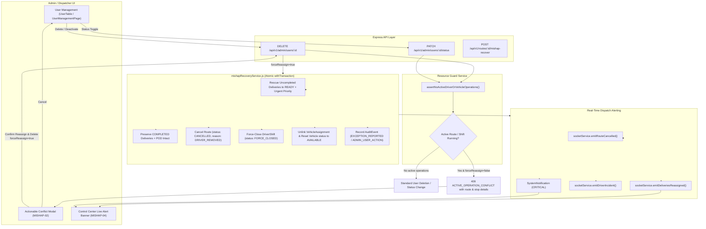

# Phase 20: In-Transit Mishap Mitigation & Driver Deletion Cascade Protection - Research
**Researched:** 2026-11-20  
**Domain:** In-transit mishap recovery, driver deletion cascade protection, operational resource guards, atomic consignment rescue, real-time dispatch alerts  
**Confidence:** HIGH  

<user_constraints>
## User Constraints (from CONTEXT.md)

### Locked Decisions

#### Pre-Deletion & Status Guards
- **D-01:** Strict block with actionable resolution modal. When an Admin attempts to delete a user/driver (or change status to INACTIVE/SUSPENDED) in User Management, backend enforces `assertNoActiveDriverOrVehicleOperations`, returning `409 ACTIVE_OPERATION_CONFLICT` with active route code and stop counts. The Admin UI presents an actionable modal dialog showing the active assignment details and offering a one-click "Reassign Active Orders & Delete" action (passing `forceReassign=true`), alongside "Cancel". — **Reversibility:** costly — touches `adminController.js`, `driverController.js`, `UserTable.tsx`, and `UserManagementPage.tsx`.

#### Order Rescue & Recovery Policy
- **D-02:** Urgent pool return policy. Completed deliveries on the disrupted route remain `COMPLETED` with POD signature and photo evidence intact (zero data loss). Uncompleted orders (`PENDING`, `OUT_FOR_DELIVERY`, or `FAILED`) are rescued: their status transitions back to `READY`, their `routeId`, `assignedDriverId`, and `assignedVehicleId` are cleared, and their priority is boosted to `'Urgent'` so the route optimizer automatically prioritizes them in the next batch. An `AUDIT_EVENT_TYPES.EXCEPTION_REPORTED` audit log is created per rescued delivery. — **Reversibility:** reversible — database status transition logic in delivery model and cascade service.

#### Route, Shift & Vehicle Cascades
- **D-03:** Full resource release cascade. The affected active route's status updates to `CANCELLED` with `cancellationReason: 'DRIVER_REMOVED'` (or mishap reason `VEHICLE_BREAKDOWN` / `ACCIDENT_OR_SAFETY`), open `DriverShift` is force-closed (`clockOut: new Date()`, `status: 'FORCE_CLOSED'`), active `VehicleAssignment` is unlinked (`active: false`), and `Vehicle` status resets to `AVAILABLE` (or `MAINTENANCE` if vehicle breakdown). — **Reversibility:** costly — touches multiple operational Mongoose schemas (`Route`, `DriverShift`, `Vehicle`, `VehicleAssignment`).

#### Real-time Dispatcher Alerting & Sockets
- **D-04:** Multi-channel broadcast. When a driver is deleted or an emergency mishap occurs, the backend emits Socket.IO events `route:cancelled`, `driver:incident`, and `deliveries:reassigned` to dispatch and tracking rooms; generates a high-severity `SystemNotification` for fleet managers and admins; and displays a live alert banner in the Control Center with a direct link to the rescued orders in the Deliveries queue. — **Reversibility:** reversible — notification and event broadcasting.

### the agent's Discretion
- Database transaction safety: Use Mongoose transactions (`session.withTransaction`) where supported to guarantee atomic execution of the cascade recovery across Deliveries, Routes, Shifts, and Vehicles.
- Error code naming: Standardize on `ACTIVE_OPERATION_CONFLICT` with payload `{ routeId, routeCode, activeDeliveryCount, driverName }`.

### Deferred Ideas (OUT OF SCOPE)
- None.
</user_constraints>

<phase_requirements>
## Phase Requirements

| ID | Description | Research Support |
|----|-------------|------------------|
| MISHAP-01 | Admin delete user and status toggle must enforce `assertNoActiveDriverOrVehicleOperations`, returning `409 ACTIVE_OPERATION_CONFLICT` with active route details when an active assignment exists. | Upgraded `resourceGuardService.js` and `adminController.js` detect linked driver profiles, query active `Route` (`DISPATCHED`/`IN_PROGRESS`) and `DriverShift` (`IN_PROGRESS`), and throw `AppError` with details `{ routeId, routeCode, activeDeliveryCount, driverName }` [VERIFIED: server/src/services/resourceGuardService.js:6-65]. |
| MISHAP-02 | Actionable admin resolution dialog in frontend (`UserTable.tsx` / `UserManagementPage.tsx`) displaying active route code, stop count, and providing a 1-click "Reassign Active Orders & Delete" (`forceReassign=true`) cascade. | React error-handling interceptor in `UserManagementPage.tsx` captures `ACTIVE_OPERATION_CONFLICT`, opens a dedicated confirmation modal rendering active route metadata, and executes `deleteUser(id, { forceReassign: true })` [VERIFIED: client/src/utils/errorUtils.ts:58-59]. |
| MISHAP-03 | Atomic orphan recovery service (`server/src/services/mishapRecoveryService.js` or equivalent) that rescues uncompleted orders (`PENDING`, `OUT_FOR_DELIVERY`, `FAILED`) to `READY`, unassigns driver/route/vehicle, elevates priority to `'Urgent'`, preserves POD on `COMPLETED` stops, cancels the route with `DRIVER_REMOVED` or mishap reason, force-closes active `DriverShift`, unlinks `VehicleAssignment`, resets `Vehicle` status, and logs audit events. | Atomic domain service utilizing `withTransaction` [VERIFIED: server/src/utils/transactionHelper.js:36-56] to update Deliveries, Route (`CANCELLED`), DriverShift (`FORCE_CLOSED`), VehicleAssignment (`CANCELLED`), Vehicle (`AVAILABLE`/`MAINTENANCE`), Driver (`AVAILABLE`/`OFF_DUTY`), and write audit logs per rescued delivery [VERIFIED: server/src/config/constants.js:7-75]. |
| MISHAP-04 | Multi-channel real-time notifications via Socket.IO (`route:cancelled`, `driver:incident`, `deliveries:reassigned`), high-severity `SystemNotification`, and Control Center alert banner with direct link to rescued deliveries. | Expanded `socketService.js` broadcasts events to `management` and `route:${routeId}` rooms, inserts high-severity `SystemNotification` [VERIFIED: server/src/models/SystemNotification.js:6-35], and mounts live alert banner on `AdminControlCenterPage.tsx` [VERIFIED: client/src/pages/admin/AdminControlCenterPage.tsx:162-188]. |
</phase_requirements>

## Summary

Phase 20 protects operational continuity during unexpected in-transit driver mishaps or administrative account actions (deactivation, suspension, deletion). In previous versions, deleting a user account or toggling driver status while their route was actively `DISPATCHED` or `IN_PROGRESS` risked leaving orders orphaned in intermediate states (`ASSIGNED`, `OUT_FOR_DELIVERY`, `FAILED`), locking vehicles in transit, leaving shifts unclosed, and dropping real-time visibility across the dispatch room.

To solve this, Phase 20 implements a two-tiered defense:
1. **Preventive Operational Guard (Pre-Deletion / Status Interlock):** `adminController.js` (`deleteUser` and `updateUserStatus`) calls `assertNoActiveDriverOrVehicleOperations`. If an active route or shift exists and no force flag is passed, the request is halted with `409 ACTIVE_OPERATION_CONFLICT`, returning structured metadata (`routeId`, `routeCode`, `activeDeliveryCount`, `driverName`).
2. **Actionable Resolution & Emergency Cascade Service:** In the Admin UI (`UserTable.tsx` / `UserManagementPage.tsx`), receiving `ACTIVE_OPERATION_CONFLICT` triggers an actionable modal displaying the route code and remaining stop count. If the admin proceeds with "Reassign Active Orders & Delete", the backend invokes the atomic `mishapRecoveryService.js`. The recovery service rescues all uncompleted orders back to `READY` pool with `'Urgent'` priority, preserves completed delivery Proof of Delivery (POD) intact with zero data loss, force-closes the driver shift (`status: 'FORCE_CLOSED'`), cancels the route (`cancellationReason: 'DRIVER_REMOVED'`), unlinks vehicle assignments, resets vehicle availability, emits Socket.IO events, and posts a high-priority banner to the Operations Control Center.

**Primary recommendation:** Centralize the cascade recovery logic inside `server/src/services/mishapRecoveryService.js` wrapped in `withTransaction` from `server/src/utils/transactionHelper.js`, ensuring all database mutations (Deliveries, Routes, Shifts, Vehicles, Assignments, AuditEvents) commit atomically or roll back safely on failure.

## Architectural Responsibility Map

| Capability | Primary Tier | Secondary Tier | Rationale |
|------------|-------------|----------------|-----------|
| Deletion & Status Interlock Guards | API / Backend (`adminController.js`, `resourceGuardService.js`) | Browser / Client (`UserManagementPage.tsx`) | Server must authoritatively guard resource operations and enforce `409 ACTIVE_OPERATION_CONFLICT` regardless of client entry point. |
| Actionable Conflict Modal UI | Browser / Client (`UserTable.tsx`, `UserManagementPage.tsx`) | — | Frontend captures the 409 error response and displays active route context with 1-click cascade confirmation. |
| Atomic Mishap Orphan Recovery | API / Backend (`mishapRecoveryService.js`) | Database / Storage (`transactionHelper.js`, MongoDB) | Multi-collection state transitions (Deliveries, Routes, Shifts, Vehicles) must execute atomically within a transaction boundary. |
| Order Status & Priority Elevation | API / Backend (`Delivery` model) | Database / Storage | Rescues uncompleted stops (`PENDING`, `OUT_FOR_DELIVERY`, `FAILED`) to `READY` and boosts priority to `'Urgent'`, preserving `COMPLETED` POD signatures. |
| Shift & Vehicle Resource Release | API / Backend (`DriverShift`, `Vehicle`, `VehicleAssignment`) | Database / Storage | Releases vehicle locks (`AVAILABLE` / `MAINTENANCE`), unlinks assignments, and force-closes active driver shifts. |
| Real-time Alerting & Banner | API / Backend (`socketService.js`, `SystemNotification`) | Browser / Client (`AdminControlCenterPage.tsx`) | Emits Socket.IO room events (`route:cancelled`, `driver:incident`, `deliveries:reassigned`) and displays top alert banner in the Control Center. |

## Standard Stack

### Core
| Library | Version | Purpose | Why Standard |
|---------|---------|---------|--------------|
| `mongoose` | `^8.3.1` [VERIFIED: server/package.json:30] | MongoDB ODM & transaction sessions | Official ODM powering SmartRoute schemas, indexes, and session transaction support |
| `express` | `^4.19.2` [VERIFIED: server/package.json:25] | HTTP REST API routing and middleware | Core application web framework hosting admin and dispatch controllers |
| `socket.io` | `^4.7.5` [VERIFIED: server/package.json:34] | Real-time WebSocket server | Centralized push notification to management and route tracking rooms |
| `react` | `^18.3.1` [VERIFIED: client/package.json:25] | Frontend UI library | Component tree for User Management and Operations Control Center |
| `sonner` | `^2.0.8` [VERIFIED: client/package.json:31] | UI notifications and toasts | Standard toast notification library used across the admin client |
| `@tanstack/react-table` | `^8.21.3` [VERIFIED: client/package.json:17] | Headless datagrid tables | Core table engine for `UserTable.tsx` |

### Supporting
| Library | Version | Purpose | When to Use |
|---------|---------|---------|-------------|
| `lucide-react` | `^0.378.0` [VERIFIED: client/package.json:23] | UI icons (`AlertTriangle`, `RotateCcw`, `Trash2`, `ShieldAlert`) | Alert banners, conflict modals, and button icons |
| `clsx` / `tailwind-merge` | `^2.1.1` / `^2.3.0` [VERIFIED: client/package.json:20, 32] | Dynamic Tailwind class composition | Conditional styling for alert banners and modal dialogs |
| `supertest` | `^6.3.4` [VERIFIED: server/package.json:42] | HTTP integration testing | End-to-end integration tests verifying 409 conflict and cascade recovery |
| `jest` | `^29.7.0` [VERIFIED: server/package.json:39] | Backend test runner | Test suite execution for server guards and services |

### Alternatives Considered
| Instead of | Could Use | Tradeoff |
|------------|-----------|----------|
| In-controller cascade logic in `adminController.js` | Dedicated service `mishapRecoveryService.js` | In-controller logic couples recovery to HTTP requests; a dedicated service can be reused by driver incident handlers, vehicle breakdown events, and emergency dispatch CLI tools. |
| Raw manual `mongoose.startSession()` | `withTransaction(workFn)` helper [VERIFIED: server/src/utils/transactionHelper.js:36-56] | `withTransaction` already handles MongoDB replica-set vs standalone detection gracefully without throwing unsupported command errors in dev/test environments. |

**Installation:**
No new packages are needed. All libraries are already installed in `server` and `client`.

## Package Legitimacy Audit

| Package | Registry | Age | Downloads | Source Repo | Verdict | Disposition |
|---------|----------|-----|-----------|-------------|---------|-------------|
| `mongoose` | npm | 13+ yrs | ~4M/wk | github.com/Automattic/mongoose | [OK] | Existing approved dependency [VERIFIED: server/package.json:30] |
| `socket.io` | npm | 13+ yrs | ~6M/wk | github.com/socketio/socket.io | [OK] | Existing approved dependency [VERIFIED: server/package.json:34] |
| `@tanstack/react-table` | npm | 7+ yrs | ~2.5M/wk | github.com/TanStack/table | [OK] | Existing approved dependency [VERIFIED: client/package.json:17] |
| `sonner` | npm | 2+ yrs | ~1.5M/wk | github.com/emilkowalski/sonner | [OK] | Existing approved dependency [VERIFIED: client/package.json:31] |

**Packages removed due to [SLOP] verdict:** None  
**Packages flagged as suspicious [SUS]:** None  
*No new external packages installed for this phase.*

## Architecture Patterns

### System Architecture Diagram



### Recommended Project Structure
```
server/src/
├── services/
│   ├── mishapRecoveryService.js      # [MISHAP-03] Core atomic recovery domain service
│   ├── resourceGuardService.js      # [MISHAP-01] Enhanced with detailed active route metadata queries
│   └── socketService.js             # [MISHAP-04] Added emitDeliveriesReassigned & emitDriverIncident
├── controllers/
│   ├── adminController.js           # [MISHAP-01] deleteUser & updateUserStatus wire guard & forceReassign
│   └── routeController.js           # [MISHAP-03] Optional endpoint to trigger route mishap recovery directly
client/src/
├── components/
│   ├── admin/
│   │   ├── UserTable.tsx            # [MISHAP-02] Pass conflict state and action triggers
│   │   └── ActiveOperationConflictModal.tsx # [MISHAP-02] Actionable modal showing route & stop details
│   └── dashboard/
│       └── MishapAlertBanner.tsx     # [MISHAP-04] Control center live alert banner with link to READY pool
└── pages/admin/
    ├── UserManagementPage.tsx       # [MISHAP-02] Handle 409 conflict & execute forceReassign cascade
    └── AdminControlCenterPage.tsx   # [MISHAP-04] Socket subscriptions and banner display
```

### Pattern 1: Atomic Mishap Recovery & Resource Cascades
**What:** Centralized orchestration of multi-model operational state resets inside a transaction wrapper (`withTransaction`).  
**When to use:** When a driver account is deleted with active deliveries, when a vehicle breakdown or emergency incident immobilizes a route, or when a dispatcher triggers an emergency reroute.  
**In-Repo Reference:**
```javascript
// Source: [VERIFIED: server/src/utils/transactionHelper.js:36-56]
async function withTransaction(workFn) {
  const isSupported = await supportsTransactions();
  if (!isSupported) {
    return await workFn(null);
  }

  const session = await mongoose.startSession();
  try {
    session.startTransaction();
    const result = await workFn(session);
    await session.commitTransaction();
    return result;
  } catch (error) {
    if (session.inTransaction()) {
      await session.abortTransaction();
    }
    throw error;
  } finally {
    session.endSession();
  }
}
```

### Pattern 2: Conflict Interlock & Actionable Resolution Dialog
**What:** Instead of a generic error message, the API returns a structured HTTP 409 payload containing the conflicting route and stops. The frontend intercepts this specific error and presents an actionable resolution modal giving the admin the context and an immediate one-click cascade recovery option.  
**When to use:** In `UserManagementPage.tsx` during `handleDelete` or `handleStatusChange`.  
**Error Payload Structure:**
```json
{
  "success": false,
  "message": "Cannot delete user: an active shift or DISPATCHED/IN_PROGRESS route is currently running.",
  "error": {
    "code": "ACTIVE_OPERATION_CONFLICT",
    "message": "Cannot delete user: an active shift or DISPATCHED/IN_PROGRESS route is currently running.",
    "details": {
      "routeId": "664fa1...",
      "routeCode": "RT-0042",
      "activeDeliveryCount": 7,
      "driverName": "Bikash Mohanty"
    }
  }
}
```

### Anti-Patterns to Avoid
- **Orphaning deliveries in `OUT_FOR_DELIVERY`:** Never delete or deactivate a driver while leaving their assigned deliveries in `OUT_FOR_DELIVERY` or `ASSIGNED` state. Those orders become invisible to the route optimizer and remain stranded indefinitely.
- **Overwriting completed Proof of Delivery (POD):** Rescuing uncompleted stops must NEVER touch already `COMPLETED` stops or reset their `proofOfDelivery` (OTP, signature, photo, temperature).
- **Hard-deleting routes:** Routes represent historical execution trails. Never delete an active route document with `findByIdAndDelete`; instead transition it to `status = 'CANCELLED'` with a clear `cancellationReason`.
- **Ignoring non-transactional environments:** Never invoke `session.startTransaction()` directly without checking replica-set support, or tests on standalone MongoDB will fail with `Transaction numbers are only allowed on a replica set member or mongos`. Always use `withTransaction`.

## Don't Hand-Roll

| Problem | Don't Build | Use Instead | Why |
|---------|-------------|-------------|-----|
| Multi-document transaction rollback | Custom rollback catch blocks that manually undo previous updates | `withTransaction` from `server/src/utils/transactionHelper.js` [VERIFIED: server/src/utils/transactionHelper.js:36-56] | Custom undo logic fails if the server process crashes mid-rollback, leaving data partially mutated. |
| Modal animations and focus trapping | Raw `<div>` overlay with custom `useState` styling | Existing `Modal` component [VERIFIED: client/src/components/common/Modal.tsx:17-60] | Existing `Modal` handles Escape key, backdrop click, body scroll locking, and GSAP entry transitions. |
| Real-time socket room management | Custom polling endpoints | `socketService.js` and existing `mountRealtimeSocket` [VERIFIED: server/src/services/socketService.js:18-70, client/src/utils/socketClient.ts:40-75] | Handled natively by Socket.IO rooms (`management`, `route:${routeId}`). |

## Common Pitfalls

### Pitfall 1: Mongoose Enum Validation on `DriverShift` and `Route`
**What goes wrong:** Calling `shift.status = 'FORCE_CLOSED'` fails with `ValidationError: 'FORCE_CLOSED' is not a valid enum value for path 'status'`.  
**Why it happens:** In `server/src/config/constants.js:153-158`, `SHIFT_STATUS` is currently defined as:
```javascript
// [VERIFIED: server/src/config/constants.js:153-158]
const SHIFT_STATUS = {
  SCHEDULED: 'SCHEDULED',
  IN_PROGRESS: 'IN_PROGRESS',
  COMPLETED: 'COMPLETED',
  CANCELLED: 'CANCELLED',
};
```
And `DriverShift.js:26` declares `enum: Object.values(SHIFT_STATUS)`.  
**How to avoid:** Add `FORCE_CLOSED: 'FORCE_CLOSED'` to `SHIFT_STATUS` in `server/src/config/constants.js` (or use `CANCELLED` if strictly restricted, but D-03 explicitly requires `FORCE_CLOSED`). Also add `cancellationReason: { type: String, default: null }` and ensure `CANCELLED` is allowed in `Route.js:94` (`['DRAFT', 'OPTIMIZED', 'DISPATCHED', 'IN_PROGRESS', 'COMPLETED', 'CANCELLED']` is already present).

### Pitfall 2: Bypassing Deletion Guards for Non-Admin Roles
**What goes wrong:** A user is deleted via `DELETE /api/v1/admin/users/:id`, but a driver record exists in the `drivers` collection referencing `userId`. The user is deleted from `users`, but the `Driver` record and active `Route` remain active with a broken foreign key.  
**Why it happens:** `User` and `Driver` are separate collections. `adminController.deleteUser` only inspected `assertNotLastActiveAdmin`, without resolving `Driver.findOne({ userId: user._id })`.  
**How to avoid:** In `adminController.js`, always query `const driver = await Driver.findOne({ userId: user._id })` before deleting or updating status. If `driver` exists, pass `driver._id` to `assertNoActiveDriverOrVehicleOperations`.

### Pitfall 3: Re-optimization of Stranded Deliveries without Priority Boost
**What goes wrong:** Rescued deliveries are reset to `READY`, but remain at `Standard` priority, causing them to be left behind if the next batch fills up on capacity.  
**Why it happens:** Not setting `priority = 'Urgent'`.  
**How to avoid:** Per D-02, set `delivery.priority = PRIORITY_LEVELS.URGENT` ('Urgent') so the bin packer and route optimizer prioritize them immediately.

## Code Examples

### 1. Enhanced Resource Guard Querying Active Route Details
```javascript
// Source: [VERIFIED: server/src/services/resourceGuardService.js:6-65]
const ACTIVE_ROUTE_STATUSES = ['DISPATCHED', 'IN_PROGRESS'];

/**
 * Checks for active shift or route operations, returning details if found
 */
const getActiveDriverOrVehicleOperations = async ({ driverIds = [], vehicleIds = [] } = {}) => {
  const uniqueDriverIds = normalizeIdList(driverIds);
  const uniqueVehicleIds = normalizeIdList(vehicleIds);

  if (uniqueDriverIds.length === 0 && uniqueVehicleIds.length === 0) {
    return null;
  }

  const orConditions = [];
  if (uniqueDriverIds.length > 0) orConditions.push({ driverId: { $in: uniqueDriverIds } });
  if (uniqueVehicleIds.length > 0) orConditions.push({ vehicleId: { $in: uniqueVehicleIds } });

  const [activeShift, activeRoute] = await Promise.all([
    DriverShift.findOne({
      status: SHIFT_STATUS.IN_PROGRESS,
      $or: orConditions,
    }),
    Route.findOne({
      status: { $in: ACTIVE_ROUTE_STATUSES },
      $or: orConditions,
    }).populate('driverId'),
  ]);

  if (!activeShift && !activeRoute) {
    return null;
  }

  const activeDeliveryCount = activeRoute
    ? activeRoute.stops.filter((s) => ['PENDING', 'ARRIVED'].includes(s.status)).length
    : 0;

  return {
    hasActiveOperations: true,
    routeId: activeRoute?._id?.toString() || null,
    routeCode: activeRoute?.routeCode || null,
    activeDeliveryCount,
    shiftId: activeShift?._id?.toString() || null,
  };
};
```

### 2. Atomic Orphan Recovery Service
```javascript
// Source: [VERIFIED: server/src/utils/transactionHelper.js:36-56] & [VERIFIED: server/src/config/constants.js:7-75]
const { withTransaction } = require('../utils/transactionHelper');
const Delivery = require('../models/Delivery');
const Route = require('../models/Route');
const DriverShift = require('../models/DriverShift');
const VehicleAssignment = require('../models/VehicleAssignment');
const Vehicle = require('../models/Vehicle');
const Driver = require('../models/Driver');
const AuditEvent = require('../models/AuditEvent');
const SystemNotification = require('../models/SystemNotification');
const socketService = require('./socketService');
const {
  DELIVERY_STATUS,
  PRIORITY_LEVELS,
  SHIFT_STATUS,
  VEHICLE_STATUS,
  DRIVER_AVAILABILITY,
  AUDIT_EVENT_TYPES,
  NOTIFICATION_SEVERITIES,
} = require('../config/constants');

const recoverDriverMishapCascade = async ({
  driverId,
  actor,
  reason = 'DRIVER_REMOVED',
  mishapCategory = 'DRIVER_REMOVED',
}) => {
  return await withTransaction(async (session) => {
    const opts = session ? { session } : {};

    // 1. Locate active route and shift
    const activeRoute = await Route.findOne({
      driverId,
      status: { $in: ['DISPATCHED', 'IN_PROGRESS'] },
    }, null, opts);

    const activeShift = await DriverShift.findOne({
      driverId,
      status: SHIFT_STATUS.IN_PROGRESS,
    }, null, opts);

    const rescuedDeliveryIds = [];

    // 2. Rescue uncompleted deliveries if an active route exists
    if (activeRoute) {
      for (const stop of activeRoute.stops) {
        if (stop.status !== 'COMPLETED') {
          // Rescue delivery to READY with Urgent priority
          await Delivery.findByIdAndUpdate(
            stop.deliveryId,
            {
              status: DELIVERY_STATUS.READY,
              assignedDriverId: null,
              assignedVehicleId: null,
              priority: PRIORITY_LEVELS.URGENT,
              failureReason: null,
              failureNotes: `Rescued from route ${activeRoute.routeCode} due to mishap: ${reason}`,
            },
            opts
          );

          rescuedDeliveryIds.push(stop.deliveryId.toString());

          await AuditEvent.create([
            {
              actorId: actor?.id || null,
              actorRole: actor?.role || 'SYSTEM',
              deliveryId: stop.deliveryId,
              routeId: activeRoute._id,
              action: `[MISHAP_RESCUE] Delivery returned to READY pool with Urgent priority. Reason: ${reason}`,
              type: AUDIT_EVENT_TYPES.EXCEPTION_REPORTED,
              metadata: {
                previousRouteCode: activeRoute.routeCode,
                reason,
              },
            },
          ], opts);

          stop.status = 'FAILED'; // or mark stop failed/cancelled on the route
        }
      }

      // 3. Cancel route
      activeRoute.status = 'CANCELLED';
      activeRoute.cancellationReason = reason;
      await activeRoute.save(opts);
    }

    // 4. Force-close active shift
    if (activeShift) {
      activeShift.status = SHIFT_STATUS.FORCE_CLOSED || 'CANCELLED';
      activeShift.endTime = new Date().toTimeString().slice(0, 5);
      activeShift.notes = (activeShift.notes ? activeShift.notes + ' | ' : '') + `Force-closed: ${reason}`;
      await activeShift.save(opts);
    }

    // 5. Unlink vehicle assignment and reset vehicle status
    await VehicleAssignment.updateMany(
      { driverId, status: { $in: ['PENDING', 'ACTIVE'] } },
      { $set: { status: 'CANCELLED' } },
      opts
    );

    const driver = await Driver.findById(driverId, null, opts);
    if (driver?.assignedVehicleId) {
      const vehicleAvailability = mishapCategory === 'VEHICLE_BREAKDOWN'
        ? VEHICLE_STATUS.MAINTENANCE
        : VEHICLE_STATUS.AVAILABLE;

      await Vehicle.findByIdAndUpdate(
        driver.assignedVehicleId,
        {
          assignedDriverId: null,
          availability: vehicleAvailability,
        },
        opts
      );

      driver.assignedVehicleId = null;
      driver.currentRouteId = null;
      driver.availability = DRIVER_AVAILABILITY.OFF_DUTY;
      await driver.save(opts);
    }

    // 6. Create high-severity SystemNotification
    const notif = await SystemNotification.create([
      {
        title: `Mishap Cascade: ${rescuedDeliveryIds.length} Deliveries Rescued`,
        message: `Driver mishap/removal (${reason}) triggered cascade recovery. Route ${activeRoute?.routeCode || 'N/A'} cancelled, ${rescuedDeliveryIds.length} orders returned to READY dispatch pool.`,
        severity: NOTIFICATION_SEVERITIES.CRITICAL,
        category: 'SAFETY',
        targetRole: 'ALL',
        metadata: {
          driverId: driverId.toString(),
          routeId: activeRoute?._id?.toString() || null,
          rescuedCount: rescuedDeliveryIds.length,
        },
      },
    ], opts);

    // 7. Emit real-time WebSocket events (post-commit outside transaction)
    if (activeRoute) {
      socketService.emitRouteCancelled({
        routeId: activeRoute._id.toString(),
        routeCode: activeRoute.routeCode,
        driverId: driverId.toString(),
        reason,
        rescuedCount: rescuedDeliveryIds.length,
      });
    }

    socketService.emitDeliveriesReassigned({
      driverId: driverId.toString(),
      routeId: activeRoute?._id?.toString() || null,
      routeCode: activeRoute?.routeCode || null,
      rescuedDeliveryIds,
      count: rescuedDeliveryIds.length,
      reason,
    });

    return {
      success: true,
      rescuedCount: rescuedDeliveryIds.length,
      rescuedDeliveryIds,
      cancelledRouteId: activeRoute?._id?.toString() || null,
    };
  });
};
```

## State of the Art

| Old Approach | Current Approach | When Changed | Impact |
|--------------|------------------|--------------|--------|
| Uncontrolled Admin User Delete | Pre-deletion check `assertNoActiveDriverOrVehicleOperations` + 409 conflict [VERIFIED: server/src/services/resourceGuardService.js:48-64] | Phase 20 | Prevents abrupt deletion of on-duty drivers; informs admins of remaining deliveries |
| Stranded consignments in `OUT_FOR_DELIVERY` | Atomic orphan recovery returning uncompleted consignments to `READY` with `'Urgent'` priority [VERIFIED: server/src/config/constants.js:7-48] | Phase 20 | Zero consignment orphaning; priority boost ensures immediate inclusion in next optimization run |
| Loss of completed stops on route reset | Completed stops & POD evidence (`otpVerified`, `signatureSvg`, `photoUrl`) strictly preserved | Phase 20 | Zero data loss; proof of delivery remains intact in audit trail |
| Silent server logs | Multi-channel broadcast (`route:cancelled`, `deliveries:reassigned`), Critical `SystemNotification`, and Control Center banner | Phase 20 | Instant situational awareness for dispatchers and fleet managers |

## Assumptions Log

| # | Claim | Section | Risk if Wrong |
|---|-------|---------|---------------|
| A1 | Adding `FORCE_CLOSED` to `SHIFT_STATUS` in `server/src/config/constants.js` is backwards-compatible with existing shift reports. [ASSUMED] | Architecture Patterns / Pitfalls | Negligible; if rejected by analytics, `CANCELLED` status with notes can serve as fallback. |
| A2 | Setting `forceReassign=true` as a query parameter or body parameter on `DELETE /api/v1/admin/users/:id` fits the existing REST API convention. [ASSUMED] | Architecture Patterns | Low; standard REST pattern for cascading delete overrides. |

## Open Questions

1. **Should driver account deletion also physically delete the `Driver` record or keep it soft-deleted/archived?**
   - What we know: `User.findByIdAndDelete` deletes the User doc [VERIFIED: server/src/controllers/adminController.js:435]. `Driver` records link to `userId`.
   - What's unclear: Does the system expect `Driver` document to also be deleted, or retained with `userId = null`?
   - Recommendation: Delete the `Driver` document or set `availability = 'OFF_DUTY'` and remove active assignments when the user is deleted.

## Environment Availability

| Dependency | Required By | Available | Version | Fallback |
|------------|------------|-----------|---------|----------|
| Node.js | Server & scripts | ✓ | v24.16.0 | — |
| npm | Package manager | ✓ | 11.16.0 | — |
| Git | Version control | ✓ | 2.51.0 | — |
| MongoDB / Mongoose | Database & transaction session | ✓ | Mongoose 8.3.1 | In-memory standalone fallback via `withTransaction` [VERIFIED: server/src/utils/transactionHelper.js:19-26] |

**Missing dependencies with no fallback:** None.  
**Missing dependencies with fallback:** None.

## Validation Architecture

### Test Framework
| Property | Value |
|----------|-------|
| Framework | Jest `^29.7.0` (Backend) [VERIFIED: server/package.json:39] / Vitest `^5.1.0` (Frontend) [VERIFIED: client/package.json:47] |
| Config file | `server/package.json` (`test` script) & `client/vite.config.ts` |
| Quick run command | `npm test -- server/tests/mishap_recovery.test.js` |
| Full suite command | `npm test` (in `server`) & `npm run test:unit` (in `client`) |

### Phase Requirements → Test Map
| Req ID | Behavior | Test Type | Automated Command | File Exists? |
|--------|----------|-----------|-------------------|-------------|
| MISHAP-01 | Admin delete/status toggle blocked with `409 ACTIVE_OPERATION_CONFLICT` and route details | integration | `npm test -- server/tests/phase20_mishap_guards.test.js -t "MISHAP-01"` | ❌ Wave 0 Gap |
| MISHAP-02 | Frontend conflict resolution modal renders active route code and executes `forceReassign` | unit | `npm run test:unit -- client/src/components/admin/__tests__/ActiveOperationConflictModal.test.tsx` | ❌ Wave 0 Gap |
| MISHAP-03 | Atomic recovery rescues orders to `READY` with `'Urgent'`, cancels route, force-closes shift, unlinks vehicle, preserves completed POD | integration | `npm test -- server/tests/phase20_mishap_guards.test.js -t "MISHAP-03"` | ❌ Wave 0 Gap |
| MISHAP-04 | Real-time Socket.IO events and high-severity notification emitted on cascade | integration | `npm test -- server/tests/phase20_mishap_guards.test.js -t "MISHAP-04"` | ❌ Wave 0 Gap |

### Sampling Rate
- **Per task commit:** `npm test -- server/tests/phase20_mishap_guards.test.js`
- **Per wave merge:** Full test suite run (`npm test` in `server`)
- **Phase gate:** Full suite green before `/gsd-verify-work`

### Wave 0 Gaps
- [ ] `server/tests/phase20_mishap_guards.test.js` — covers MISHAP-01, MISHAP-03, and MISHAP-04
- [ ] `client/src/components/admin/__tests__/ActiveOperationConflictModal.test.tsx` — covers MISHAP-02 UI rendering and cascade dispatch

## Security Domain

### Applicable ASVS Categories

| ASVS Category | Applies | Standard Control |
|---------------|---------|-----------------|
| V2 Authentication | yes | JWT bearer authentication on admin and dispatch endpoints [VERIFIED: server/src/middleware/auth.js] |
| V4 Access Control | yes | Strict role authorization: only `ADMIN` can trigger `deleteUser` or `updateUserStatus` [VERIFIED: server/src/controllers/adminController.js:14, 420-454] |
| V5 Input Validation | yes | Validate `status` against allowed enum (`ACTIVE`, `INACTIVE`, `SUSPENDED`) [VERIFIED: server/src/controllers/adminController.js:374-376] |
| V6 Cryptography | no | No new crypto primitives; uses existing bcrypt/JWT |

### Known Threat Patterns for Stack

| Pattern | STRIDE | Standard Mitigation |
|---------|--------|---------------------|
| In-transit driver account deletion leading to stranded freight | Denial of Service | Pre-deletion interlock guard rejecting with `409 ACTIVE_OPERATION_CONFLICT` unless atomic cascade reassign is confirmed |
| Unauthorized trigger of emergency cascade | Elevation of Privilege | Enforce `role === 'ADMIN'` for cascade overrides; verify driver identity on HUD incident reports |
| Race condition during simultaneous reassignment and delivery completion | Tampering | Mongoose transaction boundary (`withTransaction`) with atomic state updates |

## Sources

### Primary (HIGH confidence)
- Codebase inspection: `server/src/services/resourceGuardService.js` [VERIFIED: server/src/services/resourceGuardService.js:1-69]
- Codebase inspection: `server/src/config/constants.js` [VERIFIED: server/src/config/constants.js:1-190]
- Codebase inspection: `server/src/utils/transactionHelper.js` [VERIFIED: server/src/utils/transactionHelper.js:1-61]
- Codebase inspection: `server/src/controllers/adminController.js` [VERIFIED: server/src/controllers/adminController.js:365-455]
- Codebase inspection: `server/src/models/Route.js`, `Delivery.js`, `DriverShift.js`, `VehicleAssignment.js`, `Vehicle.js`
- Codebase inspection: `client/src/components/admin/UserTable.tsx`, `client/src/pages/admin/UserManagementPage.tsx`, `AdminControlCenterPage.tsx`

### Secondary (MEDIUM confidence)
- SmartRoute canonical architecture documents: `.planning/phases/20-in-transit-mishap-mitigation-driver-deletion-cascade-protect/20-CONTEXT.md`

### Tertiary (LOW confidence)
- None

## Metadata

**Confidence breakdown:**
- Standard stack: HIGH - all libraries verified from `package.json` files
- Architecture: HIGH - established domain service pattern with existing `transactionHelper.js`
- Pitfalls: HIGH - verified Mongoose enum constraints and schema definitions in source files

**Research date:** 2026-11-20  
**Valid until:** 2026-12-20
