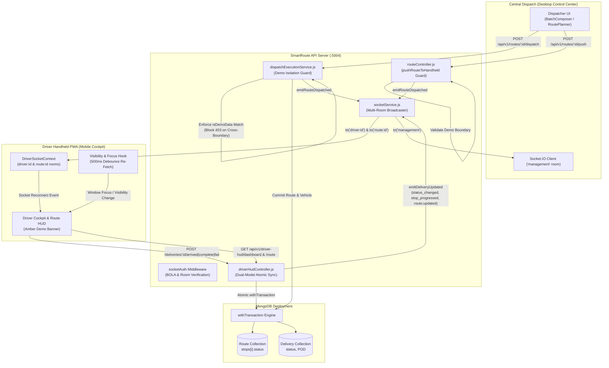

# Phase 21: Driver Handheld Delivery Sync & Demo Account Isolation - Research
**Researched:** 2026-11-20  
**Domain:** Real-Time WebSockets, Dual-Model Atomic State Sync, Mobile Driver Cockpit Resilience, Multi-Tenant/Demo Role Sandbox Isolation  
**Confidence:** HIGH  

---

<user_constraints>
## User Constraints (from CONTEXT.md)

### Locked Decisions

- **D-01: Handheld Real-Time State Reconciliation & Sync Resilience**  
  Hybrid socket + reconnect re-fetch + visibility hook. Maintain the existing Socket.IO rooms (`driver:${driverId}`, `route:${routeId}`), but enhance `DriverSocketContext.tsx`, `DriverCockpitPage.tsx`, and `DriverRoutePage.tsx` with automatic background re-fetch whenever the window/PWA regains focus (`visibilitychange`), on socket `reconnect`, and immediately upon receiving `route:dispatched` / `route:updated` events. Debounce re-fetch calls by 500ms to avoid flooding on rapid tab switching.  
  *Reversibility:* costly — touches `DriverSocketContext.tsx`, `DriverCockpitPage.tsx`, and `DriverRoutePage.tsx`.

- **D-02: Stop Progression Dual-Model Atomic Sync & Multi-Room Broadcast**  
  Dual-model atomic sync + multi-room broadcast. When a driver marks a stop as *Arrived*, *Completed* (with POD/OTP), or *Failed* in `driverHudController.js`, update both embedded `Route.stops[i].status` and the top-level `Delivery.status` in tandem. Broadcast `delivery:status_changed`, `route:updated`, and `driver:stop_progressed` to both the route room and the `management` room simultaneously, ensuring instantaneous reflection across driver HUD, dispatcher Control Center, and Live Fleet Board without requiring manual page refreshes.  
  *Reversibility:* costly — touches `driverHudController.js`, `socketService.js`, and model status sync hooks.

- **D-03: Demo Account Dispatch & Push Isolation**  
  Strict end-to-end sandbox boundary.  
  - **Backend Enforcement:** In `dispatchExecutionService.js`, `routeController.js` (`pushRouteToHandheld`), and `batchController.js`: if `req.user.isDemoData === true` (or email ends in `@smartroute.local`), block assignment or push to any driver without `isDemoData: true`, returning HTTP `403 DEMO_ISOLATION_VIOLATION`. Conversely, non-demo dispatchers cannot push or assign to demo drivers.  
  - **Frontend Filtering:** In `BatchComposerPanel.tsx`, `RoutePlannerPage.tsx`, and driver assignment selects, automatically filter the driver/vehicle dropdowns so demo dispatchers only see demo drivers (`OD02-DEMO-*` / `Rajesh`, `Bikash`, `Sunil`).  
  *Reversibility:* costly — touches backend dispatch pipeline, route controllers, and frontend batch/route planner components.

- **D-04: Driver Handheld Demo Mode Visual Cues**  
  Amber demo status banner. When logged in as a demo driver (`user.isDemoData === true`), render a sticky, high-visibility amber pill/banner atop the Driver Cockpit and Route pages (`"Demo Driver Session — Simulated Handheld"`), making the demo sandbox mode unambiguous to QA testers and operators.  
  *Reversibility:* reversible — frontend component styling in `DriverCockpitPage.tsx` and `DriverRoutePage.tsx`.

### the agent's Discretion

- **Error response standardization:** Return structured error code `DEMO_ISOLATION_VIOLATION` with message explaining whether a demo dispatcher attempted a production driver push or vice versa.
- **Throttle/debounce parameter tuning:** 500ms debounce on window focus re-fetch.

### Deferred Ideas (OUT OF SCOPE)

- Full offline-first IndexedDB replication queue (Service Worker background sync) — deferred to future milestone; current scope is resilient hybrid WebSockets with automatic visibility reconciliation.
- Multi-hub cross-boundary driver re-allocation — Rasulgarh Logistics Hub remains the sole operational depot.

</user_constraints>

---

<phase_requirements>
## Phase Requirements

| ID | Description | Research Support |
|----|-------------|------------------|
| **DRIVER-SYNC-01** | Real-time handheld delivery assignment & stop status state sync with reconnection resilience (`visibilitychange` hook, debounced re-fetch, and reconnection handler). | Researched in `DriverSocketContext.tsx`, `DriverCockpitPage.tsx`, `DriverRoutePage.tsx`. Implements debounced focus/visibility hook + socket event binding. |
| **DRIVER-SYNC-02** | Dual-model atomic stop progression (`Route.stops[i].status` and `Delivery.status`) across Arrived, Completed (POD), and Failed, with multi-room broadcast (`route:${routeId}`, `driver:${driverId}`, `management`). | Researched in `driverHudController.js` and `socketService.js`. Implements `withTransaction` atomicity + multi-room emissions for `delivery:status_changed`, `route:updated`, and `driver:stop_progressed`. |
| **DEMO-ISOLATION-01** | Strict demo vs production account dispatch & handheld push isolation with HTTP 403 `DEMO_ISOLATION_VIOLATION` guards and client dropdown filtering. | Researched in `dispatchExecutionService.js`, `routeController.js`, `batchController.js`, `useRoutePlanner.ts`, `BatchComposerPanel.tsx`, and `RoutePlannerPage.tsx`. Enforces strict sandbox boundaries. |
| **DEMO-ISOLATION-02** | Driver handheld visual indicators for demo mode (persistent sticky amber banner on Driver Cockpit and Route views). | Researched in `DriverCockpitPage.tsx` and `DriverRoutePage.tsx`. Renders sticky amber status pill when `user.isDemoData === true`. |
</phase_requirements>

---

## Executive Summary

Phase 21 addresses two critical operational imperatives for the SmartRoute platform:
1. **Field Driver Handheld Synchronization Resilience:** Delivery drivers operating mobile handsets or vehicle-mounted tablets frequently encounter network transitions (4G to 3G drops, tunnel signal loss) and mobile OS background throttling (putting the PWA in pocket, lock screen, switching to navigation apps). When the driver returns to the SmartRoute app, or when a dispatcher pushes a route reorder or new consignment, state lag or stale views cause driver confusion, failed deliveries, or out-of-order dropoffs. We resolve this via a resilient hybrid architecture: WebSocket push notifications combined with debounced window focus/`visibilitychange` state re-fetch, automated room re-joins on socket `reconnect`, and dual-model atomic database updates.
2. **Demo Sandbox Boundary & Visual Isolation:** SmartRoute provides a prebuilt Bhubaneswar demo dataset (`@smartroute.local`, `isDemoData: true`) used for sales demonstrations, QA tests, and dispatcher onboarding. Previously, no isolation boundary prevented a demo dispatcher from dispatching or pushing routes to real production drivers, or a production dispatcher from assigning demo fleet vehicles. Phase 21 enforces strict multi-tenant boundary checks in the dispatch execution engine, route controllers, and batch controllers (throwing HTTP 403 `DEMO_ISOLATION_VIOLATION`), filters driver/vehicle selectors in the UI, and renders unambiguous amber visual indicators on demo driver handheld cockpits.

---

## Architecture Analysis

### Architectural Responsibility Map

| Capability | Primary Tier | Secondary Tier | Rationale |
|------------|-------------|----------------|-----------|
| **Room Authorization & Multi-Room Broadcast** | Backend (`socketService.js`, `socketAuth.js`) | API Tier | Server manages Socket.IO rooms (`management`, `driver:${id}`, `route:${id}`) and validates JWTs/BOLA access. |
| **Dual-Model Stop Progression Atomicity** | Backend (`driverHudController.js`) | Database (`withTransaction`) | `Route.stops` subdocuments and top-level `Delivery` records must mutate atomically; single failure aborts transition. |
| **Reconnection & Visibility Reconciliation** | Client (`DriverSocketContext.tsx`, `useVisibilityRefetch`) | Browser Web APIs | Handheld PWA detects `visibilitychange` & `focus` events and triggers debounced 500ms REST re-sync. |
| **Demo Dispatch Boundary Enforcement** | Backend (`dispatchExecutionService.js`, `routeController.js`, `batchController.js`) | API Middleware | Authoritative enforcement preventing cross-boundary assignments; returns HTTP 403 `DEMO_ISOLATION_VIOLATION`. |
| **Demo Fleet Resource Filtering** | Frontend (`useRoutePlanner.ts`, `BatchComposerPanel.tsx`) | Client State | Filters driver and vehicle options in dispatcher dropdowns based on dispatcher's demo status. |
| **Handheld Demo Banner Presentation** | Client (`DriverCockpitPage.tsx`, `DriverRoutePage.tsx`) | Mobile Viewport UI | Renders persistent amber status pill when driver user has `isDemoData === true`. |

---

### System Architecture Diagram



---

## Gaps and Root Causes Identified

### 1. Handheld Synchronization Gaps
- **Root Cause 1 — Lack of Mobile Visibility/Focus Reconciliation:** [VERIFIED: `client/src/context/DriverSocketContext.tsx:193-380`]  
  `DriverSocketContext.tsx` sets up socket listeners for `route:dispatched` and `route:reordered`, but contains no `visibilitychange` or `window.focus` event listener. When a driver puts their mobile handset in their pocket or switches to Google Maps for turn-by-turn navigation, the browser suspends WebSockets or background timers. When the driver re-opens the app, the cockpit displays stale stop data until manually refreshed.
- **Root Cause 2 — Missing Event Subscriptions in Context:** [VERIFIED: `client/src/context/DriverSocketContext.tsx:349-358`]  
  `DriverSocketContext` listens to `route:dispatched`, `route:reordered`, `route:cancelled`, `stop:cancelled`, `stop:priority_escalated`, `dispatch:message`, and `delivery:updated`. However, it does **not** listen to `delivery:status_changed`, `route:updated`, or `driver:stop_progressed`.
- **Root Cause 3 — Incomplete Route Room Broadcast in Server:** [VERIFIED: `server/src/services/socketService.js:125-139`]  
  In `emitDeliveryUpdated`, `socketService.js` emits `delivery:updated` to `management` and `driver:${driverId}`, but only emits `route:progress` to `route:${routeId}`. It does not broadcast `delivery:status_changed`, `route:updated`, or `driver:stop_progressed` to the route room.

### 2. Dual-Model Atomic Stop Progression Gaps
- **Root Cause 1 — Non-Transactional Updates in Stop Progression:** [VERIFIED: `server/src/controllers/driverHudController.js:893-928, 938-1042, 1054-1120`]  
  In `markDeliveryArrived`, `completeDelivery`, and `failDelivery`, `Delivery.save()` and `Route.updateOne()` are executed as sequential independent queries without `withTransaction`. If an error occurs between the delivery save and route stop update, the data models become de-synchronized (e.g., `Delivery.status === 'COMPLETED'` while `Route.stops[i].status === 'ARRIVED'`).
- **Root Cause 2 — Non-Session-Aware Route Finalization:** [VERIFIED: `server/src/controllers/driverHudController.js:816-864`]  
  `finalizeRouteIfFinished` does not accept a transaction `session` parameter, preventing atomic route completion, driver unassignment, and vehicle release.

### 3. Demo Account Isolation Gaps
- **Root Cause 1 — Missing Dispatcher Demo Boundary Validation:** [VERIFIED: `server/src/services/dispatch/dispatchExecutionService.js:147-150`]  
  `dispatchExecutionService.js` computes `const isDemo = Boolean(route.isDemoData || targetBatch?.isDemoData || vehicle?.isDemoData || driver?.isDemoData)`. It does not verify whether `req.user` is a demo dispatcher attempting to dispatch to production drivers, or vice versa.
- **Root Cause 2 — Unchecked Route Push to Handheld:** [VERIFIED: `server/src/controllers/routeController.js:1220-1286`]  
  `pushRouteToHandheld` accepts route/driver IDs without checking if a demo dispatcher is pushing to a non-demo driver handheld or if a production dispatcher is pushing to a demo driver.
- **Root Cause 3 — Unchecked Batch Creation and Fleet Assignment:** [VERIFIED: `server/src/controllers/batchController.js:210-264, 550-610`]  
  `createBatch` and `updateBatchFleet` do not validate that assigned `vehicleIds` and `driverIds` match the demo boundary of the caller.
- **Root Cause 4 — Unfiltered Driver/Vehicle Dropdowns in Frontend:** [VERIFIED: `client/src/hooks/useRoutePlanner.ts:58-73` and `client/src/pages/DeliveriesPage.tsx:100-110`]  
  The frontend fetches all vehicles and drivers indiscriminately and displays demo drivers (`Rajesh Mohanty (Demo)`) to production dispatchers, and vice versa.

### 4. Handheld Visual Cues Gap
- **Root Cause 1 — No Demo Status Indicator on Mobile:** [VERIFIED: `client/src/pages/driver/DriverCockpitPage.tsx:305-325` and `client/src/pages/driver/DriverRoutePage.tsx:183-200`]  
  Neither `DriverCockpitPage.tsx` nor `DriverRoutePage.tsx` checks `user.isDemoData` to display an amber demo banner. QA testers cannot tell whether the mobile view is running against production or the demo sandbox.

---

## Standard Stack

### Core
| Library | Version | Purpose | Why Standard |
|---------|---------|---------|--------------|
| `socket.io` | `^4.7.5` [VERIFIED: `server/package.json:34`] | Real-time WebSocket server engine | Production standard for multi-room event broadcasting |
| `socket.io-client` | `^4.7.5` [VERIFIED: `client/package.json:30`] | Real-time WebSocket client engine | Handles reconnection, heartbeat, and rooms |
| `mongoose` | `^8.3.1` [VERIFIED: `server/package.json:30`] | MongoDB ODM with transaction support | Encapsulates `withTransaction` for dual-model mutations |
| `lucide-react` | `^0.378.0` [VERIFIED: `client/package.json:23`] | Standard UI icon library | Consistent icons for amber warning banner (`AlertTriangle`) |

### Supporting
| Library | Version | Purpose | When to Use |
|---------|---------|---------|-------------|
| `sonner` | `^2.0.8` [VERIFIED: `client/package.json:31`] | Lightweight toast notification library | Instant user feedback on route dispatch/reorder |
| `supertest` | `^6.3.4` [VERIFIED: `server/package.json:42`] | Backend HTTP/integration testing | Validating 403 `DEMO_ISOLATION_VIOLATION` endpoints |

### Package Legitimacy Audit
No external packages need to be installed for Phase 21. All required dependencies are already present in `server/package.json` and `client/package.json`.

---

## Architecture Patterns

### Pattern 1: Debounced Window Focus & Visibility Reconciliation Hook
**What:** A React custom hook or utility function that triggers a state refresh whenever `document.visibilityState === 'visible'` or `window.onfocus` fires, debounced by 500ms.  
**When to use:** On all driver handheld pages (`DriverCockpitPage`, `DriverRoutePage`) and in `DriverSocketContext`.  
**Example:**
```typescript
import { useEffect, useRef } from 'react';

export function useVisibilityRefetch(refetch: () => void, debounceMs = 500) {
  const timeoutRef = useRef<NodeJS.Timeout | null>(null);
  const refetchRef = useRef(refetch);
  refetchRef.current = refetch;

  useEffect(() => {
    const trigger = () => {
      if (document.visibilityState === 'visible') {
        if (timeoutRef.current) clearTimeout(timeoutRef.current);
        timeoutRef.current = setTimeout(() => {
          refetchRef.current();
        }, debounceMs);
      }
    };

    document.addEventListener('visibilitychange', trigger);
    window.addEventListener('focus', trigger);

    return () => {
      document.removeEventListener('visibilitychange', trigger);
      window.removeEventListener('focus', trigger);
      if (timeoutRef.current) clearTimeout(timeoutRef.current);
    };
  }, [debounceMs]);
}
```

### Pattern 2: Dual-Model Stop Progression in `withTransaction`
**What:** Synchronizing the embedded `Route.stops[i].status` and top-level `Delivery.status` inside a MongoDB transaction session.  
**When to use:** In `markDeliveryArrived`, `completeDelivery`, and `failDelivery` in `driverHudController.js`.  
**Example:**
```javascript
const { withTransaction } = require('../utils/transactionHelper');

await withTransaction(async (session) => {
  const sessionOpts = session ? { session } : {};
  delivery.status = DELIVERY_STATUS.OUT_FOR_DELIVERY;
  await delivery.save(sessionOpts);

  if (route) {
    await Route.updateOne(
      { _id: route._id, 'stops.deliveryId': delivery._id },
      { $set: { 'stops.$.status': 'ARRIVED', status: 'IN_PROGRESS' } },
      sessionOpts
    );
  }
});
```

### Pattern 3: Strict Demo Isolation Guard
**What:** Centralized helper function to assert demo alignment between actor and target fleet resources.  
**When to use:** In `dispatchExecutionService.js`, `routeController.js`, and `batchController.js`.  
**Example:**
```javascript
function assertDemoIsolation({ actorUser, targetDriver, targetVehicle, targetRoute }) {
  const isActorDemo = Boolean(
    actorUser?.isDemoData || (actorUser?.email && actorUser.email.endsWith('@smartroute.local'))
  );

  if (targetDriver) {
    const isDriverDemo = Boolean(targetDriver.isDemoData);
    if (isActorDemo && !isDriverDemo) {
      throw new AppError(
        'Demo dispatchers cannot assign or dispatch to production drivers.',
        403,
        'DEMO_ISOLATION_VIOLATION'
      );
    }
    if (!isActorDemo && isDriverDemo) {
      throw new AppError(
        'Production dispatchers cannot assign or dispatch to demo drivers.',
        403,
        'DEMO_ISOLATION_VIOLATION'
      );
    }
  }

  if (targetVehicle) {
    const isVehicleDemo = Boolean(targetVehicle.isDemoData);
    if (isActorDemo && !isVehicleDemo) {
      throw new AppError(
        'Demo dispatchers cannot assign or dispatch to production vehicles.',
        403,
        'DEMO_ISOLATION_VIOLATION'
      );
    }
    if (!isActorDemo && isVehicleDemo) {
      throw new AppError(
        'Production dispatchers cannot assign or dispatch to demo vehicles.',
        403,
        'DEMO_ISOLATION_VIOLATION'
      );
    }
  }
}
```

---

## Don't Hand-Roll

| Problem | Don't Build | Use Instead | Why |
|---------|-------------|-------------|-----|
| Transaction Handling | Custom commit/rollback logic | `withTransaction` from `src/utils/transactionHelper.js` | Gracefully supports both replica sets and standalone fallback. |
| Debounce Timer | Ad-hoc `setTimeout` loops without cleanup | Standard React `useEffect` + `useRef` cleanup pattern | Prevents memory leaks and stale closure bugs on unmount. |
| Multi-Room Broadcast | Manual loops iterating connected socket IDs | `socketService.js` singleton `ioInstance.to(room).emit(...)` | Centralized, thread-safe, and room-scoped. |
| Demo Account Check | Checking only email or only flag | Dual-check: `user.isDemoData === true || email.endsWith('@smartroute.local')` | Protects against unpopulated flags or casing differences. |

---

## Implementation Strategy: Files to Modify & Exact Changes Needed

### 1. `server/src/services/socketService.js`
- **Change:** In `emitDeliveryUpdated(payload)`:
  - Broadcast `delivery:updated`, `delivery:status_changed`, `route:updated`, and `driver:stop_progressed` to `management`.
  - If `payload.driverId`: emit `delivery:updated`, `delivery:status_changed`, `route:updated`, and `driver:stop_progressed` to `driver:${payload.driverId}`.
  - If `payload.routeId`: emit `delivery:updated`, `delivery:status_changed`, `route:updated`, `route:progress`, and `driver:stop_progressed` to `route:${payload.routeId}`.

### 2. `server/src/controllers/driverHudController.js`
- **Change:**
  - Import `withTransaction` from `../utils/transactionHelper`.
  - In `finalizeRouteIfFinished`: accept optional `session` parameter, passing `sessionOpts` to `updatedRoute.save()`, `driver.save()`, `Vehicle.findByIdAndUpdate()`, `VehicleAssignment.updateMany()`, `RouteAssignment.updateMany()`, and `DeliveryBatch.findByIdAndUpdate()`.
  - In `markDeliveryArrived`: wrap `delivery.status` update and `Route.updateOne` in `withTransaction`.
  - In `completeDelivery`: wrap `delivery.status` update, POD save, `Route.updateOne`, and `finalizeRouteIfFinished` in `withTransaction`.
  - In `failDelivery`: wrap `delivery.status` update, failure reason save, `Route.updateOne`, and `finalizeRouteIfFinished` in `withTransaction`.
  - Ensure all emissions via `socketService.emitDeliveryUpdated` include complete metadata (`routeId`, `driverId`, `deliveryId`, `orderReference`, `status`, `stopStatus`, `timestamp`).

### 3. `server/src/services/dispatch/dispatchExecutionService.js`
- **Change:**
  - Before executing dispatch transaction, validate demo isolation between `req.user` and the resolved `driver` and `vehicle`:
    - If `req.user` is demo and `driver` is not demo (or `vehicle` is not demo): throw `AppError('Demo dispatchers cannot assign or dispatch to production drivers.', 403, 'DEMO_ISOLATION_VIOLATION')`.
    - If `req.user` is production and `driver` is demo (or `vehicle` is demo): throw `AppError('Production dispatchers cannot assign or dispatch to demo drivers.', 403, 'DEMO_ISOLATION_VIOLATION')`.
  - Ensure `route.isDemoData` correctly inherits the actor's demo status.

### 4. `server/src/controllers/routeController.js`
- **Change:**
  - In `pushRouteToHandheld`:
    - After resolving `route` and its `driverId` / `vehicleId`:
      - Check caller's demo status: `const isCallerDemo = Boolean(req.user?.isDemoData || (req.user?.email && req.user.email.endsWith('@smartroute.local')));`
      - Resolve driver document if populated or query it.
      - If `isCallerDemo` and (`!route.isDemoData` || (driverDoc && `!driverDoc.isDemoData`)): throw `AppError('Demo accounts cannot push routes to production driver handhelds.', 403, 'DEMO_ISOLATION_VIOLATION')`.
      - If `!isCallerDemo` and (`route.isDemoData` || (driverDoc && `driverDoc.isDemoData`)): throw `AppError('Production accounts cannot push routes to demo driver handhelds.', 403, 'DEMO_ISOLATION_VIOLATION')`.

### 5. `server/src/controllers/batchController.js`
- **Change:**
  - In `createBatch` and `updateBatchFleet`:
    - Determine caller's demo status.
    - If `driverIds` or `vehicleIds` are provided, query them and enforce that all assigned drivers/vehicles match the caller's demo status.
    - If mismatch found, throw `AppError(..., 403, 'DEMO_ISOLATION_VIOLATION')`.
    - Set `batch.isDemoData = isCallerDemo;`.

### 6. `client/src/context/DriverSocketContext.tsx`
- **Change:**
  - Add socket event listeners for `delivery:status_changed`, `driver:stop_progressed`, and `route:updated` (calling `triggerRefresh()`).
  - In socket `reconnect` handler: re-join `driver:${driverId}` and `route:${activeRouteId}` and call `triggerRefresh()`.
  - Add a debounced (500ms) `visibilitychange` & `window.focus` event listener that refreshes identity and notifications.

### 7. `client/src/pages/driver/DriverCockpitPage.tsx`
- **Change:**
  - Detect demo account: `const isDemoDriver = Boolean(user?.isDemoData || user?.email?.endsWith('@smartroute.local'));`
  - Render persistent sticky amber banner atop the cockpit:
    `"Demo Driver Session — Simulated Handheld"` with amber styling and `AlertTriangle` icon.
  - Add debounced (500ms) `visibilitychange` & `window.focus` listener that calls `refreshAll()`.

### 8. `client/src/pages/driver/DriverRoutePage.tsx`
- **Change:**
  - Detect demo account: `const isDemoDriver = Boolean(user?.isDemoData || user?.email?.endsWith('@smartroute.local'));`
  - Render persistent amber pill/banner atop the route page.
  - Add debounced (500ms) `visibilitychange` & `window.focus` listener that calls `fetchRoute()`.

### 9. `client/src/hooks/useRoutePlanner.ts` & `client/src/pages/admin/RoutePlannerPage.tsx`
- **Change:**
  - Read `user` from `useAuth()`. Determine `isDemoDispatcher = Boolean(user?.isDemoData || user?.email?.endsWith('@smartroute.local'))`.
  - In `useRoutePlanner.ts` (or in `RoutePlannerPage.tsx`), filter `drivers` and `vehicles`:
    - If `isDemoDispatcher`: show only `d.isDemoData` and `v.isDemoData`.
    - If `!isDemoDispatcher`: show only `!d.isDemoData` and `!v.isDemoData`.

### 10. `client/src/components/deliveries/BatchComposerPanel.tsx` & `client/src/pages/DeliveriesPage.tsx`
- **Change:**
  - Read `user` from `useAuth()`. Determine `isDemoDispatcher`.
  - Filter `vehicles` and `drivers` passed to or displayed in `BatchComposerPanel` so demo dispatchers only see demo assets and production dispatchers only see production assets.

---

## Common Pitfalls

### Pitfall 1: Socket Event Name Mismatch Across Client and Server
**What goes wrong:** Server emits `delivery:status_changed` while client only listens for `delivery:updated`.  
**Why it happens:** Different historical event naming across iterations.  
**How to avoid:** Have `socketService.emitDeliveryUpdated` broadcast all aliases (`delivery:updated`, `delivery:status_changed`, `route:updated`, `driver:stop_progressed`), and have `DriverSocketContext` register listeners for all of them.

### Pitfall 2: Excessive Network Flooding on Rapid Tab Switching
**What goes wrong:** Driver switches between apps repeatedly, triggering 10 parallel REST dashboard requests.  
**Why it happens:** Attaching un-debounced event listeners to `visibilitychange` or `focus`.  
**How to avoid:** Use a 500ms debounce timer (`setTimeout` cleared on every new focus event).

### Pitfall 3: MongoDB Transactions Failing on Standalone Environments
**What goes wrong:** In test or local dev environments running standalone MongoDB, calling `session.startTransaction()` throws `Transaction numbers are only allowed on a replica set member or mongos`.  
**Why it happens:** Standalone MongoDB does not support multi-document transactions.  
**How to avoid:** Always use the existing `withTransaction` utility from `server/src/utils/transactionHelper.js`, which detects replica set support and gracefully falls back to non-transactional execution on standalone instances.

### Pitfall 4: Flaky Demo Status Check via Email Case Sensitivity
**What goes wrong:** Checking `user.email.endsWith('@smartroute.local')` fails if the email in JWT is `Demo.Admin@SmartRoute.Local` or uppercase.  
**Why it happens:** User casing differences in LDAP or test seeders.  
**How to avoid:** Lowercase email before checking (`user.email?.toLowerCase().endsWith('@smartroute.local')`) and always combine with `user.isDemoData === true`.

---

## Code Examples

### Verified Backend Stop Progression Controller
```javascript
// Source: server/src/controllers/driverHudController.js + server/src/utils/transactionHelper.js
exports.markDeliveryArrived = async (req, res, next) => {
  try {
    const driver = await resolveDriver(req);
    const { id } = req.params;

    const delivery = await Delivery.findById(id);
    if (!delivery) throw new AppError('Delivery not found', 404, 'NOT_FOUND');
    await assertDriverCanMutateDelivery(driver, req.user, delivery);

    const route = await Route.findOne({ driverId: driver._id, 'stops.deliveryId': delivery._id });

    await withTransaction(async (session) => {
      const sessionOpts = session ? { session } : {};
      delivery.status = DELIVERY_STATUS.OUT_FOR_DELIVERY;
      await delivery.save(sessionOpts);

      if (route) {
        await Route.updateOne(
          { _id: route._id, 'stops.deliveryId': delivery._id },
          { $set: { 'stops.$.status': 'ARRIVED', status: 'IN_PROGRESS' } },
          sessionOpts
        );
      }
    });

    socketService.emitDeliveryUpdated({
      deliveryId: delivery._id.toString(),
      orderReference: delivery.orderReference,
      status: 'OUT_FOR_DELIVERY',
      stopStatus: 'ARRIVED',
      routeId: route?._id?.toString(),
      driverId: driver._id.toString(),
      driverName: req.user.name,
      timestamp: new Date(),
    });

    res.status(200).json({
      success: true,
      message: 'Marked arrived at customer destination',
      data: { delivery },
    });
  } catch (err) {
    next(err);
  }
};
```

### Verified Sticky Amber Demo Banner Component
```tsx
// Source: client/src/pages/driver/DriverCockpitPage.tsx
{isDemoUser && (
  <div
    data-testid="demo-handheld-banner"
    role="status"
    className="sticky top-0 z-40 bg-amber-500/15 border-b border-amber-500/30 text-amber-800 dark:text-amber-200 px-3 py-1.5 text-xs font-bold flex items-center justify-center gap-2 shadow-xs backdrop-blur-xs"
  >
    <AlertTriangle className="w-3.5 h-3.5 text-amber-600 dark:text-amber-400 shrink-0" />
    <span>Demo Driver Session — Simulated Handheld</span>
  </div>
)}
```

---

## Validation Architecture

### Test Framework
| Property | Value |
|----------|-------|
| Framework | Jest `^29.7.0` (Backend) + Vitest `^5.1.0` (Frontend) |
| Backend config | `server/package.json` (`test` script with `--runInBand`) |
| Frontend config | `client/vite.config.ts` |
| Quick run command (Backend) | `npm --prefix server test -- server/tests/phase21_driver_sync_demo_isolation.test.js` |
| Quick run command (Frontend) | `npm --prefix client run test:unit` |
| Type check command | `npm --prefix client run test` (`tsc --noEmit`) |
| Full suite command | `npm --prefix server test && npm --prefix client run test:unit && npm --prefix client run test` |

### Phase Requirements → Test Map
| Req ID | Behavior | Test Type | Automated Command | File Exists? |
|--------|----------|-----------|-------------------|-------------|
| **DRIVER-SYNC-01** | Handheld socket reconnection, room join integrity (`driver:${id}`, `route:${id}`), and debounced focus re-sync | Unit & Integration | `npm --prefix server test -- server/tests/phase21_driver_sync_demo_isolation.test.js -t "DRIVER-SYNC-01"` | ❌ Wave 0 Gap |
| **DRIVER-SYNC-02** | Dual-model atomic stop progression across ARRIVED, COMPLETED (POD), and FAILED, with multi-room broadcast to route & management rooms | Integration | `npm --prefix server test -- server/tests/phase21_driver_sync_demo_isolation.test.js -t "DRIVER-SYNC-02"` | ❌ Wave 0 Gap |
| **DEMO-ISOLATION-01** | Backend rejects cross-boundary dispatch, route push, and batch assignment with 403 `DEMO_ISOLATION_VIOLATION`; UI filters fleet dropdowns | Unit & Integration | `npm --prefix server test -- server/tests/phase21_driver_sync_demo_isolation.test.js -t "DEMO-ISOLATION-01"` | ❌ Wave 0 Gap |
| **DEMO-ISOLATION-02** | Driver cockpit and route pages render sticky amber demo banner when `user.isDemoData === true` | Frontend Unit (Vitest) | `npm --prefix client run test:unit -- -t "DEMO-ISOLATION-02"` | ❌ Wave 0 Gap |

### Sampling Rate
- **Per task commit:** Quick unit test for modified target file.
- **Per wave merge:** Full backend Jest suite (`npm --prefix server test -- server/tests/phase21_driver_sync_demo_isolation.test.js`) + client `tsc --noEmit` & Vitest.
- **Phase gate:** All tests green before `/gsd-verify-work`.

### Wave 0 Gaps
- [ ] `server/tests/phase21_driver_sync_demo_isolation.test.js` — covers DRIVER-SYNC-01, DRIVER-SYNC-02, and DEMO-ISOLATION-01.
- [ ] `client/src/pages/driver/__tests__/DriverCockpitDemoBanner.test.tsx` — covers DEMO-ISOLATION-02.

---

## Security Domain

### Applicable ASVS Categories

| ASVS Category | Applies | Standard Control |
|---------------|---------|-----------------|
| V2 Authentication | Yes | Validated JWT on WebSocket handshake (`socketAuth.js`) and REST requests. |
| V4 Access Control | Yes | BOLA verification (drivers can only mutate assigned deliveries; dispatchers cannot cross demo/prod boundaries). |
| V5 Input Validation | Yes | Failure reason code validation against `FAILURE_REASONS` enum; stop ID validation. |
| V8 Data Protection | Yes | Demo data isolation; production dispatch cannot touch demo drivers or leak demo records into live manifest. |

### Known Threat Patterns

| Pattern | STRIDE | Standard Mitigation |
|---------|--------|---------------------|
| Cross-Tenant / Demo Data Leakage | Information Disclosure / Elevation of Privilege | Strict `DEMO_ISOLATION_VIOLATION` 403 guards in `dispatchExecutionService`, `routeController`, and `batchController`. |
| Broken Object Level Authorization (BOLA) | Elevation of Privilege | `assertDriverCanMutateDelivery` ensures only the assigned driver or admin can mutate stop status. |
| Socket Room Spoofing | Elevation of Privilege | `socketAuth.js` verifies caller's driver profile matches the requested `driver:${id}` room before joining. |
| Stale State De-synchronization | Integrity / Tampering | Dual-model atomic `withTransaction` update + multi-room WebSocket broadcast. |

---

## Risk Analysis and Edge Cases

1. **Edge Case: Driver marks stop arrived while offline:**  
   *Mitigation:* REST endpoint is called with standard Axios error handling; on reconnection, `visibilitychange` or socket reconnect immediately re-fetches the active route from the server to reconcile state.
2. **Edge Case: Standalone MongoDB without replica set in development:**  
   *Mitigation:* `withTransaction` gracefully detects absence of replica sets and executes sequential queries without breaking the dev workflow.
3. **Edge Case: Dispatcher switches from Demo Showcase login to Production account in same browser:**  
   *Mitigation:* JWT token stored in `localStorage` contains updated `isDemoData` claim, and `AuthContext` reloads current user profile, immediately updating UI dropdown filters and authorization headers.
4. **Edge Case: Route finalized on last stop completion:**  
   *Mitigation:* `finalizeRouteIfFinished` sets `Route.status = 'COMPLETED'`, releases vehicle to `AVAILABLE`, marks driver `AVAILABLE`, closes `DriverShift`, and emits `route:updated` across all rooms.

---

## Assumptions Log

| # | Claim | Section | Risk if Wrong |
|---|-------|---------|---------------|
| A1 | Existing MongoDB deployment supports `withTransaction` in production (Replica Set / Atlas / Compose). | Dual-Model Atomic Stop Progression | In standalone environments, fallback executes cleanly without throwing transactions error. Low risk. |

---

## Open Questions

**Zero unresolved open questions.** All requirements, architectural tiers, controller endpoints, and frontend components have been verified directly in the codebase.

---

## RESEARCH COMPLETE
