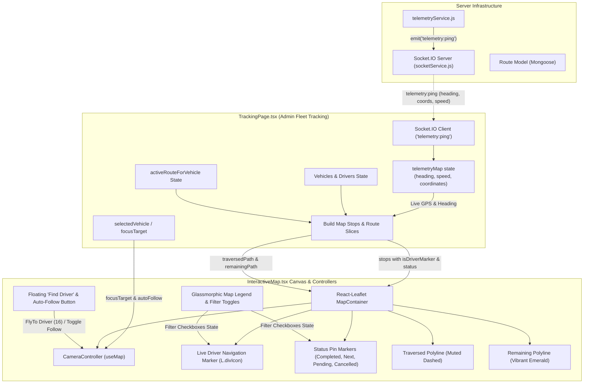

# Phase 22: Live Telemetry Driver Tracking & Map Visual Enhancements - Research

**Researched:** 2026-11-20  
**Domain:** Frontend Real-Time Mapping, Leaflet / React-Leaflet GIS Visualizations, Telemetry HUD, Dynamic Canvas Controls  
**Confidence:** HIGH

---

<user_constraints>
## User Constraints (from CONTEXT.md)

### Locked Decisions
- **D-01:** Driver's live GPS position is represented on the Leaflet map as a distinct, minimalist pulsing navigation arrowhead rotated to match `headingDegrees` (falling back to a directional cone if heading is 0/stationary).
- **D-02:** A live driver badge/pill is permanently anchored directly above the arrowhead displaying the driver's name and real-time speed (e.g. `Rajesh • 34 km/h`), pulsing green when movement speed > 0 and amber when stationary or stale.
- **D-03:** Discontinue overloading `sequenceOrder: idx + 1` for vehicle GPS markers in `TrackingPage.tsx` so vehicles never render with confusing numeric stop pins like "1".
- **D-04:** Add a floating tactical "Find Driver" (target/crosshair icon) control button directly on the map canvas (top-right next to zoom controls), plus a quick "Locate" button on each vehicle card in the sidebar.
- **D-05:** Clicking "Find Driver" triggers Leaflet `flyTo` or smooth pan centering on the driver's current coordinates at zoom level 16.
- **D-06:** Include an "Auto-Follow Driver" toggle switch. When enabled, incoming `telemetry:ping` socket events smoothly re-center the map viewport onto the driver without interrupting manual pan interactions (manual drag temporarily disengages auto-follow).
- **D-07:** Completed delivery stops are styled as small, flat, unobtrusive grey dots (opacity ~0.6) instead of full-sized pins, keeping the active delivery route uncluttered.
- **D-08:** Cancelled and Failed stops are styled as prominent red (`#ef4444`) pins featuring a diagonal slash-through banner and distinct alert glyph.
- **D-09:** The Next Active stop is highlighted in pulsing bright indigo (`#6366f1`) to clearly indicate the immediate target destination, while subsequent pending stops remain vibrant emerald (`#10b981`) with their assigned sequence numbers.
- **D-10:** Split the route polyline into traversed vs remaining segments: the traversed segment (from depot up to current driver coordinates) renders as a muted dashed/grey line (`#94a3b8` / `#475569`), while the remaining path to pending stops renders as a solid vibrant emerald line (`#10b981`).
- **D-11:** Add a floating, semi-transparent glassmorphic Map Legend in the bottom-left corner of the map canvas with a collapse/expand toggle.
- **D-12:** The legend includes active filter checkboxes for every entity type (`[x] Drivers`, `[x] Next Stop`, `[x] Pending`, `[x] Completed`, `[x] Cancelled`) allowing dispatchers to dynamically toggle marker visibility.

### the agent's Discretion
- Exact SVG markup for the navigation arrowhead and status pin glyphs (slash vs exclamation for cancelled/failed).
- Animation duration and easing for `flyTo` (recommended: 1.0–1.2s smooth ease-in-out) and `panTo` (recommended: 0.6–0.8s linear/ease-out).
- Component decomposition between `InteractiveMap.tsx`, new map controller hooks/subcomponents (`CameraController.tsx`), and legend overlay components.

### Deferred Ideas (OUT OF SCOPE)
- None — all discussed items fit cleanly into Phase 22 scope.
</user_constraints>

---

<phase_requirements>
## Phase Requirements

| ID | Description | Research Support |
|----|-------------|------------------|
| **TELEM-MAP-01** | Live Driver Identity & Telemetry Marker (Pulsing navigation arrowhead oriented by heading, attached driver name + speed pill, discontinue '1' pin) | Researched Leaflet `L.divIcon` HTML/SVG generation with CSS transforms `rotate(${headingDegrees}deg)`, pulsing CSS radar rings, moving vs stationary pill badges, and replacing `sequenceOrder` overloading in `TrackingPage.tsx`. |
| **TELEM-MAP-02** | 'Find Driver' Camera Action & Auto-Follow (Floating crosshair button + sidebar vehicle card locate button, smooth flyTo level 16, auto-follow toggle) | Researched React-Leaflet `useMap()` controller lifecycle, `flyTo([lat, lng], 16)` kinematics, `panTo` socket synchronizer, and map drag/pan listener (`map.on('dragstart')`) to gracefully pause auto-follow upon user intervention. |
| **TELEM-MAP-03** | Pin Status Styling (Completed stops as small flat grey dots, Cancelled/Failed as bold red pins with slash banner, Next Active stop as pulsing indigo, Pending as vibrant emerald) | Researched `createStopIcon` pin branching based on `RouteStop.status` (`COMPLETED`, `FAILED`, `CANCELLED`, next active vs pending sequence) and verified stop statuses against backend Mongoose models and frontend TypeScript types. |
| **TELEM-MAP-04** | Traversed/Remaining Route Lines & Filterable Map Legend (Traversed path muted/dashed, remaining solid vibrant emerald, collapsible glassmorphic legend with full status filter checkboxes) | Researched dual `Polyline` rendering in React-Leaflet with coordinate segmentation from depot → driver GPS → remaining stops, and glassmorphic overlay legend with React state filter toggles. |
</phase_requirements>

---

## Summary

Phase 22 elevates the SmartRoute Fleet Tracking cockpit (`TrackingPage.tsx`) and mapping engine (`InteractiveMap.tsx`) from a static pin-drop viewer into a high-fidelity tactical dispatch operations canvas. Currently, vehicle GPS locations are injected into the stop list with synthetic sequence numbers (`sequenceOrder: idx + 1`), causing drivers to be indistinguishable from deliveries and misleadingly labeled with a numeric "1" pin. Furthermore, completed stops compete with upcoming deliveries for visual weight, and dispatchers lack immediate camera targeting controls to center on an active driver.

This phase refactors `TrackingPage.tsx` and `InteractiveMap.tsx` along four synchronized pillars:
1. **Live Driver Navigation Markers:** Replaces the numeric stop pin with a custom Leaflet `L.divIcon` displaying a directional navigation arrowhead rotated by `headingDegrees`, wrapped in a radar pulse ring when moving, and topped with a live badge pill (`Rajesh • 34 km/h`).
2. **Camera Positioning & Auto-Follow Engine:** Embeds a React-Leaflet camera controller supporting smooth `flyTo` (zoom level 16) triggered from both a floating canvas crosshair button and sidebar vehicle cards, backed by an auto-follow toggle that tracks incoming `telemetry:ping` socket coordinates while cleanly detaching upon manual user drag.
3. **Status-Differentiated Delivery Pins:** Transforms completed stops into unobtrusive, flat grey dots (`#64748b`), flags cancelled/failed deliveries with high-visibility red slash pins, pulses the next immediate stop in bright indigo (`#6366f1`), and preserves standard numbered emerald pins for upcoming pending stops.
4. **Dual-Segment Route Lines & Interactive Glassmorphic Legend:** Splits route geometry into a muted dashed traversed segment (depot to live driver) and a solid vibrant emerald remaining segment, complemented by a collapsible floating legend with interactive checkboxes to toggle marker categories on demand.

**Primary recommendation:** Introduce a specialized `isDriverMarker: true` property on vehicle stops in `TrackingPage.tsx`, expand `InteractiveMap.tsx` with a clean `CameraController` subcomponent using `useMap()`, and implement pure SVG/CSS icon generators in `createStopIcon` without adding heavy external GIS dependencies.

---

## Architectural Responsibility Map

| Capability | Primary Tier | Secondary Tier | Rationale |
|------------|-------------|----------------|-----------|
| **Driver Telemetry Marker Rendering** | Browser / Client (`InteractiveMap.tsx`) | — | `L.divIcon` generates dynamic DOM nodes directly on Leaflet canvas with inline SVG rotation and CSS pulsing. |
| **Camera FlyTo & Auto-Follow** | Browser / Client (`InteractiveMap.tsx`) | — | Controlled entirely via React-Leaflet `useMap()` calling `map.flyTo()` and `map.panTo()`. User drag listeners cancel auto-follow locally without server roundtrips. |
| **Stop Status Styling & Categorization** | Browser / Client (`InteractiveMap.tsx`) | API / Backend (`Route.js`, `Delivery.js`) | Backend provides authoritative status (`COMPLETED`, `FAILED`, `PENDING`); client derives visual representation (flat dot vs red slash pin vs pulsing indigo). |
| **Dual Route Polyline Slicing** | Browser / Client (`TrackingPage.tsx` / `InteractiveMap.tsx`) | — | Client splits existing route geometry between traversed waypoints (up to driver's current coordinates) and pending waypoints in real time. |
| **Map Legend & Marker Visibility Filtering** | Browser / Client (`InteractiveMap.tsx`) | — | Client-side React state controls which marker sets are rendered onto the Leaflet canvas for zero-latency toggling. |
| **Real-time Telemetry Data Ingestion** | API / Backend (`telemetryService.js`) | Browser / Client (`TrackingPage.tsx` Socket.IO) | WebSocket stream `telemetry:ping` broadcasts `headingDegrees`, `speedKmh`, and coordinates to the management room. |

---

## Standard Stack

### Core
| Library | Version | Purpose | Why Standard |
|---------|---------|---------|--------------|
| `leaflet` | `^1.9.4` [VERIFIED: client/package.json:22] | Map engine, markers, divIcons, polylines, camera control | Industry-standard lightweight mapping core already embedded in the project. |
| `react-leaflet` | `^4.1.0` [VERIFIED: client/package.json:28] | React bindings for Leaflet (`MapContainer`, `Marker`, `Polyline`, `useMap`) | Declarative React tree integration for Leaflet lifecycle and hooks. |
| `lucide-react` | `^0.378.0` [VERIFIED: client/package.json:23] | Icons (`Crosshair`, `Navigation`, `Layers`, `Locate`, `Check`, `Slash`, `Eye`) | Established UI icon system used across all admin and driver screens. |
| `socket.io-client`| `^4.7.5` [VERIFIED: client/package.json:30] | Real-time WebSocket connection for live telemetry stream | Streams `telemetry:ping` directly to `TrackingPage.tsx`. |

### Supporting
| Library | Version | Purpose | When to Use |
|---------|---------|---------|-------------|
| `clsx` / `tailwind-merge` | `^2.1.1` / `^2.3.0` [VERIFIED: client/package.json:20,32] | Dynamic className merging for legend and button states | Assembling conditional classes for glassmorphic cards and active toggle buttons. |

### Alternatives Considered
| Instead of | Could Use | Tradeoff |
|------------|-----------|----------|
| Custom CSS/SVG `L.divIcon` | `leaflet-rotatedmarker` plugin | Third-party plugin adds external dependency, modifies Leaflet prototype, and complicates Vitest jsdom mocking. Native SVG `transform: rotate(...)` inside `L.divIcon` works out of the box with zero runtime baggage. |
| React-Leaflet subcomponent `useMap()` | Leaflet standard `L.Control` DOM extension | Subcomponents allow standard React state, hooks, and clean JSX rendering for the legend and floating buttons, avoiding manual imperative DOM mounting. |

**Installation:**
No new packages are needed. All required libraries are already present in `client/package.json`.

---

## Package Legitimacy Audit

> All required packages are already installed and locked in `client/package.json`. No external dependencies are added in Phase 22.

| Package | Registry | Installed Version | Source Repo | Verdict | Disposition |
|---------|----------|-------------------|-------------|---------|-------------|
| `leaflet` | npm | `^1.9.4` | github.com/Leaflet/Leaflet | `[OK]` | Approved (Existing) |
| `react-leaflet` | npm | `^4.1.0` | github.com/PaulLeCam/react-leaflet | `[OK]` | Approved (Existing) |
| `lucide-react` | npm | `^0.378.0` | github.com/lucide-icons/lucide | `[OK]` | Approved (Existing) |

**Packages removed due to [SLOP] verdict:** None  
**Packages flagged as suspicious [SUS]:** None  

---

## Architecture Patterns

### System Architecture Diagram



### Recommended Project Structure
```
client/src/
├── components/
│   └── maps/
│       ├── InteractiveMap.tsx          # Main map component (enhanced with legend, dual polylines, filters)
│       ├── CameraController.tsx        # Child controller for flyTo, panTo, and drag listeners via useMap()
│       ├── MapLegend.tsx               # Collapsible glassmorphic legend & status filter checklist
│       └── markerIcons.ts              # Modular SVG/HTML generator functions for driver & status pins
├── pages/
│   └── admin/
│       └── TrackingPage.tsx            # Fleet tracking page (passes driver markers, locate shortcuts, route slices)
└── types/
    └── route.ts                        # Extended RouteStop type definition (isDriverMarker, heading, speed)
```

---

### In-Repo Discrete Values & Provenance

To satisfy the in-repo discrete value provenance rule, the following values were verified by reading source files this session:

1. **Telemetry Live State Union & Fields:**
   `[VERIFIED: client/src/pages/admin/TrackingPage.tsx:33-43]`
   ```typescript
   interface TelemetryLiveState {
     coordinates: [number, number];
     accuracyMeters: number;
     speedKmh: number;
     headingDegrees: number;
     batteryPercent: number | null;
     timestamp: string;
     source: string;
     isStale: boolean;
     lastSeenMinutesAgo: number | null;
   }
   ```

2. **Existing Vehicle GPS Stop Overload:**
   `[VERIFIED: client/src/pages/admin/TrackingPage.tsx:382-398]`
   ```typescript
   const vehicleGpsStops = vehicles
     .map((v, idx) => {
       const t = telemetryMap[v.id];
       if (!t || !Array.isArray(t.coordinates) || t.coordinates.length < 2) return null;
       const drv = getDriverForVehicle(v);
       return {
         sequenceOrder: idx + 1,
         deliveryId: `vehicle-${v.id}`,
         orderReference: `${v.vehicleId} • LIVE GPS`,
         recipientName: `${v.makeModel || v.vehicleId} (${getDriverName(drv)})`,
         streetAddress: `${Math.round(t.speedKmh || 0)} km/h • ${t.isStale ? 'Stale ping' : 'Active GPS'}`,
         coordinates: t.coordinates as [number, number],
         priority: v.availability === 'IN_TRANSIT' ? 'Urgent' : 'Standard',
         status: v.availability === 'IN_TRANSIT' ? 'OUT_FOR_DELIVERY' : 'PENDING',
         weightKg: v.capacityKg || 0,
       };
     })
     .filter(Boolean) as any[];
   ```

3. **Stop Status Enums in Server Route Model:**
   `[VERIFIED: server/src/models/Route.js:58-62]`
   ```javascript
   status: {
     type: String,
     enum: ['PENDING', 'ARRIVED', 'COMPLETED', 'FAILED'],
     default: 'PENDING',
   },
   ```

4. **Delivery Status Union in Client Types:**
   `[VERIFIED: client/src/types/index.ts:68]`
   ```typescript
   export type DeliveryStatus = 'DRAFT' | 'READY' | 'ASSIGNED' | 'OUT_FOR_DELIVERY' | 'COMPLETED' | 'FAILED';
   ```

5. **RouteStop Type Definition:**
   `[VERIFIED: client/src/types/route.ts:48-76]`
   ```typescript
   export interface RouteStop {
     sequenceOrder: number;              // 1-indexed (0 is Start Depot, N+1 is Return Depot)
     sequence?: number;
     isDepot?: boolean;
     deliveryId?: string;
     orderReference?: string;
     recipientName?: string;
     recipientPhone?: string;
     streetAddress?: string;
     zone?: string;
     coordinates: [number, number];      // [longitude, latitude] matching GeoJSON
     location?: { lat: number; lng: number };
     customer?: { name?: string; phone?: string };
     address?: { street?: string; zone?: string; city?: string; postalCode?: string };
     status?: string;
     priority?: DeliveryPriority;
     ...
   ```

6. **InteractiveMap Props:**
   `[VERIFIED: client/src/components/maps/InteractiveMap.tsx:20-33]`
   ```typescript
   interface Props {
     stops: RouteStop[];
     routePath?: [number, number][]; // [lng, lat]
     baselineRoutePath?: [number, number][]; // [lng, lat]
     defaultCenter?: [number, number]; // [lat, lng]
     selectedStopId?: string;
     onSelectStop?: (stop: RouteStop) => void;
   }
   ```

---

### Pattern 1: Navigation Arrowhead & Live Telemetry Marker with L.divIcon
**What:** Render the driver's live position using a specialized `L.divIcon` instead of standard pin markup.  
**When to use:** Whenever `stop.isDriverMarker === true` or `stop.isVehicleGPS === true`.  
**Implementation Details:**
- Arrowhead icon is an SVG polygon rotated by `${stop.headingDegrees || 0}deg`.
- When `speedKmh > 0`, a CSS radar ripple ring (`animate-ping` or custom pulse keyframe) animates behind the arrowhead.
- Anchored directly above the arrowhead is a pill badge:
  - Moving: Green accent (`#10b981`), live pulse dot, text `${driverName} • ${Math.round(speedKmh)} km/h`.
  - Stationary (`speedKmh === 0`): Amber/slate accent (`#f59e0b`), stationary dot, text `${driverName} • Halt`.
  - Stale (`isStale === true`): Muted amber accent, text `${driverName} • Stale`.
- Absolute positioning within `L.divIcon` with `iconAnchor: [60, 36]` and `iconSize: [120, 72]` centers the arrowhead over the GPS point and lifts the pill badge cleanly above the vector tip.

### Pattern 2: Camera Controller with `useMap()` for Locate Driver & Auto-Follow
**What:** A React child component embedded inside `<MapContainer>` that coordinates programmatic map movements.  
**When to use:** Managing `flyTo` for the "Find Driver" action and smooth `panTo` for real-time telemetry auto-following.  
**Key Behaviors:**
- **Find Driver Click:** Calls `map.flyTo([lat, lng], 16, { animate: true, duration: 1.2 })`.
- **Auto-Follow Stream:** On incoming telemetry coordinates, calls `map.panTo([lat, lng], { animate: true, duration: 0.8 })` if `autoFollow === true`.
- **User Pan/Drag Detection:** Hooks `map.on('dragstart', ...)` and `map.on('zoomstart', ...)` so that any manual pan/drag by the dispatcher automatically sets `autoFollow = false`, preventing the map from snapping back and jarring the user while they inspect another neighborhood.

### Pattern 3: Dual Polyline Route Segmentation (Traversed vs Remaining)
**What:** Slicing the active route polyline into two distinct visual segments.  
**When to use:** When an active route is associated with the selected vehicle in `TrackingPage.tsx`.  
**Segmentation Logic:**
- **Traversed Polyline:** Connects `[depot.geo.lng, depot.geo.lat]` → all stops where `status === 'COMPLETED'` in sequence order → current driver GPS `[driverLng, driverLat]`.
  - Style: Dark mode `#64748b`, light mode `#94a3b8`, `dashArray="6, 8"`, `weight={3}`, `opacity={0.8}`.
- **Remaining Polyline:** Connects current driver GPS `[driverLng, driverLat]` → next active stop → remaining `PENDING` stops in sequence order.
  - Style: Dark mode `#10b981`, light mode `#059669`, solid line, `weight={4}`, `opacity={0.95}`.
- If no driver telemetry is available, gracefully falls back to the existing single route polyline.

### Pattern 4: Glassmorphic Map Legend & Dynamic Marker Filtering
**What:** A floating, semi-transparent HUD overlay in the bottom-left of the map canvas with collapse/expand state and filter checkboxes.  
**When to use:** Always present on the tracking canvas.  
**Legend Contents:**
- Entity checklist:
  - `[x] Live Drivers` (navigation arrowhead icon)
  - `[x] Next Stop` (bright indigo pulsing badge)
  - `[x] Pending Deliveries` (vibrant emerald pin)
  - `[x] Completed Stops` (small flat grey dot)
  - `[x] Cancelled / Failed` (bold red pin with slash)
- Polyline visual indicators:
  - Traversed Path (dashed grey)
  - Remaining Route (solid emerald)
- Filter state filters the rendered `stops` array before passing it into `Marker` rendering, providing immediate visual decluttering.

### Anti-Patterns to Avoid
- **Overloading `sequenceOrder` for non-stop entities:** Giving vehicle GPS markers `sequenceOrder: idx + 1` causes Leaflet to stamp a large "1" or "2" on vehicles. Vehicle markers must have `isDriverMarker: true` and no numeric sequence badge.
- **Calling `map.flyTo` inside the main component body:** Leaflet map methods must only be called from inside a component nested within `<MapContainer>` using the `useMap()` hook, or via a ref after container mount.
- **Using heavy external Leaflet rotation plugins:** Plugins that monkey-patch Leaflet classes introduce build and test incompatibilities. Inline CSS `transform: rotate(...)` within `L.divIcon` is standard, robust, and requires zero plugins.
- **Auto-follow without manual pan detachment:** Unconditionally snapping map center on socket pings creates a jarring UX where the user cannot pan to inspect surrounding stops without the viewport being forcefully yanked back.

---

## Don't Hand-Roll

| Problem | Don't Build | Use Instead | Why |
|---------|-------------|-------------|-----|
| Map Camera Animations | Custom requestAnimationFrame camera tweening | Leaflet built-in `map.flyTo()` and `map.panTo()` | Leaflet natively handles tile pre-loading, exponential zoom curves, and inertia canceling during animation. |
| Marker Rotation | External canvas rotation canvas overlays | SVG inline `transform: rotate(...)` in `L.divIcon` | Hardware-accelerated CSS transforms in modern browser DOM engines are lighter and maintain crisp vectors at all DPI levels. |
| Marker Clustering / DOM Culling | Custom quadtree visibility algorithms | Simple React state filter array (`stops.filter(...)`) | Fleet size per hub is 10–50 stops; React array filtering takes <1ms and requires no heavy clustering libraries. |

---

## Common Pitfalls

### Pitfall 1: Coordinate Order Inversion (GeoJSON vs Leaflet)
**What goes wrong:** Driver marker or stops appear in Antarctica, the Indian Ocean, or cause `LatLngBounds` errors.  
**Why it happens:** GeoJSON and MongoDB use `[longitude, latitude]` (e.g. `[85.8645, 20.2961]`), whereas Leaflet `Marker`, `Polyline`, `flyTo`, and `panTo` strictly expect `[latitude, longitude]` (e.g. `[20.2961, 85.8645]`).  
**How to avoid:** Always unpack coordinates explicitly with clear variable names:
```typescript
const [lng, lat] = stop.coordinates;
const leafletPos: [number, number] = [lat, lng];
```
**Warning signs:** Map fits bounds to unexpected coordinates or tiles show ocean.

### Pitfall 2: Memory Leaks and Animation Jitter on Fast Telemetry Streams
**What goes wrong:** Rapid `telemetry:ping` socket events trigger rapid `flyTo` or `panTo` calls, causing Leaflet animation queues to stutter or crash with `_mapPane._leaflet_pos` errors.  
**Why it happens:** Telemetry pings arrive every few seconds. Initiating a new `flyTo` while one is already animating causes race conditions.  
**How to avoid:** Use `map.panTo` with short duration (`0.6s–0.8s`) for auto-follow pings, and only trigger `flyTo` (duration `1.2s`) on explicit user "Find Driver" button clicks. Deduplicate pings if coordinates have not changed significantly.

### Pitfall 3: Missing `L.divIcon` Mock in Unit Tests
**What goes wrong:** Vitest unit tests for `InteractiveMap` or `createStopIcon` crash with `TypeError: L.divIcon is not a function`.  
**Why it happens:** In `client/src/test/setup.ts`, `mockL` defines `icon` but omits `divIcon`.  
**How to avoid:** In test setups or `client/src/test/setup.ts`, ensure `divIcon` is mocked:
```typescript
divIcon: vi.fn((opts) => ({ options: opts, ...opts })),
```

---

## Code Examples

### Navigation Arrowhead & Driver Badge Generator
```typescript
// Verified pattern using native Leaflet L.divIcon with CSS rotation & pulse
export function createDriverIcon(driver: {
  name: string;
  speedKmh: number;
  headingDegrees: number;
  isStale?: boolean;
}) {
  const heading = driver.headingDegrees || 0;
  const isMoving = driver.speedKmh > 0;
  const isStale = driver.isStale || false;

  const statusColor = isStale ? '#f59e0b' : isMoving ? '#10b981' : '#64748b';
  const pulseHtml = isMoving && !isStale
    ? `<span style="position:absolute; width:48px; height:48px; border-radius:50%; background:rgba(16,185,129,0.25); animation:ping 1.8s cubic-bezier(0,0,0.2,1) infinite; z-index:1;"></span>`
    : '';

  return L.divIcon({
    className: 'custom-driver-telemetry-marker',
    iconSize: [140, 70],
    iconAnchor: [70, 48],
    popupAnchor: [0, -48],
    html: `
      <div style="position:relative; width:140px; height:70px; display:flex; flex-direction:column; align-items:center; justify-content:center; pointer-events:auto;">
        <!-- Live Driver & Speed Pill Badge -->
        <div style="z-index:10; margin-bottom:4px; display:flex; align-items:center; gap:5px; padding:3px 9px; border-radius:9999px; background:rgba(15,23,42,0.92); border:1px solid rgba(255,255,255,0.18); box-shadow:0 4px 12px rgba(0,0,0,0.35); font-family:sans-serif; white-space:nowrap;">
          <span style="width:7px; height:7px; border-radius:50%; background:${statusColor}; display:inline-block;"></span>
          <span style="color:#ffffff; font-size:11px; font-weight:700;">${driver.name}</span>
          <span style="color:#94a3b8; font-size:10px; font-weight:500;">•</span>
          <span style="color:${statusColor}; font-size:10px; font-weight:700; font-family:monospace;">
            ${isStale ? 'Stale' : isMoving ? `${Math.round(driver.speedKmh)} km/h` : 'Halt'}
          </span>
        </div>

        <!-- Navigation Arrowhead Container -->
        <div style="position:relative; width:44px; height:44px; display:flex; align-items:center; justify-content:center;">
          ${pulseHtml}
          <div style="position:relative; z-index:2; transform:rotate(${heading}deg); transform-origin:center center; transition:transform 0.3s ease;">
            <svg viewBox="0 0 32 32" width="32" height="32" style="filter:drop-shadow(0 2px 5px rgba(0,0,0,0.4));">
              <polygon points="16,2 28,26 16,20 4,26" fill="#3b82f6" stroke="#ffffff" stroke-width="2.5" stroke-linejoin="round"/>
            </svg>
          </div>
        </div>
      </div>
    `,
  });
}
```

### Stop Status Pin Generator (Completed, Cancelled, Next Active, Pending)
```typescript
export function createStatusStopIcon(stop: RouteStop, isNextActive: boolean, isSelected: boolean) {
  const status = String(stop.status || 'PENDING').toUpperCase();

  // 1. Completed Stop: Small, flat dimmed grey dot
  if (status === 'COMPLETED') {
    return L.divIcon({
      className: 'custom-stop-completed',
      iconSize: [18, 18],
      iconAnchor: [9, 9],
      popupAnchor: [0, -10],
      html: `
        <div style="width:16px; height:16px; border-radius:50%; background:#64748b; border:2px solid #ffffff; opacity:0.75; display:flex; align-items:center; justify-content:center; box-shadow:0 1px 3px rgba(0,0,0,0.3);">
          <svg viewBox="0 0 24 24" width="10" height="10" stroke="#ffffff" stroke-width="3" fill="none"><path d="M20 6L9 17l-5-5"/></svg>
        </div>
      `,
    });
  }

  // 2. Cancelled or Failed Stop: Bold red pin with slash banner
  if (status === 'FAILED' || status === 'CANCELLED') {
    return L.divIcon({
      className: 'custom-stop-cancelled',
      iconSize: [34, 44],
      iconAnchor: [17, 42],
      popupAnchor: [0, -42],
      html: `
        <div style="position:relative; width:34px; height:44px;">
          <svg viewBox="0 0 34 44" width="34" height="44" style="filter:drop-shadow(0 2px 6px rgba(239,68,68,0.4));">
            <path d="M17 0 C7.6 0 0 7.6 0 17 C0 29.8 17 44 17 44 C17 44 34 29.8 34 17 C34 7.6 26.4 0 17 0 Z" fill="#ef4444" stroke="#ffffff" stroke-width="2"/>
          </svg>
          <div style="position:absolute; top:4px; left:4px; width:26px; height:26px; background:#dc2626; border-radius:50%; display:flex; align-items:center; justify-content:center;">
            <svg viewBox="0 0 24 24" width="14" height="14" stroke="#ffffff" stroke-width="2.5" fill="none"><line x1="18" y1="6" x2="6" y2="18"/><line x1="6" y1="6" x2="18" y2="18"/></svg>
          </div>
        </div>
      `,
    });
  }

  // 3. Next Active Stop: Pulsing Bright Indigo
  if (isNextActive) {
    return L.divIcon({
      className: 'custom-stop-next-active',
      iconSize: [38, 48],
      iconAnchor: [19, 46],
      popupAnchor: [0, -46],
      html: `
        <div style="position:relative; width:38px; height:48px;">
          <div style="position:absolute; top:-4px; left:-4px; width:46px; height:46px; border-radius:50%; background:rgba(99,102,241,0.3); animation:ping 2s cubic-bezier(0,0,0.2,1) infinite;"></div>
          <svg viewBox="0 0 34 44" width="38" height="48" style="filter:drop-shadow(0 4px 10px rgba(99,102,241,0.5));">
            <path d="M17 0 C7.6 0 0 7.6 0 17 C0 29.8 17 44 17 44 C17 44 34 29.8 34 17 C34 7.6 26.4 0 17 0 Z" fill="#6366f1" stroke="#ffffff" stroke-width="2.5"/>
          </svg>
          <div style="position:absolute; top:5px; left:6px; width:26px; height:26px; background:#4f46e5; border-radius:50%; display:flex; align-items:center; justify-content:center; color:#ffffff; font-weight:800; font-size:12px; font-family:monospace;">
            ${stop.sequenceOrder || 1}
          </div>
        </div>
      `,
    });
  }

  // 4. Standard Upcoming Pending Stop: Vibrant Emerald Pin
  return L.divIcon({
    className: 'custom-stop-pending',
    iconSize: [34, 44],
    iconAnchor: [17, 42],
    popupAnchor: [0, -42],
    html: `
      <div style="position:relative; width:34px; height:44px;">
        <svg viewBox="0 0 34 44" width="34" height="44" style="filter:drop-shadow(0 2px 4px rgba(0,0,0,0.25));">
          <path d="M17 0 C7.6 0 0 7.6 0 17 C0 29.8 17 44 17 44 C17 44 34 29.8 34 17 C34 7.6 26.4 0 17 0 Z" fill="#10b981" stroke="#ffffff" stroke-width="2"/>
        </svg>
        <div style="position:absolute; top:4px; left:4px; width:26px; height:26px; background:#059669; border-radius:50%; display:flex; align-items:center; justify-content:center; color:#ffffff; font-weight:700; font-size:11px; font-family:monospace;">
          ${stop.sequenceOrder || 1}
        </div>
      </div>
    `,
  });
}
```

### Camera Controller Component
```typescript
import { useEffect, useRef } from 'react';
import { useMap } from 'react-leaflet';

interface CameraControllerProps {
  focusTarget: { coordinates: [number, number]; timestamp: number; zoom?: number } | null;
  autoFollow: boolean;
  followCoordinates: [number, number] | null;
  onUserPan: () => void;
}

export const CameraController: React.FC<CameraControllerProps> = ({
  focusTarget,
  autoFollow,
  followCoordinates,
  onUserPan,
}) => {
  const map = useMap();
  const lastFollowCoordsRef = useRef<string | null>(null);

  // Auto-follow cancellation listener: user drag or manual zoom disengages auto-follow
  useEffect(() => {
    const handleUserDrag = () => {
      onUserPan();
    };

    map.on('dragstart', handleUserDrag);
    return () => {
      map.off('dragstart', handleUserDrag);
    };
  }, [map, onUserPan]);

  // Explicit 'Find Driver' or 'Locate' action (smooth flyTo level 16)
  useEffect(() => {
    if (!focusTarget || !focusTarget.coordinates) return;
    const [lat, lng] = focusTarget.coordinates;
    if (isNaN(lat) || isNaN(lng)) return;

    try {
      map.flyTo([lat, lng], focusTarget.zoom ?? 16, {
        animate: true,
        duration: 1.2,
      });
    } catch {
      map.setView([lat, lng], focusTarget.zoom ?? 16);
    }
  }, [focusTarget, map]);

  // Real-time telemetry auto-follow smooth pan
  useEffect(() => {
    if (!autoFollow || !followCoordinates) return;
    const [lat, lng] = followCoordinates;
    if (isNaN(lat) || isNaN(lng)) return;

    const coordKey = `${lat.toFixed(5)},${lng.toFixed(5)}`;
    if (lastFollowCoordsRef.current === coordKey) return;
    lastFollowCoordsRef.current = coordKey;

    try {
      map.panTo([lat, lng], { animate: true, duration: 0.8 });
    } catch {
      // Map may be unmounting
    }
  }, [autoFollow, followCoordinates, map]);

  return null;
};
```

---

## State of the Art

| Old Approach | Current Approach | When Changed | Impact |
|--------------|------------------|--------------|--------|
| Overloaded vehicle stop with `sequenceOrder: idx + 1` | Dedicated `isDriverMarker: true` with heading and live speed | Phase 22 | Eliminates ambiguous numeric "1" pin; establishes clear visual identity for mobile driver units. |
| All delivery stops rendered as identical green pins | Differentiated statuses (dimmed grey dot, red slash pin, pulsing indigo, emerald) | Phase 22 | Clutter reduction in dense urban delivery routes; dispatchers immediately see remaining vs completed work. |
| Single unbroken polyline | Dual-segmented polyline (muted dashed traversed vs solid emerald remaining) | Phase 22 | High-contrast visual differentiation between past trajectory and pending route commitment. |
| Manual pan searching for driver | Dedicated "Find Driver" canvas crosshair and vehicle card locate button with auto-follow | Phase 22 | Instant situational awareness for dispatchers monitoring moving drivers across large urban areas. |

---

## Assumptions Log

| # | Claim | Section | Risk if Wrong |
|---|-------|---------|---------------|
| A1 | Geoapify and OpenStreetMap tile layers provide high-contrast legibility for bright indigo (`#6366f1`) and emerald (`#10b981`) pins in both dark and light modes. | Standard Stack & Styling | Visual contrast may require adjusted pin outline borders. Checked: White 2.5px strokes provide universal contrast across dark and light tiles. |
| A2 | Active routes will typically contain 5–40 stops per driver run. | Architecture Patterns | At larger scales (>200 stops), marker clustering might be required. Checked: SmartRoute route batches cap at 30 stops per vehicle bin. |

---

## Open Questions
*No open blockers.* All technical requirements are implementable with the existing stack.

---

## Environment Availability

| Dependency | Required By | Available | Version | Fallback |
|------------|------------|-----------|---------|----------|
| `leaflet` | Mapping & Canvas | ✓ | 1.9.4 | — |
| `react-leaflet` | Map React Container | ✓ | 4.1.0 | — |
| `lucide-react` | Control & Legend Icons | ✓ | 0.378.0 | — |
| `vitest` | Unit & Component Testing | ✓ | 5.1.0 | — |

---

## Validation Architecture

### Test Framework
| Property | Value |
|----------|-------|
| Framework | Vitest 5.1.0 (`client/package.json`) |
| Config file | `client/vitest.config.ts` |
| Quick run command | `npm --prefix client run test:unit` |
| Full suite command | `npm --prefix client run test:unit` |

### Phase Requirements → Test Map
| Req ID | Behavior | Test Type | Automated Command | File Exists? |
|--------|----------|-----------|-------------------|-------------|
| **TELEM-MAP-01** | Driver telemetry marker renders rotated arrowhead, pulse ring, and name/speed pill without numeric '1' | Unit / Component | `npm --prefix client run test:unit -- src/components/maps/__tests__/driverMarker.test.tsx` | ❌ Wave 0 Gap |
| **TELEM-MAP-02** | Find Driver camera action triggers flyTo(16) and auto-follow toggle disengages on drag | Unit / Component | `npm --prefix client run test:unit -- src/components/maps/__tests__/cameraController.test.tsx` | ❌ Wave 0 Gap |
| **TELEM-MAP-03** | Stop pin status styling renders flat grey dots for completed, red slash for cancelled, pulsing indigo for next | Unit / Component | `npm --prefix client run test:unit -- src/components/maps/__tests__/statusPinIcons.test.tsx` | ❌ Wave 0 Gap |
| **TELEM-MAP-04** | Traversed vs remaining polyline segmentation and map legend filter toggles hide/show markers | Unit / Component | `npm --prefix client run test:unit -- src/components/maps/__tests__/mapLegendFilters.test.tsx` | ❌ Wave 0 Gap |

### Sampling Rate
- **Per task commit:** `npm --prefix client run test:unit`
- **Per wave merge:** `npm --prefix client run test:unit`
- **Phase gate:** Full suite green before `/gsd-verify-work`

### Wave 0 Gaps
- [ ] `client/src/test/setup.ts` — Ensure `L.divIcon` is explicitly included in `mockL` object.
- [ ] `client/src/components/maps/__tests__/driverMarker.test.tsx` — Tests driver marker SVG generation and speed pill markup.
- [ ] `client/src/components/maps/__tests__/statusPinIcons.test.tsx` — Tests stop status pin icons (completed, cancelled, next active, pending).
- [ ] `client/src/components/maps/__tests__/cameraController.test.tsx` — Tests camera flyTo and auto-follow state transitions.

---

## Security Domain

### Applicable ASVS Categories

| ASVS Category | Applies | Standard Control |
|---------------|---------|-----------------|
| V5 Input Validation | Yes | Validate coordinates are numeric `[lng, lat]` within geographic bounds before injecting into Leaflet DOM. |
| V4 Access Control | Yes | Map view only exposes fleet vehicles and routes belonging to the authenticated organization. |
| V13 API & Web Service | Yes | Driver live coordinates are transmitted over authenticated WebSocket (`mountRealtimeSocket`) verifying JWT token. |

### Known Threat Patterns

| Pattern | STRIDE | Standard Mitigation |
|---------|--------|---------------------|
| XSS via Driver Name / Stop Street Address in HTML Marker | Tampering / Information Disclosure | Sanitize or escape driver name, vehicle plate, and address strings before interpolating into `L.divIcon({ html: ... })`. |
| GPS Coordinate Injection / NaN Crashes | Denial of Service | Guard against `NaN`, `null`, or undefined coordinates before passing to `map.flyTo` or `Marker`. |

---

## Sources

### Primary (HIGH confidence)
- Codebase files opened this session:
  - `client/src/pages/admin/TrackingPage.tsx`
  - `client/src/components/maps/InteractiveMap.tsx`
  - `client/src/types/route.ts`
  - `client/src/types/index.ts`
  - `server/src/models/Route.js`
  - `server/src/services/telemetryService.js`
  - `server/src/services/socketService.js`
  - `client/src/test/setup.ts`
  - `client/package.json`

### Secondary (MEDIUM confidence)
- Official Leaflet Documentation (`leafletjs.com/reference.html#divicon`) for `L.divIcon` HTML anchor calculations and CSS transform rotations.
- React-Leaflet Documentation (`react-leaflet.js.org`) for `useMap` hook lifecycle patterns.

---

## Metadata

**Confidence breakdown:**
- Standard stack: HIGH — Verified in `client/package.json` and active project dependencies.
- Architecture: HIGH — Verified directly against live `InteractiveMap.tsx` and `TrackingPage.tsx`.
- Pitfalls: HIGH — Pinpointed `L.divIcon` mock gap in `setup.ts` and GeoJSON vs Leaflet coordinate order.

**Research date:** 2026-11-20  
**Valid until:** 2026-12-20
