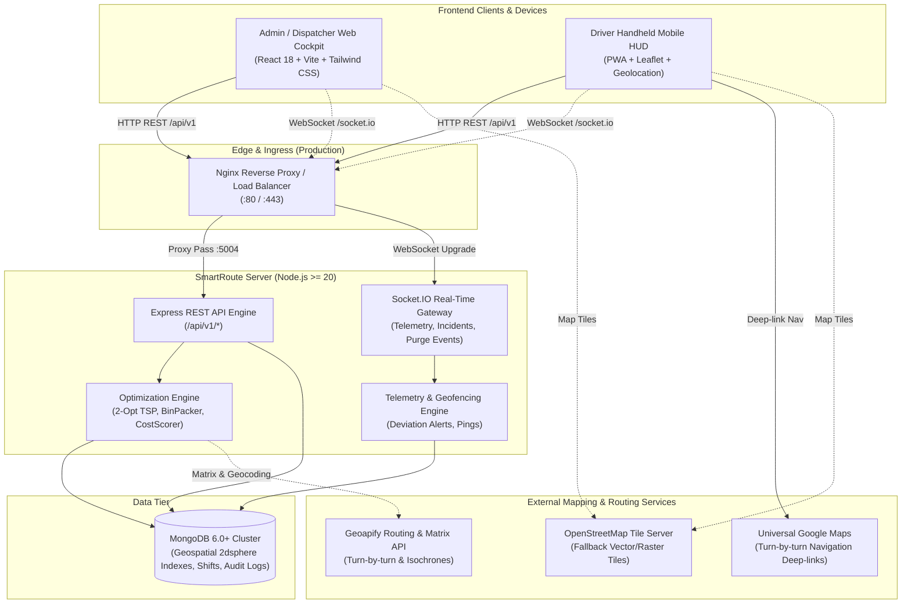

<!-- generated-by: gsd-doc-writer -->
# SmartRoute — Last-Mile Delivery Optimization Platform

[](https://github.com/smartroute/smartroute/actions)
[](https://nodejs.org/)
[](https://react.dev/)
[](https://www.typescriptlang.org/)
[](https://vitejs.dev/)
[](https://expressjs.com/)
[](https://www.mongodb.com/)
[](https://tailwindcss.com/)
[](https://leafletjs.com/)
[](https://socket.io/)
[](client/public/sw.js)
[](LICENSE)

**SmartRoute** is an enterprise-grade last-mile delivery optimization, fleet dispatching, and driver execution platform architected for dense urban logistics clusters. Built with a reactive TypeScript frontend, high-throughput Express and Socket.IO micro-services, and MongoDB spatial indexing, SmartRoute combines multi-vehicle heuristic routing, capacity-constrained bin packing, real-time telemetry, and resilient driver execution workflows into a single operational cockpit.

---

## 📋 Table of Contents

- [System Architecture](#-system-architecture)
- [Key Highlights & Feature Matrix](#-key-highlights--feature-matrix)
- [Quick Start Guide](#-quick-start-guide)
- [Usage Examples](#-usage-examples)
- [Production Deployment Topologies](#-production-deployment-topologies)
- [Verification & Test Suites](#-verification--test-suites)
- [Project Directory Organization](#-project-directory-organization)
- [Security Guidelines](#-security-guidelines)
- [Contributing](#-contributing)
- [License](#-license)

---

## 🏛 System Architecture

SmartRoute is structured as an npm monorepo with distinct separation between the client SPA, backend API & real-time socket gateway, and external mapping and routing providers.



---

## ⚡ Key Highlights & Feature Matrix

| Capability | Technical Implementation | Operational Impact |
| :--- | :--- | :--- |
| **Multi-Vehicle 2-Opt TSP Engine** | Bounded local search algorithm with 2-Opt edge exchanges, cost matrices, and Nearest-Neighbor heuristics. | Guarantees distance invariant: $D_{\text{optimized}} \le D_{\text{baseline}}$ on every computed route. |
| **Capacity-Constrained Bin Packing** | Multi-dimensional bin packing enforcing simultaneous weight ($kg$) and volume ($m^3$) thresholds. | Eliminates vehicle overloading while maximizing payload utilization per vehicle class. |
| **Dynamic EV Preference & Cost Analytics** | Intelligent vehicle allocation favoring Electric Vehicles (EVs) based on State-of-Charge (SoC) and range feasibility. | Calculates monetary savings in Indian Rupees ($\text{₹}$) and avoided tailpipe $\text{CO}_2$ emissions per run. |
| **Driver Cockpit & Mobile HUD** | Dedicated PWA driver interface with stop sequencing, Google Maps universal deep-links, and location geofencing. | Minimizes driver friction; delivers one-tap turn-by-turn navigation directly into Google Maps on mobile devices. |
| **Proof of Delivery (POD) & OTP Verification** | 4-digit recipient SMS OTP validation, HTML5 canvas signature pad, geostamped photo upload, and cold-chain temperature checklist. | Guarantees indisputable proof-of-handoff with tamper-proof delivery logs and timestamps. |
| **Real-Time Fleet Telemetry & Geofencing** | High-frequency WebSocket GPS telemetry (`telemetry:ping`), route corridor monitoring, and deviation alerts. | Live vehicle tracking on Leaflet maps with automatic mishap logging and corridor departure alarms. |
| **Vehicle Lifecycle & Pre-Trip Checklists** | Comprehensive vehicle status states (`AVAILABLE`, `ON_ROUTE`, `MAINTENANCE`, `DECOMMISSIONED`) and daily pre-trip driver inspections. | Prevents unroadworthy vehicles from leaving the depot; logs odometer readings and fuel/charge levels. |
| **High-Density CSV Bulk Ingestion** | Asynchronous CSV parser with PapaParse, strict schema validation, dry-run previews, and downloadable sample datasets. | Ingests hundreds of consignments, vehicles, and drivers in seconds with transactional validation. |
| **Cascade-Safe Bulk Operations** | Multi-select data tables in Deliveries, Fleets, and Drivers views with dependency-aware deletion locks. | Prevents accidental orphan records by rejecting deletion or unbinding of active on-route resources. |
| **Developer Danger Zone & Operational Reset** | Authenticated admin purge endpoint (`DELETE /api/v1/admin/dev-purge`) backed by a 2-step countdown safety modal. | Wipes test batches, routes, and telemetry without touching persistent administrator credentials. |
| **Dark & Light Mode with Zero FOUC** | High-contrast Tailwind palette with synchronous inline `<head>` script (`theme-init.js`) and persistent storage. | Eliminates flash of unstyled content during shifts transitioning between bright daylight and night routes. |
| **PWA & Offline-Resilient Service Worker** | `sw.js` implementing a network-first strategy for HTML navigations and cache-first for static assets. | Ensures driver handhelds load reliably in network dead zones and urban fringe routes. |

---

## 🚀 Quick Start Guide

### Prerequisites

- **Node.js**: `>= 20.0.0` (enforced via `package.json` `engines`)
- **npm**: `>= 10.0.0`
- **MongoDB**: `>= 6.0` (local instance, Docker container, or MongoDB Atlas cluster)
- **Docker & Docker Compose v2** *(optional, required for containerized deployment)*

---

### Step 1: Clone & Install Dependencies

Clone the repository and install all monorepo workspace dependencies:

```bash
git clone https://github.com/smartroute/smartroute.git
cd "Last Mile Delivery Optimization"
npm run install:all
```

---

### Step 2: Configure Environment Variables

SmartRoute uses audited environment configuration files. Copy the template files into active `.env` files across the monorepo:

**Windows PowerShell:**
```powershell
Copy-Item .env.example .env
Copy-Item server/.env.example server/.env
Copy-Item client/.env.example client/.env
```

**macOS / Linux:**
```bash
cp .env.example .env
cp server/.env.example server/.env
cp client/.env.example client/.env
```

> **Default Local Ports:**
> - Server: `http://localhost:5004` (REST API & Socket.IO)
> - Client: `http://localhost:5173` (Vite Dev Server with built-in proxy to `:5004`)

---

### Step 3: Provision the Initial Administrator (`seed:admin`)

SmartRoute enforces secure defaults and does not ship with hardcoded credentials. Bootstrap your primary non-demo `ADMIN` user:

**Windows PowerShell:**
```powershell
$env:ADMIN_EMAIL="admin@yourdomain.com"
$env:ADMIN_PASSWORD="SecureAdminPassword123!"
$env:ADMIN_NAME="SmartRoute Administrator"
npm run seed:admin
```

**macOS / Linux:**
```bash
ADMIN_EMAIL=admin@yourdomain.com \
ADMIN_PASSWORD="SecureAdminPassword123!" \
ADMIN_NAME="SmartRoute Administrator" \
npm run seed:admin
```

`seed:admin` is completely idempotent: if an active non-demo administrator account already exists, it terminates cleanly without overwriting credentials.

---

### Step 4: (Optional) Seed Bhubaneswar Sample Dataset

Populate your database with a sample urban logistics cluster in Bhubaneswar (10 consignments, 4 vehicles, 3 drivers, and pre-configured depots):

```bash
npm run seed
```

*To purge this sample dataset at any time without affecting real operational data:*
```bash
node server/src/seed/seedBhubaneswar.js --delete
```

---

### Step 5: Start Local Development Stack

Launch both the backend Express/Socket.IO server and the Vite React frontend concurrently:

```bash
npm run dev
```

Your services are now live:
- 💻 **Dispatch & Admin Cockpit**: [`http://localhost:5173`](http://localhost:5173)
- 🔌 **API Base Endpoint**: [`http://localhost:5004/api/v1`](http://localhost:5004/api/v1)
- 🩺 **API Liveness Probe**: [`http://localhost:5004/healthz`](http://localhost:5004/healthz)
- 🩺 **API Readiness Probe**: [`http://localhost:5004/readyz`](http://localhost:5004/readyz)

---

## 💡 Usage Examples

### 1. Authenticate & Obtain Bearer Token

```bash
curl -X POST http://localhost:5004/api/v1/auth/login \
  -H "Content-Type: application/json" \
  -d '{
    "email": "admin@yourdomain.com",
    "password": "SecureAdminPassword123!"
  }'
```

**Expected Response (`200 OK`):**
```json
{
  "success": true,
  "message": "Login successful",
  "data": {
    "user": {
      "id": "6732f1a2e9b04a1122334455",
      "name": "SmartRoute Administrator",
      "email": "admin@yourdomain.com",
      "role": "ADMIN"
    },
    "token": "eyJhbGciOiJIUzI1NiIsInR5cCI6IkpXVCJ9..."
  }
}
```

---

### 2. Trigger Multi-Vehicle 2-Opt Route Optimization

Send an unassigned batch ID with vehicle assignments to the optimization engine:

```bash
curl -X POST http://localhost:5004/api/v1/routes/optimize \
  -H "Authorization: Bearer <YOUR_JWT_TOKEN>" \
  -H "Content-Type: application/json" \
  -d '{
    "batchId": "6732f22ce9b04a1122334499",
    "vehicleIds": ["6732f1cfe9b04a1122334460", "6732f1cfe9b04a1122334461"],
    "depotLocation": { "lat": 20.2961, "lng": 85.8245 },
    "enableTwoOpt": true,
    "preferEV": true
  }'
```

**Expected Response (`200 OK`):**
```json
{
  "success": true,
  "data": {
    "routes": [
      {
        "vehicleId": "6732f1cfe9b04a1122334460",
        "vehicleType": "EV_VAN",
        "stopCount": 5,
        "baselineDistanceKm": 24.8,
        "optimizedDistanceKm": 18.2,
        "distanceSavedKm": 6.6,
        "co2SavedKg": 1.78,
        "costSavingsRupees": 142.50,
        "stops": [
          { "orderId": "ORD-101", "sequence": 1, "lat": 20.3012, "lng": 85.8310 },
          { "orderId": "ORD-104", "sequence": 2, "lat": 20.3155, "lng": 85.8452 }
        ]
      }
    ]
  }
}
```

---

### 3. Emit Real-Time Telemetry Ping via Socket.IO

Simulate a driver mobile client sending live coordinates and battery State-of-Charge (SoC):

```javascript
import { io } from "socket.io-client";

const socket = io("http://localhost:5004", {
  auth: { token: "<DRIVER_JWT_TOKEN>" }
});

socket.emit("telemetry:ping", {
  driverId: "6732f1f0e9b04a1122334470",
  vehicleId: "6732f1cfe9b04a1122334460",
  location: { lat: 20.3085, lng: 85.8392 },
  speedKmh: 34.5,
  headingDeg: 142,
  batterySoC: 78.4,
  timestamp: new Date().toISOString()
});
```

---

## 🚢 Production Deployment Topologies

SmartRoute supports both containerized Single-Origin and cloud-native Split-Origin deployment patterns.

### Topology A: Single-Origin Docker Compose + Nginx (Recommended)

In this configuration, Nginx serves the pre-compiled React SPA assets directly and proxies `/api/v1` and WebSocket connections (`/socket.io`) to a single-instance Node.js backend.

1. **Prepare configuration**:
   ```bash
   cp .env.example .env
   ```
   Ensure `MONGODB_URI=mongodb://mongo:27017/smartroute` and strong 32-character `JWT_SECRET` and `JWT_REFRESH_SECRET` values are set.

2. **Build and launch services**:
   ```bash
   docker compose config -q
   docker compose up -d --build --wait
   ```

3. **Bootstrap production admin**:
   ```bash
   docker compose exec -e ADMIN_EMAIL="admin@yourcompany.com" \
     -e ADMIN_PASSWORD="ProductionStrongPassword123!" \
     app npm --prefix server run seed:admin
   ```

4. **Verify container health**:
   ```bash
   node scripts/smoke-test.js --api-url http://127.0.0.1:80 --expect-spa
   ```

---

### Topology B: Split-Origin (Vercel Frontend + Render/Node API)

- **Backend API (`server`)**:
  - Deployed on Render, Fly.io, or Railway using Node 20 runtime (`replicas: 1`).
  - Sets `SERVE_CLIENT=false`, `TRUST_PROXY=1`, `CLIENT_ORIGIN=https://your-app.vercel.app`.
  - Connects to external MongoDB Atlas cluster.
- **Frontend SPA (`client`)**:
  - Hosted on Vercel CDN via root `vercel.json` or `client/vercel.json`.
  - Configures Single Page Application rewrites, strict Content-Security-Policy, and cache headers.
  - Set build-time variables: `VITE_API_URL=https://api.yourcompany.com/api/v1`.

---

## 🧪 Verification & Test Suites

SmartRoute contains comprehensive automated testing across unit, integration, end-to-end, and smoke verification layers.

```bash
# Run full server test suite (Jest unit, integration & RBAC security tests)
npm run test:server

# Run server coverage report
npm run test:coverage

# Run client type safety checks
npm run test --workspace=client

# Run client Vitest unit test suite
npm run test:unit --workspace=client

# Run Playwright browser end-to-end tests
npm run test:e2e --workspace=client

# Run cross-tier E2E runner (spawns test DB & runs automated flows)
npm run test:e2e

# Run post-deployment smoke test verifier
npm run smoke -- --api-url http://localhost:5004
```

---

## 📂 Project Directory Organization

```
Last Mile Delivery Optimization/
├── client/                     # Frontend Vite + React 18 SPA
│   ├── public/                 # Static assets, sw.js, manifest.json, sample_data/
│   │   ├── sample_data/        # Downloadable CSV templates (orders, vehicles, drivers)
│   │   ├── sw.js               # Network-first Service Worker (PWA)
│   │   └── theme-init.js       # Synchronous dark/light theme initializer (Anti-FOUC)
│   └── src/
│       ├── api/                # Typed Axios API client & REST abstractions
│       ├── components/         # Modular UI components (admin, driver, maps, optimization)
│       │   ├── admin/          # Developer Danger Zone, fleet management, audits
│       │   ├── driver/         # Mobile HUD, turn-by-turn cards, OTP, signature canvas
│       │   └── maps/           # Leaflet interactive map, route layers & markers
│       ├── context/            # React context providers (Auth, Socket, Theme)
│       ├── pages/              # Primary route pages (RoutePlanner, Tracking, Batches)
│       └── utils/              # Client helpers, formatters, and CSV handlers
├── server/                     # Backend Express & Socket.IO Engine
│   └── src/
│       ├── config/             # Configuration, env validators, and role constants
│       ├── controllers/        # Route controllers (admin, auth, routes, telemetry)
│       ├── middleware/         # RBAC authorization, Helmet CSP, rate-limiters
│       ├── models/             # Mongoose data schemas (Delivery, Route, Vehicle, Driver)
│       ├── routes/             # REST API endpoint definitions
│       ├── scripts/            # Admin bootstrap and migration utilities
│       ├── seed/               # Bhubaneswar sample urban dataset generator
│       └── services/           # Business logic & algorithms
│           ├── dispatch/       # Batch dispatching & state machines
│           ├── mapping/        # Geoapify & OpenStreetMap client wrappers
│           ├── optimization/   # 2-Opt TSP, Nearest-Neighbor & BinPacker engines
│           └── socketService.js# Real-time WebSocket emission management
├── deploy/                     # Production deployment configurations
│   └── nginx/                  # Nginx configuration (gzip, websocket upgrades, CSP)
├── sample_data/                # Raw operational CSV datasets (orders, vehicles, drivers)
├── scripts/                    # Zero-dependency post-deploy smoke verifier
├── tests/                      # Monorepo multi-tier E2E testing framework
├── docker-compose.yml          # Multi-container orchestration (App, Mongo, Nginx)
├── Dockerfile                  # Multi-stage container build definition
└── package.json                # Root monorepo workspace configuration
```

---

## 🔒 Security Guidelines

SmartRoute adheres to defense-in-depth principles:

1. **Role-Based Access Control (RBAC)**: All endpoints are protected by `authenticate` JWT middleware and strictly partitioned by role (`ADMIN`, `FLEET_MANAGER`, `DRIVER`).
2. **Hardened Headers & CSP**: Protected by Helmet with strict Content-Security-Policy, cross-origin isolations, and clickjacking protections.
3. **Cascading Safety Guards**: Dangerous operations require explicit confirmation payloads and reject any action that disrupts active on-route assignments.
4. **Zero Default Passwords**: Neither the repository nor container images contain hardcoded credentials; initial administrators must be bootstrapped explicitly.

For vulnerability disclosure and supply-chain auditing protocols, please refer to [SECURITY.md](SECURITY.md).

---

## 🤝 Contributing

We welcome community contributions, bug reports, and enhancements.

1. Fork the repository and create a descriptive feature branch (`feat/smart-clustering` or `fix/telemetry-latency`).
2. Ensure all server and client test suites pass:
   ```bash
   npm run test:server && npm run test --workspace=client
   ```
3. Commit your changes using concise, semantic commit messages.
4. Submit a Pull Request detailing the changes, testing methodology, and verified outputs.

---

## 📄 License

This project is licensed under the terms of the **MIT License**.
See the LICENSE file for full licensing terms.
