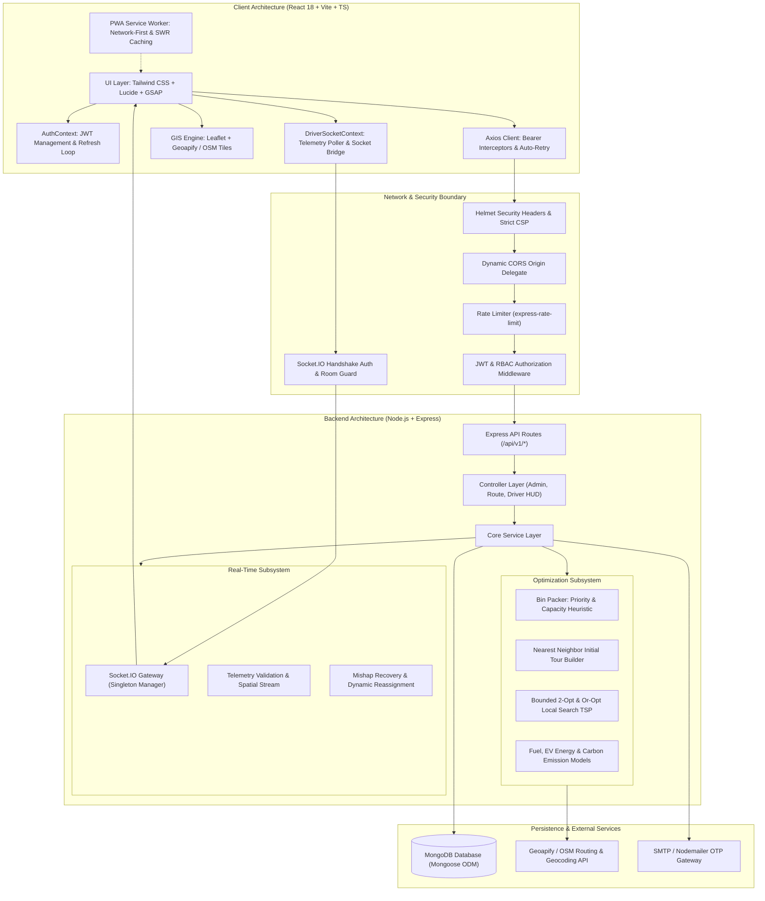
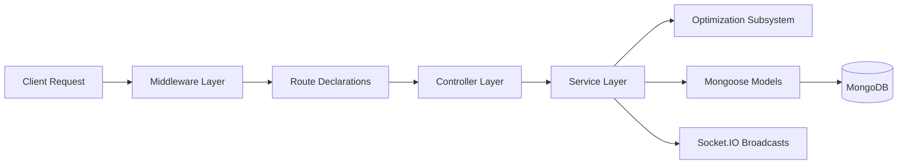
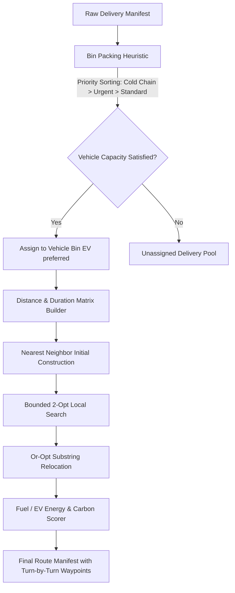
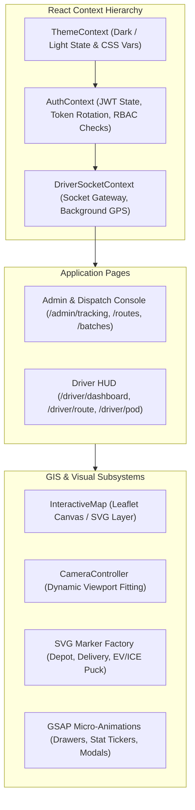
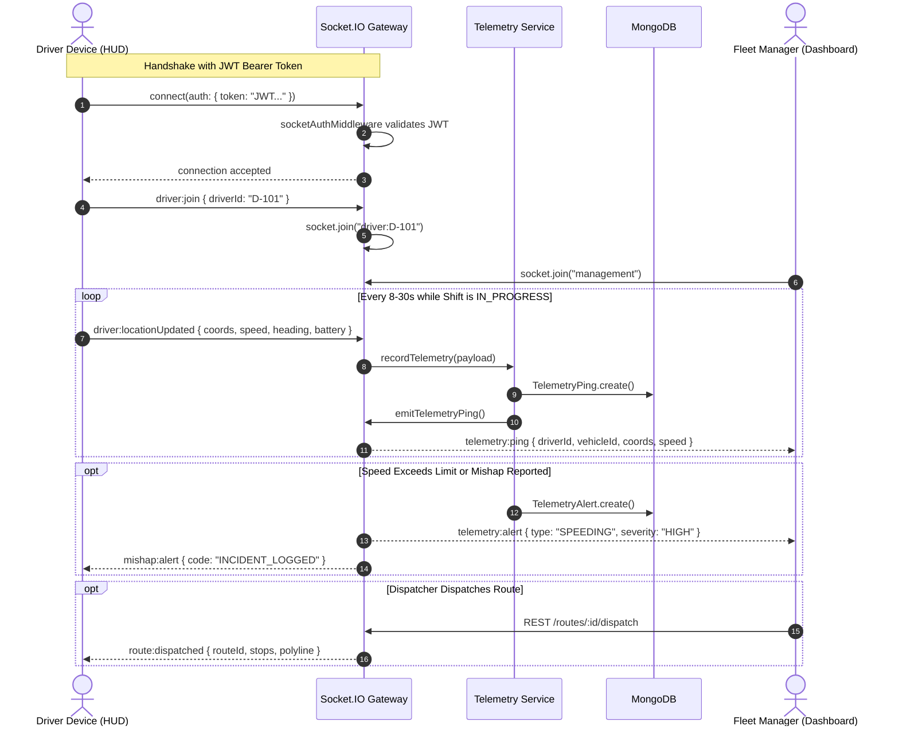
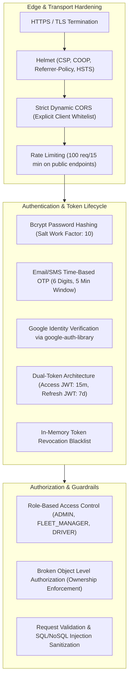
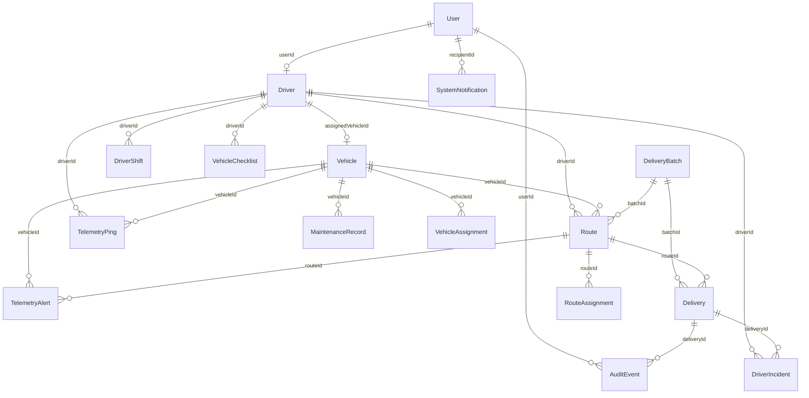
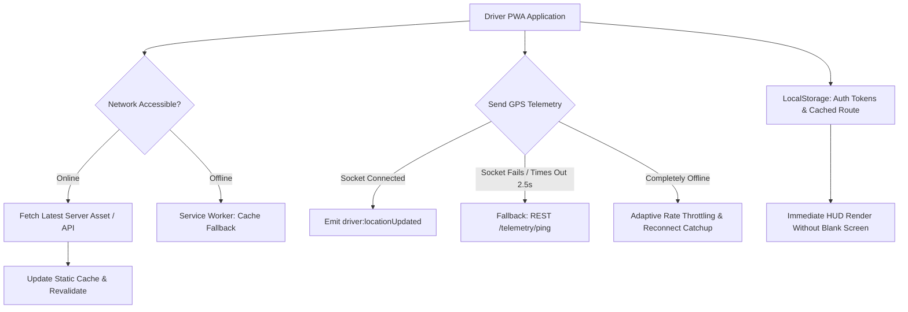

<!-- generated-by: gsd-doc-writer -->
# SmartRoute Platform Architecture

SmartRoute is an enterprise-grade last-mile delivery optimization platform designed for modern urban logistics and mixed electric/internal combustion engine (EV/ICE) fleets. The platform transforms raw logistics consignments into mathematically optimized dispatch routes, tracks operational execution in real time via high-frequency GPS telemetry, and automates driver workflow management through an offline-resilient Progressive Web Application (PWA). SmartRoute is implemented as a cohesive TypeScript and Node.js monorepo featuring a layered Express.js backend, a reactive React 18 frontend, a heuristic Vehicle Routing Problem (VRP) optimization engine, and a hardened bi-directional Socket.IO event grid.

---

## System Overview

SmartRoute ingests bulk delivery manifests (via CSV imports or REST API consignments), driver schedules, and vehicle telematics to generate cost-, energy-, and priority-optimal multi-vehicle dispatch tours. The platform's primary inputs include consignment delivery specifications (payload weight, volume, geographic coordinates, recipient metadata, and service constraints such as Cold Chain or Urgent priority), fleet capacities (EV battery specs, ICE fuel efficiencies, volumetric and payload limits), and real-time GPS coordinates streamed from active mobile devices. Its primary outputs include bounded 2-Opt and Or-Opt optimized delivery stop sequences, turn-by-turn navigation itineraries, instantaneous driver HUD guidance, real-time fleet telematics dashboards, and verified financial and carbon (CO2) savings analytics.

Architecturally, SmartRoute is structured as a decoupled monorepo separating a Node.js/Express REST and WebSocket backend (`server/`) from a React 18 single-page application (`client/`). The system relies on MongoDB and Mongoose for transactional persistence and spatial geospatial indexing, Socket.IO for low-latency bi-directional messaging, and Leaflet GIS mapping for map visualization.

---

## Component Diagram



---

## Monorepo Layout

The repository is structured as a two-tier workspace dividing frontend client applications from backend services:

```
Last Mile Delivery Optimization/
├── client/                      # React 18 Vite frontend workspace
│   ├── public/                  # Static assets, Web App Manifest, Service Worker
│   │   ├── manifest.json        # PWA application metadata
│   │   └── sw.js                # Offline network-first / SWR Service Worker
│   ├── src/
│   │   ├── api/                 # Axios HTTP client, API route modules, response types
│   │   ├── components/          # Reusable UI component modules (admin, driver, maps, common)
│   │   ├── context/             # React Context providers (Auth, Theme, DriverSocket)
│   │   ├── hooks/               # Custom hooks (useOptimization, useRoutePlanner, useRealtimeCatchup)
│   │   ├── pages/               # Application view controllers (Admin, Driver HUD, Fleet, Auth)
│   │   ├── types/               # TypeScript interfaces and shared schema types
│   │   └── utils/               # Formatting, error translation, Google Maps deep-links
│   ├── package.json             # Frontend dependencies & build scripts
│   ├── vite.config.ts           # Vite bundler configuration & local dev proxy
│   └── tailwind.config.js       # Design tokens, typography, dark mode theming
│
├── server/                      # Node.js Express backend workspace
│   ├── src/
│   │   ├── config/              # Environment validation, database connectors, constants
│   │   ├── controllers/         # Express endpoint request handlers
│   │   ├── middleware/          # Security headers, auth, RBAC, error handlers, rate limiting
│   │   ├── models/              # Mongoose schema definitions
│   │   ├── routes/              # Express API versioned route declarations (/api/v1/*)
│   │   ├── scripts/             # Administrative bootstrapping and test fixtures
│   │   ├── seed/                # Geospatial seed data (Bhubaneswar metro area)
│   │   ├── services/            # Business logic, optimization algorithms, real-time sockets
│   │   ├── utils/               # Logger, token helpers, matrix distance math
│   │   ├── app.js               # Express application instantiation & middleware pipeline
│   │   └── index.js             # HTTP/WebSocket server bootstrapping & graceful drain
│   └── package.json             # Backend dependencies, Jest runner configs, engine constraints
│
└── docs/                        # System architecture, API contracts, guides, operational specs
```

---

## Backend Layered Architecture

The backend follows a strict layered architectural pattern that decouples HTTP transport semantics from core optimization and business logic.



### 1. Middleware Pipeline (`server/src/middleware/`)
- **`helmet`**: Enforces strict Content-Security-Policy (CSP) with whitelist configurations for tile providers (`tile.openstreetmap.org`, `basemaps.cartocdn.com`, `maps.geoapify.com`), Google Identity popups, and secure frame ancestors.
- **`cors`**: Dynamic CORS delegation (`server/src/config/cors.js`) verifying origins across production, staging, and preview deployments.
- **`rateLimiter.js`**: Protects public authentication and dispatch endpoints from brute-force and denial-of-service traffic.
- **`auth.js` (`authenticate`, `authorize`)**: Decodes and verifies RS256/HS256 JWT tokens, validates revocation via in-memory blacklist, and executes Role-Based Access Control (RBAC).
- **`socketAuth.js`**: Intercepts WebSocket handshakes, validates bearer tokens, and manages authorized room subscriptions.
- **`errorHandler.js`**: Catches unhandled operational exceptions, normalizes validation errors, logs stack traces in non-production environments, and emits consistent semantic error payloads.

### 2. Route Layer (`server/src/routes/`)
Routes define versioned URL paths (`/api/v1/...`) and bind controller actions behind middleware guards:
- `authRoutes.js`: Authentication, credential login, OTP generation/verification, Google OAuth, and token refresh.
- `batchRoutes.js`: Delivery batch upload, CSV parsing, validation, and batch commitment.
- `deliveryRoutes.js`: CRUD operations on individual delivery consignments.
- `routeRoutes.js`: Dispatch generation, TSP optimization triggers, manual reordering, and re-optimization.
- `driverHudRoutes.js`: Specialized mobile endpoints for active drivers (shift management, pre-trip vehicle checklists, proof of delivery submission).
- `driverRoutes.js` & `vehicleRoutes.js`: Fleet and asset resource provisioning.
- `telemetryRoutes.js`: REST-based GPS ingestion fallback and historical location query endpoints.
- `adminRoutes.js`: System-wide settings, user management, and dev-mode system purging.

### 3. Controller Layer (`server/src/controllers/`)
Controllers extract parameters from `req.body`, `req.params`, and `req.query`, enforce request authorization rules (e.g., verifying Broken Object Level Authorization so drivers cannot mutate foreign routes), delegate business workflows to services, and format standardized JSON HTTP responses.

### 4. Service Layer (`server/src/services/`)
Encapsulates domain logic without awareness of HTTP request/response objects:
- `dispatchEligibilityService.js`: Evaluates driver duty status, vehicle capacity, maintenance status, and vehicle checklist readiness before dispatching.
- `mishapRecoveryService.js`: Handles emergency rerouting when a vehicle breaks down or a driver is incapacitated, reassigning unfulfilled stops to eligible fleet units.
- `savingsAnalyticsService.js`: Compares initial unoptimized routes against 2-Opt optimized tours, computing net kilometers saved, fuel/electricity cost reductions, and CO2 abatement.
- `telemetryService.js`: Ingests GPS pings, computes speed/heading deltas, detects geofence violations, and logs telemetry alerts.
- `socketService.js`: Singleton gateway managing WebSocket broadcasts to specific operational rooms.

---

## Optimization Engine & VRP Algorithms

SmartRoute solves the Capacitated Vehicle Routing Problem with Time Windows and Mixed Fleet Constraints (CVRPTW-MF) using a hybrid two-phase heuristic: greedy cluster-first allocation followed by local search tour improvement.



### 1. Bin-Packing Heuristic (`server/src/services/optimization/binPacker.js`)
Consignments are partitioned among available fleet vehicles using a multi-criteria greedy heuristic:
1. **Priority Ordering**: Deliveries are sorted deterministically by strict priority tiers: `Cold Chain` (0) > `Urgent` (1) > `Standard` (2).
2. **Vehicle Preference Sorting**: Vehicles are sorted according to dispatch strategy (`EV` preferential, `ICE` preferential, or `COST_OPTIMAL`). When electric vehicles are available, they receive packing priority to maximize green fleet utilization.
3. **Weight & Volume Packing**: Deliveries are sequentially assigned to vehicle bins while `totalWeightKg + delivery.weightKg <= vehicle.capacityKg`. Unpackable items are returned in an `unassignedDeliveries` manifest with actionable rejection codes (`EXCEEDS_VEHICLE_CAPACITY`, `NO_AVAILABLE_VEHICLES`).

### 2. Nearest Neighbor Initial Construction (`server/src/services/optimization/nearestNeighbor.js`)
From the designated origin depot, an initial feasible Traveling Salesperson tour is constructed:
- Iteratively searches all unvisited stops to select the node with minimum travel distance from the current node:
  $$\min_{j \in \text{unvisited}} d(i, j)$$
- **Priority-Weighted Tie-Breaking**: When multiple stops possess near-identical distances ($\Delta \le 1\text{m}$), tie-breakers prioritize higher urgency stops (`Cold Chain` > `Urgent` > `Standard`), followed by deterministic stop index ordering to ensure algorithmic idempotency.

### 3. Bounded 2-Opt Local Search (`server/src/services/optimization/twoOpt.js`)
The initial tour is iteratively refined through 2-Opt edge swaps that untangle intersecting paths:
- At each step, two non-adjacent edges $(u_1, v_1)$ and $(u_2, v_2)$ are replaced with $(u_1, u_2)$ and $(v_1, v_2)$, reversing the intermediate stop sequence.
- **Asymmetric Matrix Support**: Evaluates directed travel distances across reversed subsegments to account for one-way urban streets.
- **Bounded Convergence**: Halts when the edge-swap delta is smaller than an epsilon threshold ($\epsilon = 0.001\text{ km}$) or when reaching `maxIterations` (default 1,000 iterations), preventing event-loop starvation during real-time dispatch.
- **Or-Opt Refinement (`orOpt.js`)**: Executes consecutive string relocations (shifting sequences of 1, 2, or 3 stops to alternative positions) to escape 2-Opt local minima without exhaustive computation.

### 4. EV Battery & Energy Modeling (`server/src/services/optimization/fuelModel.js`)
Energy expenditure is modeled per vehicle propulsion architecture:
- **Internal Combustion (ICE)**: Fuel consumption is calculated based on vehicle efficiency ($km/L$):
  $$\text{Fuel}_{\text{liters}} = \frac{\text{Distance}_{\text{km}}}{\text{Efficiency}_{\text{km/L}}}$$
- **Electric Vehicles (EV)**: Energy consumption is derived from battery powertrain metrics ($kWh/km$):
  $$\text{Energy}_{\text{kWh}} = \text{Distance}_{\text{km}} \times \text{Consumption Rate}_{\text{kWh/km}}$$
  The model computes remaining battery state-of-charge (SoC) along each leg of the tour, flagging warnings if a route exceeds maximum battery range without intermediate charging.

### 5. Cost & Carbon Calculators (`server/src/services/optimization/costScorer.js`)
Each route is scored across operational financial cost and environmental impact using organization tariffs:
- **Tariff Inputs**: Electricity cost ($\text{INR } 8.00/\text{kWh}$ default), Diesel ($\text{INR } 95.00/\text{L}$ default), Petrol ($\text{INR } 103.00/\text{L}$ default).
- **Carbon Intensity Factors**: Diesel ($\approx 210\text{ g CO}_2/\text{km}$), Petrol ($\approx 230\text{ g CO}_2/\text{km}$), Electric ($0.0\text{ g CO}_2/\text{km}$ direct tailpipe emissions).
- **Savings Delta**: Compares baseline (unoptimized dispatch order) against 2-Opt optimized metrics to demonstrate exact fuel savings, expense reductions, and grams of carbon avoided.

---

## Frontend Architecture

SmartRoute's frontend is a React 18 single-page application built with Vite and TypeScript, optimized for high responsiveness on both desktop dispatch consoles and driver mobile browsers.



### 1. State Management & Context Architecture
- **`AuthContext` (`client/src/context/AuthContext.tsx`)**: Manages the current authenticated user, access token memory, and role helper booleans (`isAdmin`, `isFleetManager`, `isDriver`). Implements an event-driven session refresh listener (`smartroute:token-refreshed`, `smartroute:session-expired`).
- **`ThemeContext` (`client/src/context/ThemeContext.tsx`)**: Manages light/dark mode preference, synchronizes with `localStorage`, and updates the root `document.documentElement` class list.
- **`DriverSocketContext` (`client/src/context/DriverSocketContext.tsx`)**: The operational hub for drivers. Maintains a single authenticated WebSocket connection, synchronizes unread dispatch notifications, handles automatic room subscriptions (`driver:{id}`, `route:{id}`), and runs the background GPS telemetry loop.

### 2. GIS Mapping & Real-Time Visualization
- **React-Leaflet Engine (`client/src/components/maps/InteractiveMap.tsx`)**: Renders interactive vector maps powered by OpenStreetMap and CartoDB tile layers.
- **Dynamic Camera Auto-Fitting (`CameraController.tsx`)**: Automatically computes the bounding box encompassing active vehicle coordinates, depot origins, and all pending delivery stops, smoothly animating camera transitions as stops are checked off.
- **Custom Marker Factory (`markerIcons.ts`)**: Generates high-DPI SVG pins color-coded by stop status (`PENDING`, `COMPLETED`, `FAILED`), priority badges (`URGENT`, `COLD_CHAIN`), and heading-oriented vehicle icons for real-time fleet markers.
- **External Deep-Linking (`OpenInGoogleMapsButton.tsx`)**: Translates turn-by-turn waypoint coordinates into native Google Maps / Apple Maps navigation intents for native navigation apps.

### 3. GSAP Micro-Interactions
GSAP (`@gsap/react` and `gsap`) drives high-performance UI transitions:
- Animated KPI counters and progress rings during batch optimization.
- Smooth accordion sliding on the driver delivery timeline.
- Micro-interactions on route dispatch and completion toasts.

---

## Real-Time Data Flow & WebSocket Event Grid

Real-time coordination is facilitated through a centralized Socket.IO architecture. Connections are secured at the handshake level, and events are routed using scoped room topologies.



### WebSocket Event Dictionary

| Event Name | Direction | Scope / Rooms | Payload Summary |
|------------|-----------|---------------|-----------------|
| `driver:join` | Inbound | Handshake client | `{ driverId: string }` — Subscribes socket to private driver channel. |
| `driver:leave` | Inbound | Handshake client | `{ driverId: string }` — Unsubscribes from driver channel. |
| `route:join` | Inbound | Handshake client | `{ routeId: string }` — Subscribes to route progress updates. |
| `driver:locationUpdated` | Inbound | Driver $\to$ Server | `{ coordinates: [lng, lat], speedKmh, heading, batteryPercent, accuracyMeters }`. |
| `telemetry:request_ping` | Inbound | Admin $\to$ Driver | `{ driverId, vehicleId }` — Demands immediate GPS transmission. |
| `telemetry:ping` | Outbound | `management`, `route:{id}` | Broadcasts latest verified GPS ping to fleet tracking consoles. |
| `telemetry:alert` | Outbound | `management` | Dispatches critical alerts (speeding, low battery, boundary deviation). |
| `route:dispatched` | Outbound | `management`, `driver:{id}` | Signals that a route has been locked and assigned for active delivery. |
| `route:reordered` | Outbound | `management`, `driver:{id}` | Emitted when stops are reordered dynamically due to re-optimization. |
| `route:cancelled` | Outbound | `management`, `driver:{id}` | Notifies driver that an assigned route has been revoked. |
| `stop:cancelled` | Outbound | `management`, `driver:{id}` | Notifies driver that a specific delivery stop has been retracted. |
| `batch:created` / `batch:updated` | Outbound | `management` | Real-time status indicators during CSV import and optimization. |
| `system:purged` | Outbound | Global broadcast | Emitted during dev database resets to trigger client-side data refetching. |

---

## Security Architecture

SmartRoute enforces a defense-in-depth security model across both the HTTP and WebSocket surfaces:



### 1. Dual-Token JWT Lifecycle & Rotation
- **Access Tokens**: Short-lived (15 minutes), signed with `JWT_SECRET`, containing user identity claims (`sub`, `email`, `role`, `name`, `isDemoData`).
- **Refresh Tokens**: Long-lived (7 days), signed with `JWT_REFRESH_SECRET`, possessing unique `jti` UUIDs stored in the database.
- **Client Auto-Refresh Interceptor (`client/src/api/client.ts`)**: Implements single-flight request coalescing (`refreshPromise`). When concurrent API calls receive a `401 TOKEN_EXPIRED`, a single refresh request is dispatched, preventing token race conditions while transparently replaying stalled requests.
- **Token Blacklisting**: Logout immediately pushes the token to an in-memory blacklist (`tokenBlacklist`), invalidating sessions across all active worker threads.

### 2. Role-Based Access Control (RBAC)
User permissions are strictly enforced through declarative middleware guards:
- **`ADMIN`**: Complete system access, fleet provisioning, organization tariffs, user administration, and system purge utilities.
- **`FLEET_MANAGER`**: Batch upload, route optimization, manual stop reordering, vehicle assignment, and live telemetry monitoring.
- **`DRIVER`**: Access restricted strictly to own driver profile, assigned vehicle checklist, current route itinerary, and proof of delivery submission.

### 3. Object-Level Security (BOLA Defense)
Drivers are authoritatively bound to their verified credentials:
- When a driver emits GPS coordinates or joins a socket room, the server rejects client-supplied driver IDs that do not match the token's authenticated driver document.
- Route modification endpoints verify that a driver can only mutate stops belonging to their currently assigned route.

---

## Data Model Relationships

The persistence layer is modeled using Mongoose schemas in MongoDB, utilizing explicit foreign key object references (`ref`) and compound geospatial indexes:



### Schema Responsibilities

1. **`User`**: Account identity, credentials (`passwordHash` excluded by default), email/phone verification flags, Google ID, and role enum (`ADMIN`, `FLEET_MANAGER`, `DRIVER`).
2. **`Driver`**: Driver operational record linked 1-to-1 with `User`. Tracks commercial license number, license category (`TWO_WHEELER`, `LIGHT_MOTOR_VEHICLE`, `HEAVY_TRANSPORT`), availability status, current route, and assigned vehicle.
3. **`Vehicle`**: Fleet asset specification. Tracks registration plate, vehicle type (`Bike`, `Van`, `Truck`), fuel type (`Petrol`, `Diesel`, `Electric`), payload capacity in kilograms, volumetric capacity, fuel efficiency, battery capacity ($kWh$), and current battery SoC.
4. **`Delivery`**: Consignment entity with order references, pickup/delivery coordinates (`GeoJSON Point`), recipient contact info, delivery time window, payload weight/volume, priority level, and delivery lifecycle status (`DRAFT`, `READY`, `ASSIGNED`, `OUT_FOR_DELIVERY`, `COMPLETED`, `FAILED`).
5. **`DeliveryBatch`**: Grouping container for bulk CSV consignment uploads, tracking processing state, total parcel counts, and optimization progress.
6. **`Route`**: Complete vehicle tour manifest. Contains ordered stop sequences, depot origin coordinates, total distance ($km$), estimated duration (minutes), financial cost ($INR$), carbon emission ($kg CO_2$), and GeoJSON polyline geometry.
7. **`VehicleAssignment` & `RouteAssignment`**: Historical ledger tracking driver-vehicle and driver-route pairing intervals.
8. **`TelemetryPing`**: High-frequency location documents storing `[longitude, latitude]` geospatial coordinates (`2dsphere` indexed), recorded speed, heading, device altitude, accuracy, and device battery level.
9. **`TelemetryAlert`**: Operational exceptions triggered by real-time streams (speed violations, prolonged halts, critical battery drain).
10. **`DriverShift`**: Shift lifecycle record tracking clock-in/out timestamps, starting/ending vehicle odometer readings, and shift status (`SCHEDULED`, `IN_PROGRESS`, `COMPLETED`).
11. **`DriverIncident`**: Field exception logs submitted by drivers (traffic accidents, severe delays, customer unavailable, mechanical breakdowns).
12. **`VehicleChecklist`**: Pre-trip and post-trip vehicle inspection checklist (brakes, tires, mirrors, EV battery level, cargo latch) ensuring regulatory compliance before dispatch.
13. **`MaintenanceRecord`**: Vehicle servicing, repair logs, scheduled inspections, and maintenance expense tracking.
14. **`AuditEvent`**: Immutable security and audit logging tracking status mutations across delivery consignments and administrative configurations.

---

## Resilient Offline & PWA Strategy

To maintain operational continuity in low-connectivity urban canyons or cellular dead zones, SmartRoute employs an offline-first driver strategy:



### 1. Service Worker Caching Policy (`client/public/sw.js`)
- **Navigation Requests (`/`, `/index.html`)**: Employs a **Network-First** strategy. The Service Worker attempts to fetch the newest HTML bundle from the server, guaranteeing that users immediately receive newly deployed code. If the network is unavailable, it gracefully serves the cached `/index.html`.
- **Static Assets (`manifest.json`, `favicon.svg`, icons)**: Employs a **Stale-While-Revalidate** strategy, serving cached assets instantaneously while fetching and caching updates in the background.
- **API & WebSocket Isolation**: All `/api/*` and `/socket.io/*` paths explicitly bypass the Service Worker cache, ensuring no synthetic responses or stale authorization headers compromise transactional calls.

### 2. Dual-Transport Telemetry Ingestion
In `DriverSocketContext.tsx`, driver GPS transmission utilizes an adaptive dual-transport mechanism:
1. **Low-Latency WebSocket Transport**: Attempts to emit `driver:locationUpdated` over the active Socket.IO connection with a 2,500ms acknowledgement timeout.
2. **REST Failover**: If the socket connection drops or the acknowledgement times out, the payload is immediately dispatched via standard HTTP `POST /api/v1/driver/hud/location`.
3. **Adaptive Ping Frequency**: When moving at speeds $> 3\text{ km/h}$, telemetry is broadcast every 8 seconds; when stationary, transmission throttles to every 30 seconds to conserve mobile battery power.
4. **Session Resilience**: Active route data and user credentials persist in `localStorage`. If a driver restarts their phone or browser, the Driver HUD renders the route and delivery stop checklist instantly from storage without awaiting server response.

---

## Key Abstractions

| Abstraction | File Location | Role & Responsibility |
|-------------|---------------|----------------------|
| `createApp` | `server/src/app.js` | Express factory configuring security headers, CORS, body parsers, health probes, and route mounts. |
| `startServer` / `gracefulShutdown` | `server/src/index.js` | Server lifecycle manager coordinating HTTP/Socket shutdown, connection draining, and clean DB disconnect. |
| `packDeliveries` | `server/src/services/optimization/binPacker.js` | Heuristic bin packer enforcing priority and weight limits across mixed fleets. |
| `constructNearestNeighborRoute` | `server/src/services/optimization/nearestNeighbor.js` | Multi-criteria nearest-neighbor algorithm generating initial valid TSP tours. |
| `optimize2Opt` | `server/src/services/optimization/twoOpt.js` | Bounded local search algorithm executing directed edge swaps with convergence guards. |
| `scoreRouteCost` | `server/src/services/optimization/costScorer.js` | Multi-tariff financial and environmental calculator for ICE and EV vehicles. |
| `setIo` / `getIo` | `server/src/services/socketService.js` | Singleton manager exposing broadcast primitives across backend service domains. |
| `socketAuthMiddleware` | `server/src/middleware/socketAuth.js` | WebSocket handshake interceptor validating JWTs and guarding room access. |
| `apiClient` | `client/src/api/client.ts` | Axios instance configured with Bearer token injection and single-flight refresh rotation. |
| `DriverSocketProvider` | `client/src/context/DriverSocketContext.tsx` | React provider orchestrating real-time socket subscriptions and driver GPS polling. |
| `InteractiveMap` | `client/src/components/maps/InteractiveMap.tsx` | Leaflet GIS map renderer with dynamic camera auto-bounds and SVG vehicle/stop markers. |

---

## Directory Structure Rationale

```
Last Mile Delivery Optimization/
├── client/                     # Isolated frontend workspace enabling standalone client builds & preview
│   ├── public/                 # Static web assets and Service Worker scripts required for PWA installation
│   ├── src/
│   │   ├── api/                # Encapsulates HTTP client instances and strongly-typed API call methods
│   │   ├── assets/             # Bundled SVG sprites and application images
│   │   ├── components/         # Modular UI components partitioned by feature domain (admin, driver, maps)
│   │   ├── context/            # React global context providers isolating auth, theming, and real-time state
│   │   ├── hooks/              # Custom reusable React hooks abstracting business calculations and listeners
│   │   ├── pages/              # Routed page-level view components mapping directly to application URLs
│   │   ├── test/               # Frontend testing setup and Vitest environment mocks
│   │   ├── types/              # Domain TypeScript interfaces mirroring backend contracts
│   │   └── utils/              # Utility helpers for error formatting, unit conversion, and deep navigation
│   └── tests/                  # Playwright end-to-end integration test suites
│
├── server/                     # Backend API server, optimization engine, and persistence workspace
│   ├── src/
│   │   ├── config/             # Environment validation, database configuration, and system constants
│   │   ├── controllers/        # Request decoders and HTTP response formatters
│   │   ├── middleware/         # Express and Socket.IO guards (auth, rate limiting, error handling)
│   │   ├── models/             # Mongoose schemas with indexes, hooks, and relational references
│   │   ├── routes/             # Versioned REST API endpoint definitions
│   │   ├── scripts/            # Database bootstrapping, admin creation, and test user seeding
│   │   ├── seed/               # Realistic geographic seed data and mock consignments
│   │   ├── services/           # Core domain logic, optimization heuristics, and socket managers
│   │   └── utils/              # Mathematical utilities (Haversine distance matrix) and token helpers
│   └── tests/                  # Jest integration and unit test suites covering optimization and APIs
│
└── docs/                       # Comprehensive platform architecture, security guidelines, and user manuals
```
