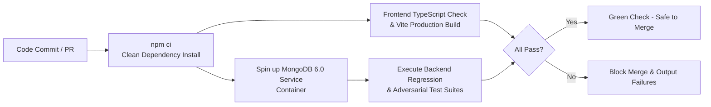

# SmartRoute – CI/CD Pipeline & Quality Gates Guide

---

## 1. Automated Workflow Topology

SmartRoute enforces automated quality gates on every Pull Request and branch push via GitHub Actions (`.github/workflows/ci.yml`):

---

## 2. Quality Pipeline Stages

1. **Step 1: Clean Dependency Installation (`npm ci`)**:
   - Ensures exact versions specified in `package-lock.json` are installed without drifting.
2. **Step 2: Frontend Type Check & Compilation**:
   - Executes `tsc --noEmit` and `vite build`.
   - Fails if any TypeScript typing mismatch or broken import exists.
3. **Step 3: Service Containerization**:
   - Launches an isolated `mongo:6.0` service container with internal health checks (`mongosh`).
4. **Step 4: Regression & Adversarial Testing**:
   - Executes `npm --prefix server test` covering all 151 unit, integration, and security tests.
   - Verifies RBAC, CSV batch parsing, BFD bin packing, 2-Opt local search, and driver POD submissions.
