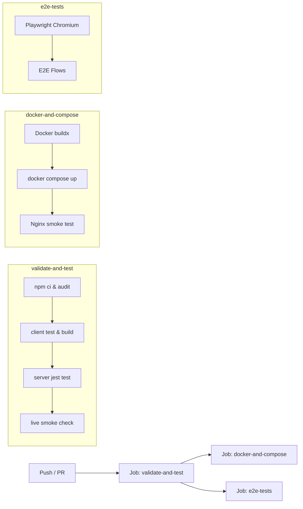

<!-- generated-by: gsd-doc-writer -->
# SmartRoute — Production Deployment Guide

This guide details the deployment architectures, orchestration runbooks, environment hardening, continuous integration pipelines, monitoring configurations, and disaster recovery procedures for the SmartRoute platform.

---

## Deployment Targets

The SmartRoute repository includes pre-configured orchestration and deployment descriptors for both containerized on-premises/cloud VM hosting and decoupled cloud platforms:

| Target Platform | Deployment Model | Configuration Files | Primary Artifacts |
|---|---|---|---|
| **Docker Compose / Docker Engine** | Single-Origin Containerized (Recommended) | `Dockerfile`<br>`docker-compose.yml`<br>`deploy/nginx/default.conf` | Multi-stage image (`smartroute:latest`), Nginx 1.27 reverse proxy, MongoDB 6.0 |
| **Render Cloud Application Platform** | Single-Origin Managed PaaS | `render.yaml` | Node.js web service running Express API & built SPA client |
| **Vercel Edge Network** | Split-Origin Frontend CDN | `vercel.json` | Vite + React Single Page Application (SPA) distribution |
| **Cloud Managed Database** | Dedicated / Serverless DB Cluster | `docker-compose.yml`<br>`server/src/config/db.js` | MongoDB Atlas (M10+ replica set recommended) or self-hosted MongoDB 6.0 |

---

## Deployment Topologies & Runbooks

### Topology A: Single-Origin Containerized Deployment (Recommended)

In Topology A, all platform services (Nginx reverse proxy, Node.js backend application, and MongoDB data store) operate within an isolated Docker network. The Node.js application serves both the REST API (`/api/v1`), real-time WebSocket channels (`/socket.io/`), and static frontend SPA assets (`client/dist`) via `SERVE_CLIENT=true`.

```
                Internet / HTTPS (Port 443/80)
                             │
                             ▼
              ┌───────────────────────────────┐
              │     Nginx Reverse Proxy       │
              │   (deploy/nginx/default.conf) │
              └──────────────┬────────────────┘
                             │
             ┌───────────────┴───────────────┐
             │ HTTP / WebSocket (Keepalive)  │
             ▼                               ▼
  ┌──────────────────────┐       ┌──────────────────────┐
  │   Static Assets      │       │ Express + Socket.IO  │
  │  /assets/ (1y cache) │       │   Node.js (app:5004) │
  └──────────────────────┘       └──────────┬───────────┘
                                            │
                                            ▼ Mongoose ODM
                                 ┌──────────────────────┐
                                 │   MongoDB 6.0 Engine │
                                 │   (mongo:27017)      │
                                 │ Volume: mongo_data   │
                                 └──────────────────────┘
```

#### Key Architecture Components

1. **Reverse Proxy (`deploy/nginx/default.conf`)**:
   - Upstream connection pooling with `keepalive 32` to backend `app:5004`.
   - WebSocket protocol upgrade headers (`$http_upgrade`, `$connection_upgrade`).
   - Extended timeouts (`proxy_read_timeout 86400s; proxy_send_timeout 86400s;`) to keep driver and dispatcher WebSocket connections alive.
   - Gzip compression for text, CSS, JSON, JavaScript, and SVG payloads.
   - Long-lived caching headers (`Cache-Control: public, max-age=31536000, immutable`) for content-hashed files under `/assets/`.
   - Max client upload limit of 12MB (`client_max_body_size 12m;`) to accommodate batch consignment CSV imports and driver proof-of-delivery uploads.
2. **Application Runtime Container (`Dockerfile`)**:
   - Multi-stage build separating frontend compilation (`client-builder` using `node:20-bookworm-slim`) from production execution (`runtime`).
   - Drops all root privileges and executes as the unprivileged user `USER node`.
   - Built-in container health check querying `http://127.0.0.1:5004/readyz`.
3. **Data Persistence (`docker-compose.yml`)**:
   - Persistent volume `mongo_data` mounted to `/data/db`.
   - Automated health probes querying `mongosh --eval 'db.adminCommand("ping").ok'`.
   - Pinned service instance count (`deploy.replicas: 1`) to preserve in-memory Socket.IO room subscriptions.

#### Step-by-Step Deployment Runbook

1. **Clone Repository and Prepare Environment**:
   ```bash
   git clone https://github.com/your-org/smartroute.git /opt/smartroute
   cd /opt/smartroute
   cp .env.example .env
   ```

2. **Generate Cryptographically Secure Secrets**:
   Generate production secrets and insert them into `.env`:
   ```bash
   JWT_SECRET=$(openssl rand -hex 32)
   JWT_REFRESH_SECRET=$(openssl rand -hex 32)
   sed -i "s|^JWT_SECRET=.*|JWT_SECRET=${JWT_SECRET}|" .env
   sed -i "s|^JWT_REFRESH_SECRET=.*|JWT_REFRESH_SECRET=${JWT_REFRESH_SECRET}|" .env
   ```

3. **Configure Core Environment Values**:
   Edit `.env` to configure production flags:
   ```ini
   NODE_ENV=production
   PORT=5004
   SERVE_CLIENT=true
   TRUST_PROXY=1
   FORCE_HTTPS_CSP=true
   HTTP_PORT=80
   MONGODB_URI=mongodb://mongo:27017/smartroute
   GEOAPIFY_SERVER_API_KEY=your_production_geoapify_key
   VITE_GEOAPIFY_TILE_API_KEY=your_production_tile_key
   ```

4. **Launch the Container Stack**:
   ```bash
   docker compose up -d --build
   ```

5. **Verify Service Health**:
   ```bash
   docker compose ps
   docker compose logs -f app
   ```

6. **Bootstrap the Initial Administrator Account**:
   Run the administrative provisioning script inside the application container:
   ```bash
   docker compose exec -e ADMIN_EMAIL="admin@yourdomain.com" \
     -e ADMIN_PASSWORD="SecureAdminPassword123!" \
     -e ADMIN_NAME="Operations Admin" \
     app node server/src/scripts/bootstrapAdmin.js
   ```

---

### Topology B: Split-Origin Cloud Deployment

In Topology B, the frontend and backend are hosted on separate cloud infrastructures:
* **Frontend SPA**: Hosted on Vercel Edge Network (`vercel.json`).
* **Backend API & WebSockets**: Hosted on Render (`render.yaml`) or a managed cloud VM / container orchestrator (AWS ECS, Google Cloud Run).

```
                      Client Browser (Driver / Dispatcher)
                       │                              │
        HTTPS (UI SPA) │                              │ API & Socket.IO
                       ▼                              ▼
             ┌───────────────────┐          ┌───────────────────┐
             │   Vercel Edge     │          │   Render Web Svc  │
             │   (vercel.json)   │          │   (render.yaml)   │
             │                   │          │                   │
             │  client/dist SPA  │          │  Express 5004     │
             └───────────────────┘          └─────────┬─────────┘
                                                      │
                                                      ▼
                                            ┌───────────────────┐
                                            │   MongoDB Atlas   │
                                            │   Cluster (Replica│
                                            │   Set)            │
                                            └───────────────────┘
```

#### Split-Origin Configuration Requirements

1. **Frontend Configuration (Vercel)**:
   - Root configuration file: `vercel.json`.
   - Build command: `npm --prefix client run build`.
   - Output directory: `client/dist`.
   - Rewrites rule: Directs all navigation paths (excluding static assets and API prefixes) to `/index.html`.
   - Environment variables set in Vercel project settings:
     ```ini
     VITE_API_URL=https://api.yourdomain.com/api/v1
     VITE_SOCKET_URL=https://api.yourdomain.com
     VITE_MAP_PROVIDER=geoapify
     VITE_GEOAPIFY_TILE_API_KEY=your_geoapify_key
     ```

2. **Backend Configuration (Render / PaaS)**:
   - Root configuration file: `render.yaml`.
   - Set instance scaling: `numInstances: 1` (`replicas: 1`).
     > [!IMPORTANT]
     > The real-time driver telemetry and delivery dispatch engine maintains in-memory Socket.IO connection rooms (`server/src/socket.js`). Scaling across multiple container instances without a Redis adapter (`@socket.io/redis-adapter`) will cause room broadcast disconnects. Always pin replicas to `1` unless a cluster adapter is configured.
   - Configure environment variables:
     ```ini
     NODE_ENV=production
     SERVE_CLIENT=false
     TRUST_PROXY=1
     CLIENT_ORIGIN=https://smartroute.yourdomain.com
     MONGODB_URI=mongodb+srv://app_user:<password>@cluster.mongodb.net/smartroute?retryWrites=true&w=majority
     ```

3. **CORS & Credential Handling**:
   - SmartRoute uses HTTP cookies for authentication tokens (`token`, `refreshToken`).
   - The frontend Axios instance is configured with `withCredentials: true` (`credentials: 'include'`).
   - The backend `server/src/config/cors.js` delegates origins strictly against the comma-separated `CLIENT_ORIGIN` list. Wildcard `*` origins are rejected in production.

---

### MongoDB Atlas Setup & Database Hardening

When deploying to production, using MongoDB Atlas or an authenticated replica set is mandatory.

<!-- VERIFY: MongoDB Atlas cluster tier, AWS/GCP hosting region, and project network peering VPC IDs -->

1. **Cluster Provisioning**:
   - Provision a MongoDB Atlas cluster (M10+ recommended for dedicated RAM and high IOPS).
   - Ensure the database deployment is configured as a 3-node Replica Set.
2. **Access Security & Network Restrictions**:
   - In Atlas **Network Access**, avoid `0.0.0.0/0`. Whitelist only the static outbound IP addresses of the application containers (e.g., Render outbound IPs, AWS NAT Gateway, or VPC Peering CIDR).
3. **Database User Authorization**:
   - In Atlas **Database Access**, create a dedicated application user (e.g., `smartroute_app`).
   - Grant role `readWrite` specifically on the `smartroute` production database. Do not grant `atlasAdmin` or cluster-wide permissions.
4. **Connection String Syntax**:
   - Format:
     ```
     MONGODB_URI=mongodb+srv://smartroute_app:<ENCODED_PASSWORD>@cluster0.abcde.mongodb.net/smartroute?retryWrites=true&w=majority
     ```
   - If the password contains special characters (`@`, `:`, `/`, `%`), percent-encode them before configuring `MONGODB_URI`.

---

## Build Pipeline & CI/CD

Continuous integration and automated verification are enforced through GitHub Actions in `.github/workflows/ci.yml`.

### Workflow Stages

The CI/CD pipeline triggers on every push to `main`, `master`, `develop`, `feature/**`, and pull requests targeting default branches:



1. **Job: `validate-and-test`**:
   - **Environment**: Ubuntu Latest, Node.js 22.x, MongoDB 6.0 container service.
   - **Dependencies**: `npm ci` with clean lockfile validation.
   - **Supply Chain Security**: `npm audit --audit-level=high`.
   - **Frontend Verification**: TypeScript type checking (`npm --prefix client test`), unit tests (`npm --prefix client run test:unit`), and production bundle compilation (`npm --prefix client run build`).
   - **Backend Regression Suite**: Jest integration suite running with `--runInBand` and ephemeral credentials.
   - **Production Simulation**: Boots server with `NODE_ENV=production` and `SERVE_CLIENT=true`, provisions admin, and verifies via `scripts/smoke-test.js`.
2. **Job: `docker-and-compose`**:
   - Validates compose schema and Nginx configuration syntax (`nginx -t`).
   - Builds multi-stage production image with Docker Buildx.
   - Spins up full stack (`docker compose up -d --build --wait`).
   - Executes live smoke suite through Nginx reverse proxy on port 18080.
3. **Job: `e2e-tests`**:
   - Boots full stack and runs Playwright automated browser tests against Chromium.
   - Generates and uploads test trace artifacts on failure.

---

## Environment Setup & Secret Management

Production environments must provide verified secrets. In `NODE_ENV=production`, `server/src/config/env.js` executes strict startup validation and will intentionally abort process boot if required variables are missing or insecure.

Refer to [CONFIGURATION.md](file:///c:/Users/Yash/Documents/ChatGPT/Last%20Mile%20Delivery%20Optimization/docs/CONFIGURATION.md) for the complete variable catalog.

### Critical Production Variables

| Variable | Requirement | Rule / Enforcement |
|---|---|---|
| `NODE_ENV` | **Required** | Must be set to `production`. Activates production validation and security middleware. |
| `MONGODB_URI` | **Required** | Must start with `mongodb://` or `mongodb+srv://`. Local unauthenticated defaults are rejected. |
| `JWT_SECRET` | **Required** | Minimum 32 characters. Cannot match any committed default or example value. |
| `JWT_REFRESH_SECRET` | **Required** | Minimum 32 characters. Must be cryptographically distinct from `JWT_SECRET`. |
| `SERVE_CLIENT` | **Required** | `"true"` for Single-Origin container/Render; `"false"` for split-origin cloud hosting. |
| `CLIENT_ORIGIN` | **Required if `SERVE_CLIENT=false`** | Comma-delimited list of allowed origin URLs (e.g. `https://smartroute.yourdomain.com`). |
| `TRUST_PROXY` | **Required** | Must be set to an integer hop count (e.g. `1` behind Nginx/Render). Setting `true` is disallowed. |
| `FORCE_HTTPS_CSP` | Optional | Set to `"true"` to instruct browsers to upgrade insecure requests. |

<!-- VERIFY: Secret store provider (AWS Secrets Manager, Doppler, Vault, or GitHub Repository Secrets) -->

### Secret Generation Commands

Generate production secrets securely using OpenSSL:

```bash
# Generate 64-character hex secret for JWT_SECRET
openssl rand -hex 32

# Generate distinct 64-character hex secret for JWT_REFRESH_SECRET
openssl rand -hex 32

# Generate cookie session secret (if external cookie signing is enabled)
openssl rand -hex 32
```

---

## Production Launch Checklist

Complete this checklist prior to routing live delivery traffic:

- [ ] **1. Secrets Injected**: Confirm `JWT_SECRET` and `JWT_REFRESH_SECRET` are generated, >=32 characters, and distinct.
- [ ] **2. Fail-Fast Check Verified**: Start backend with `node server/src/index.js` and verify no `Fatal production configuration error` appears.
- [ ] **3. Reverse Proxy Hardening**:
  - [ ] Nginx `client_max_body_size` is set to at least `12m`.
  - [ ] WebSocket timeouts are configured to `86400s`.
  - [ ] Host and Proto headers (`X-Forwarded-For`, `X-Forwarded-Proto`, `Host`) are forwarded.
- [ ] **4. MongoDB Replica Set Ready**:
  - [ ] Production database uses authenticated connection with `readWrite` user.
  - [ ] IP access list is locked down to container hosts.
  - [ ] Automatic daily backups or continuous snapshots are enabled.
- [ ] **5. Admin Account Provisioned**:
  - [ ] Initial admin user created via `npm --prefix server run seed:admin` using a strong password (>=10 characters).
  - [ ] Weak default passwords (`admin123`, `changeme`, etc.) are rejected by the validator.
- [ ] **6. Demo Data Guard Checked**:
  - [ ] Confirm no demo fixtures exist in production. The test dataset is marked with `isDemoData: true`.
  - [ ] If demo data was accidentally populated during testing, purge it cleanly:
    ```bash
    node server/src/seed/seedBhubaneswar.js --delete
    ```
- [ ] **7. Smoke Test Verification**: Execute `scripts/smoke-test.js` against the live domain.

---

## Health Checks, Monitoring & Smoke Testing

### Container & Orchestrator Probes

SmartRoute provides dedicated HTTP endpoints for container orchestration, Kubernetes probes, and load balancers. These endpoints are defined in `server/src/app.js` before CORS and rate-limiting middleware to prevent false alerts:

#### 1. Liveness Probe: `GET /healthz`
* **Purpose**: Indicates whether the process is alive and responsive.
* **Response Codes**:
  - `200 OK`: Server process is healthy.
  - `503 Service Unavailable`: Server is in graceful shutdown draining mode (`isDraining = true`).
* **Payload**:
  ```json
  {
    "success": true,
    "status": "OK",
    "timestamp": "2026-11-23T01:54:32.000Z"
  }
  ```

#### 2. Readiness Probe: `GET /readyz`
* **Purpose**: Indicates whether the backend is ready to accept user and WebSocket traffic.
* **Logic**: Evaluates that the server is not draining AND `mongoose.connection.readyState === 1`.
* **Response Codes**:
  - `200 OK`: Ready to receive traffic.
  - `503 Service Unavailable`: Database is disconnected or server is shutting down.
* **Payload**:
  ```json
  {
    "success": true,
    "status": "READY",
    "database": "CONNECTED",
    "timestamp": "2026-11-23T01:54:32.000Z"
  }
  ```

#### 3. Diagnostic Health Check: `GET /api/v1/health/ready`
* **Purpose**: Detailed subsystem status for ops teams and synthetic monitoring.
* **Payload**: Includes uptime seconds, database status, and subsystem health indicators.

### Automated Smoke Testing

The repository provides an automated post-deployment validation script at `scripts/smoke-test.js`. It validates endpoint availability, database readiness, CORS preflight headers, and static SPA serving:

```bash
# Validate Single-Origin deployment (Docker / Render)
node scripts/smoke-test.js --api-url http://127.0.0.1:5004 --expect-spa --retries 15 --delay-ms 1000

# Validate Split-Origin deployment (Backend on Render, Frontend on Vercel)
node scripts/smoke-test.js \
  --api-url https://api.smartroute.com \
  --client-url https://smartroute.vercel.app \
  --origin https://smartroute.vercel.app \
  --retries 20 \
  --delay-ms 1500

# Full validation including authenticated API smoke check
node scripts/smoke-test.js \
  --api-url https://api.smartroute.com \
  --email admin@yourdomain.com \
  --password "SecureAdminPassword123!"
```

### Application Logging & APM

* **HTTP Logging**: Active in non-test environments using `morgan('dev')`. Output is directed to standard stdout/stderr for container log aggregators (e.g. Datadog Agent, AWS CloudWatch, LogDNA).
* **Application Performance Monitoring (APM)**: No external third-party APM SDK (Sentry, New Relic, OpenTelemetry) is bundled by default in `package.json`. Standard container stdout/stderr log monitoring and orchestrator probe polling (`/readyz`) provide the primary observability layer.

<!-- VERIFY: Centralized logging aggregator (CloudWatch, Grafana Loki, Datadog) and ops notification webhook URLs -->

---

## Backup & Disaster Recovery

### MongoDB Database Backup Routines

Establish scheduled cron backups using `mongodump` on the database host or automated Atlas snapshot policies:

#### 1. Backup Creation (`mongodump`)
```bash
BACKUP_DATE=$(date +%Y%m%d_%H%M%S)
BACKUP_DIR="/var/backups/smartroute/${BACKUP_DATE}"
mkdir -p "${BACKUP_DIR}"

# Archive and compress database dump
mongodump --uri="${MONGODB_URI}" \
  --archive="${BACKUP_DIR}/smartroute_backup.gz" \
  --gzip

# Retain local backups for 14 days
find /var/backups/smartroute -maxdepth 1 -type d -mtime +14 -exec rm -rf {} +
```

#### 2. Restoration Routine (`mongorestore`)
```bash
# Restore directly from compressed archive to target cluster
mongorestore --uri="${TARGET_MONGODB_URI}" \
  --archive="/var/backups/smartroute/20261123_000000/smartroute_backup.gz" \
  --gzip \
  --drop
```

### Zero-Downtime Rolling Update & WebSocket Considerations

1. **Graceful Shutdown Lifecycle**:
   - When the host receives `SIGTERM` or `SIGINT`, `server/src/index.js` sets `app.set('isDraining', true)`.
   - `/healthz` and `/readyz` immediately return `503 Service Unavailable`, prompting Nginx or the cloud load balancer to stop routing new requests to the instance.
   - The server triggers `io.close()` to stop accepting new Socket.IO connections.
   - Existing idle HTTP connections are closed with `server.closeIdleConnections()`.
   - Remaining in-flight HTTP requests have up to 15 seconds (`stop_grace_period: 15s`) to finish.
   - Database connections disconnect cleanly via `disconnectDB()`, and the process exits with status `0`.
2. **Stateful WebSocket Affinities**:
   - Because live driver GPS coordinates and batch notifications are delivered through persistent WebSocket connections, client connections will briefly reconnect during a rolling update.
   - The frontend Socket.IO client has auto-reconnect enabled by default. Reconnected clients will automatically rejoin user and role rooms upon re-authenticating with their existing JWT.

---

## Rollback Procedures

If an issue is detected during or immediately after deployment, follow the respective rollback procedure:

### Docker Compose Stack Rollback

1. **Revert Git Release Tag / Revision**:
   ```bash
   git checkout <PREVIOUS_STABLE_COMMIT_OR_TAG>
   ```
2. **Rebuild and Restart**:
   ```bash
   docker compose up -d --build
   ```
3. **Verify Restoration**:
   ```bash
   node scripts/smoke-test.js --api-url http://127.0.0.1:80 --expect-spa
   ```

### Render Rollback

1. In the Render Dashboard, navigate to the `smartroute` web service.
2. Under the **Deploys** tab, select the previous successful deployment.
3. Click **Rollback to this deploy**. Render redeploys the previous image and verifies `/readyz` before cutting traffic.

<!-- VERIFY: Render Dashboard service URL: https://dashboard.render.com -->

### Vercel Rollback

1. In the Vercel Project Dashboard, navigate to **Deployments**.
2. Locate the previous production deployment.
3. Select **Instant Rollback** to immediately redirect Edge CDN traffic to the prior build artifact.

<!-- VERIFY: Vercel Project Dashboard URL: https://vercel.com -->
