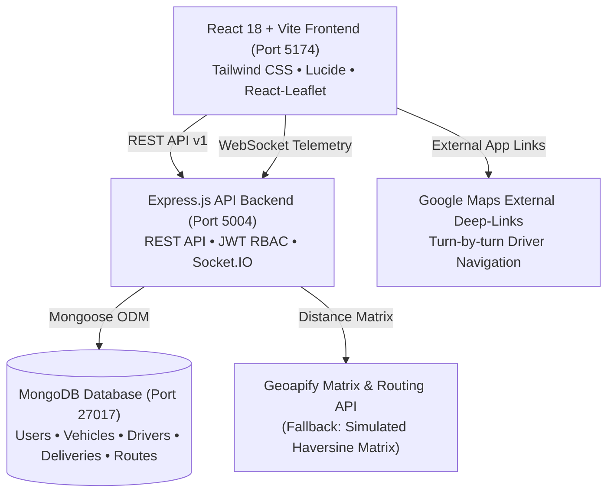

# SmartRoute – Project Overview & System Architecture

## 1. What is SmartRoute?
**SmartRoute** is an enterprise-grade, last-mile delivery route optimization, fleet scheduling, and driver execution platform specifically tailored for dense urban distribution clusters (with a canonical baseline implementation for Bhubaneswar, Odisha).

The system solves the fundamental challenges of last-mile logistics:
* **Payload Overload & Capacity Violations**: Automatically allocates parcels according to vehicle weight (kg) and volume ($m^3$) constraints.
* **Propulsion & Fuel Efficiency**: Prioritizes Electric Vehicles (EVs) over Internal Combustion Engine (ICE) vehicles, calculating exact fuel savings in Indian Rupees (₹) and tailpipe $\text{CO}_2$ reductions.
* **Complex Stop Sequencing**: Replaces unorganized deliveries with a Nearest-Neighbor Euclidean/Haversine heuristic refined by bounded 2-Opt local search heuristics.
* **Tamper-Resistant Proof of Delivery (POD)**: Combines OTP handoff, HTML5 signature canvas, photo capture, and tamper-resistant GPS timestamp validation.
* **Multi-Theme Support**: Native Dark, Light, and System-Default themes with persistent state and high-contrast Google Stitch styling.

---

## 2. Target User Personas & Roles

SmartRoute enforces strict Role-Based Access Control (RBAC) across three operational personas:

| Role | Primary Responsibilities | Interface & Tools |
|---|---|---|
| **Chief Operations Admin** (`ADMIN`) | System-wide governance, operator onboarding, global fleet oversight, audit logs, and security compliance. | Admin Web Cockpit (`/admin/*`) |
| **Fleet Manager / Dispatcher** (`FLEET_MANAGER`) | Batch creation, CSV manifests, vehicle/driver mutual pairings, route optimization runs, dispatch approval, live tracking. | Dispatcher Web Cockpit (`/admin/*`) |
| **Delivery Driver** (`DRIVER`) | Shift onboarding, turn-by-turn navigation via Google Maps, stop sequence execution, POD recording, delivery exception logging. | Driver Handheld Mobile App (`/driver`) |

---

## 3. High-Level Architecture & Component Topology

SmartRoute is structured as an integrated monorepo comprising:

---

## 4. Operational Modules

1. **Deliveries Manifest (`/admin/deliveries`)**:
   - Order management, customer contacts, address geocodes, package weight, priority tiers (Cold Chain, Urgent, Standard), and delivery time windows.
   - Bulk CSV import with dry-run schema validation and atomic commit.

2. **Operational Batches (`/admin/batches`)**:
   - Grouping of consignments by delivery date, operational cluster, depot, and vehicle assignments.

3. **Fleet & Driver Registry (`/admin/fleets` & `/admin/drivers`)**:
   - Vehicle registration with fuel types (Electric, Diesel, Petrol), payload limits, and fuel efficiencies.
   - Commercial driver onboarding, license verification, and 1:1 mutual exclusivity vehicle pairings.
   - Bulk CSV import for vehicles, fleets, and drivers.

4. **Route Optimizer (`/admin/optimizer`)**:
   - Visual multi-vehicle route planner powered by 2-Opt TSP search.
   - Interactive Leaflet map canvas rendering sequenced stops and road polylines.
   - Fuel cost (₹) and tailpipe $\text{CO}_2$ savings deltas.
   - One-click dispatch and mobile push to driver handhelds.

5. **Live Telemetry & Tracking (`/admin/tracking`)**:
   - Real-time fleet HUD tracking active vehicles, transit progress, and cluster density.

6. **Operations Analytics (`/admin/analytics`)**:
   - Executive KPIs, delivery completion rates, vehicle utilization percentages, and CSV export.

7. **Driver Handheld Mobile App (`/driver`)**:
   - Mobile-first interface with target stops, Google Maps turn-by-turn deep links, OTP confirmation, signature pad, and exception reporting.
