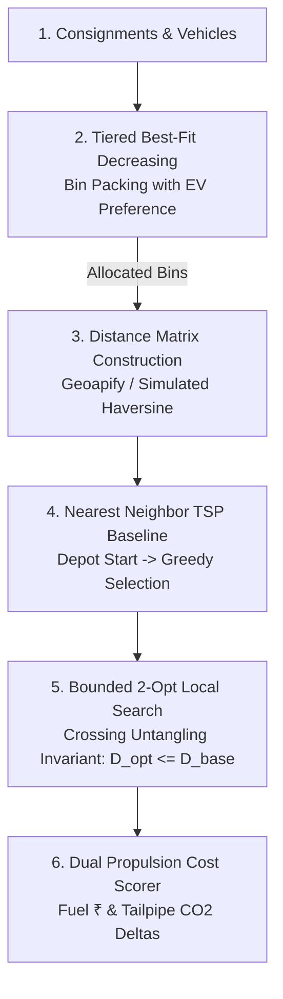

# SmartRoute – Route Optimization & Algorithmic Guide

This document provides a technical and operational explanation of SmartRoute's multi-vehicle Traveling Salesperson Problem (TSP) optimization engine.

---

## 1. Algorithmic Pipeline Overview

The SmartRoute optimization engine operates in four deterministic stages:

---

## 2. Stage 1: Tiered Best-Fit Decreasing (BFD) Bin Packing

Before route sequencing begins, consignments are partitioned across available fleet vehicles using vehicle payload capacity:

1. **EV Preference Tiering**:
   - If `vehiclePreference === 'EV'`, electric vehicles form Tier 1, while ICE combustion vehicles form Tier 2.
   - Consignments are packed into Tier 1 first; Tier 2 is utilized only when EV capacity is exhausted.
2. **Priority Ordering**:
   - Consignments are sorted by priority (`Cold Chain` $\to$ `Urgent` $\to$ `Standard`), then by weight descending.
   - High-priority items are guaranteed placement in vehicles with appropriate capabilities.
3. **Capacity Constraints**:
   - $\sum \text{weightKg} \le \text{Vehicle.capacityKg}$.
   - Oversized packages exceeding the maximum fleet vehicle capacity are cleanly segregated into `unassignedDeliveries` with reason `EXCEEDS_VEHICLE_MAX_CAPACITY`.
   - Overflow packages when all vehicles are full are placed in `unassignedDeliveries` with reason `CAPACITY_OVERFLOW`.

---

## 3. Stage 2: Distance Matrix Construction

A symmetric $(N+1) \times (N+1)$ road distance and travel duration matrix is constructed:
* **Index 0**: Starting and returning Depot (e.g., Rasulgarh Logistics Hub: `20.2961°N, 85.8645°E`).
* **Indices $1 \dots N$**: Stop geocodes.

### Providers & Resilient Fallback:
1. **Primary**: Geoapify Routing API.
2. **Fallback**: High-precision Haversine distance with a $1.35\times$ urban curvature factor for dense Indian road geometries:
   $$d = 2R \arcsin\left(\sqrt{\sin^2\left(\frac{\Delta\phi}{2}\right) + \cos(\phi_1)\cos(\phi_2)\sin^2\left(\frac{\Delta\lambda}{2}\right)}\right) \times 1.35$$
3. **Traffic Scenarios**: Applies discrete time multipliers:
   - `FREE_FLOW`: $1.0\times$
   - `MORNING_RUSH`: $1.8\times$
   - `EVENING_PEAK`: $2.2\times$
   - `MONSOON_RAIN`: $1.5\times$
   - `WEEKEND`: $1.1\times$

---

## 4. Stage 3: Nearest Neighbor (NN) Baseline Tour

A greedy baseline route is constructed starting from Depot (0):
1. From the current location, select the unvisited stop with minimum travel distance.
2. Ties are broken in favor of `Cold Chain` and `Urgent` deliveries.
3. Return to depot after visiting the final consignment stop.

---

## 5. Stage 4: Bounded 2-Opt Local Search

The Nearest Neighbor tour is refined using the 2-Opt edge exchange heuristic:
1. In each iteration, test pairs of edges $(u, v)$ and $(x, y)$.
2. If swapping edges eliminates crossed paths and reduces total tour distance, reverse the segment between $v$ and $x$:
   $$\Delta D = (\text{dist}(u, x) + \text{dist}(v, y)) - (\text{dist}(u, v) + \text{dist}(x, y))$$
3. If $\Delta D < 0$, apply the reversal.
4. **Guaranteed Invariant**:
   $$D_{\text{optimized}} \le D_{\text{baseline}}$$
   The optimized tour distance is mathematically proven never to exceed the baseline Nearest Neighbor distance.
5. Search halts when no further distance reduction is possible (local optimum) or when `maxIterations` is reached.

---

## 6. Stage 5: Cost & Emissions Scoring

Fuel and emissions are calculated using calibrated vehicle propulsion models:

| Fuel Type | Consumption Model | Energy / Fuel Unit Cost | $\text{CO}_2$ Emissions |
|---|---|---|---|
| **Electric (EV)** | `energyKWhPerKm` (default: $0.15\text{ kWh/km}$) | ₹$8.50\text{ per kWh}$ | $0.0\text{ g/km}$ (Zero tailpipe) |
| **Diesel** | `kmPerLitre` (default: $14.0\text{ km/L}$) | ₹$92.50\text{ per Litre}$ | $210.0\text{ g/km}$ |
| **Petrol** | `kmPerLitre` (default: $16.0\text{ km/L}$) | ₹$103.00\text{ per Litre}$ | $230.0\text{ g/km}$ |

Savings deltas are reported to dispatchers in:
* **Distance Saved**: $\text{dist}_{\text{baseline}} - \text{dist}_{\text{optimized}}\text{ km}$ (and $\%$ reduction).
* **Time Saved**: $\text{time}_{\text{baseline}} - \text{time}_{\text{optimized}}\text{ min}$.
* **Cost Saved**: $\text{cost}_{\text{baseline}} - \text{cost}_{\text{optimized}}\text{ ₹}$.
* **$\text{CO}_2$ Avoided**: $\text{co2}_{\text{baseline}} - \text{co2}_{\text{optimized}}\text{ kg}$.
